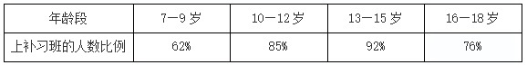

# 2015年上半年全国事业单位联考B类《综合应用能力》题（内蒙古/甘肃/宁夏/浙江）

> 分类：事业单位-综合应用/联考 · 来源：fenbi（gwy.gkzhenti.cn）
> 考次：2015-H1 · 类别：B 类 · 卷面ID：1646192691253
> 原文：https://gwy.gkzhenti.cn/paper/1646192691253

---

## 一、给定材料
**材料1**
人类社会每次经历的大飞跃，最关键的并不是物质催化，甚至不是技术催化，而是思维工具的更迭，以下是关于“互联网思维”的四种观点：
观点一：互联网思维就是要对传统的工业思维进行颠覆，从大规模生产、大规模销售和大规模传播转向专注产品与服务的极致以及优秀的社会化媒体营销，依托互联网，消费者已经反客为主，真正意义上的消费主权异军突起，因此，互联网思维实质上是一种“用户至上”的思维。
观点二：互联网思维首先强调的不是收入，而是用户规模和流量。通过提供免费服务汇聚海量用户群，然后在此基础上，为少部分用户提供多样化、个性化的收费服务，构建一种新的商业模式。
观点三：互联网思维就是在互联网时代冲击下对人们思维模式或思维方式的一种变革，是一种非线性的思维模式。运用互联网思维的最大特征是必须运用平台思维，通过平台规则、平台运营机制的创新。聚合双边或多边市场规模，打造有关利益方共赢的商业生态圈。
观点四：互联网思维延伸出的便捷、参与、免费、体验、创新等表现形式，都只是重复描述了企业在推广策略或者营销管理上需要关注的重点，互联网思维的真正意义其实就一条——在移动互联时代，任何环节的信息交流均会被加速，互联网改变了信息传输的效能。
**材料2**
第一段：①时至今日，还有很多转基因方面的虚假报到。②这也从一个侧面说明转基因科普还需形成合力，科研机构、管理机构、大众媒体和社会人士都还有很多工作可做。③国内有“转基因玉米致老鼠减少”“母猪流产”等；国外有“转基因马铃薯试验大鼠中毒”“转基因玉米致癌”等。④虽然这些消息已被科学界和有关国家生物安全管理机构否定并证伪，但还是有不少人相信就是假的。
第二段：⑤日前，中央2015年“一号文件”提出要加强农业转基因生物的研究、安全管理、科学普及。⑥虽是近九年多来中央“一号文件”中第六次提到转基因技术，因此还是引起了社会的广泛关注。
第三段：⑦近年来，转基因一直是个社会热点话题，关于这一问题的争论，已经达成共识。⑧其中原因更是令人深思。⑨屡屡发生的食品安全事件，让人们的精神绷得紧紧的。⑩从湖南爆出的“黄金大米”事件，到中储粮的“转基因油入库”风波，再到湖北的“转基因作物违规种植”事件，近年来的这些转基因违规事件也加强了人们的担忧。⑪实际上，对于转基因技术缺乏共识，主要症结在安全性上，这就凸显了科技的重要性。⑫严谨专业的科学语言需要与个人的思维对接。⑬接地气的科普、就是用老百姓的语言、适应大众的接收方式，讲清楚、说明白。⑭加强科普的有效性，还需在舆论导向、思想认识层面形成公开的讨论氛围。
**材料3**
小张是A市的一名学生家长，他的孩子正在上小学。小张认为，应该让孩子有一个轻松、愉快的童年，不用让孩子上补习班。但通过与孩子班上的家长们交流，他发现不少家长都准备给孩子报补习班。于是他开始犹豫，该不该让自己的孩子也去上补习班呢？他决定自己做一个调查。
首先，小张查阅了各级教育部门制定的相关文件。他发现，近年来各级教育部门几乎年年都在暑期前下发文件，不允许各中小学校集体补课，要严格控制学生作业量，要组织好学生暑假的学习生活和社会实践活动，把时间还给学生。
接着，小张又来到了附近的学校、街道、社区。在学校周边的大街上，不时会有人塞给他一张补习班的招生广告，走进社区，告示栏上贴的也是各种补习班的广告，但大多数补习班的宣传栏中各科辅导教师只有姓氏，没有名字。
然后，小张专程赶到附近的一个培训班，随机询问一些报了补习班的学生。他发现，多数人在幼儿园和小学阶段，父母就给他们报了各种培训班；上初中后，这种现象更加普遍，父母对孩子的学习抓得更紧，几个主要科目都报了班。多数学生表示双休日及假期从来没有完整地休息过，感到很疲劳，希望能在假期好好休息调整一下。
同时，小张发现，许多都市类报纸上，有时一个版面都是假期辅导班招生的广告。一个地区一天就有几十家补习班在招生。其中，有些补习班打着重点中学“高级教师”“资深教师”的牌子，毫不避讳地用名师做广告。为吸引更多生源，还有些补习班在宣传中宣称授课老师为重点中学的在职老师。
**材料4**
2015年2月22日，日本某媒体发表题为《“中国资金”春节期间席卷日本列岛》的文章。其中提到，在春节期间，有45万中国游客在日本消费了60亿元人民币。日本各大商场的电饭煲、电吹风、刀具等生活用品被中国游客抢购一空，尤其是马桶盖，几乎处于断货状态。
**材料5**
2015年春节前夕，王先生跟随一个旅行团到日本旅游，他此行肩负着许多亲朋好友的代购任务。在大阪的电器商场，王先生惊奇地发现，一款S品牌的马桶盖外包装上赫然印着“Made in China”，产地是杭州下沙，为此他还拍下了照片。这让王先生很费解，“兜了一大圈，买到的居然还是自家门前生产的东西，那不是等于当了回搬运工？”
根据网友提供的线索，王先生通过媒体找到了位于杭州下沙的生产企业。公司某管理人员一眼就认出照片中的马桶盖，并表示一些在日本售卖的热销智能马桶盖，都是中国制造并出口的，这些产品不仅销往日本，还销往新加坡、香港等地。现在，全球所有的S品牌智能马桶盖都是下沙制造的，但事实是，很多人都知道S品牌的智能马桶盖，却很少有人知道下沙是它的产地。
## 二、回答问题
**【试题一】**
**概念分析题：**
**分析材料（材料**1**）中的观点、提法、表述等，按要求回答问题。（18分）**
**问题：**
**根据以上四种观点（材料**1**中的四种观点），分别归纳每种观点所反映的“互联网思维”的基本特征，并对每个特征进行简要说明。**
要求：简洁、准确、清晰，不超过150字。
**【试题二】**
**注意：该题目暂时不支持批改**
**校阅改错题：**
**下列文字（材料**2**）在行文逻辑、文字运用等方面存在一些错误或不当之处，如段落或语句顺序不当、语法错误、用词不当、错别字等，请指出其中的8处并予以改正。（32分）**
要求：指出及改正时，请使用段落序号和句子序号，不用抄写全句。
**【试题三】**
**材料分析题：**
**分析材料（材料3）内容，按要求回答问题。**
**为确保调查内容的完整性和真实性，以便做出孩子是否上补习班的决定，除了上述调查内容外，小张还需要重点调查哪些内容？（本题20分）**
**【试题四】**
**材料分析题：**
**分析材料（材料3）内容，按要求回答问题。**
**下表是小张从网上找到一张关于“不同年龄段孩子上补习班的人数比例”的调查统计表。要判断该统计结果的有效性和可信性，还需要进一步掌握关于这一调查的哪些信息？（本题20分）**
**不同年龄段孩子上补习班的人数比例表**

>
**【试题五】**
**写作题：**
**仔细阅读下列材料（材料**4**、材料**5**），按要求作答。（60分）**
**参考上述材料，联系实际，以“品牌就是竞争力”为题目，写一篇议论文。**
要求：
1.观点明确、分析具体、条理清楚、语言流畅；
2.字数800—1000字。
