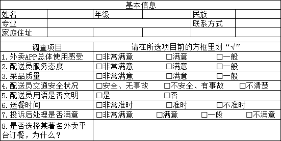

# 2019年上半年全国事业单位联考B类《综合应用能力》题

> 分类：事业单位-综合应用/联考 · 来源：fenbi（gwy.gkzhenti.cn）
> 考次：2019-H1 · 类别：B 类 · 卷面ID：1646192709133
> 原文：https://gwy.gkzhenti.cn/paper/1646192709133

---

## 一、给定材料
**材料1**
数字经济是继农业经济、工业经济之后的更高级经济形态，其内涵丰富。
如同农业经济时代以劳动力和土地、工业经济时代以资本和技术为新的生产要素一样，数字经济时代，数字化的知识和信息成为新的关键生产要素。数字经济与经济社会的交汇融合，特别是互联网和物联网的发展，引发数据爆发式增长，数据成为社会基础性战略资源。
数字技术创新活跃，成为数字经济发展的核心驱动力。大数据、物联网、移动互联网、云计算等数字技术的突破和融合发展，推动数字经济快速发展。人工智能、虚拟现实、区块链等前沿技术正加速进步，产业应用生态持续完善，不断强化未来发展动力。
信息产业是数字经济时代驱动发展的基础性先导性产业，现代信息网络为数字经济的重要载体。信息产业早期快速扩张，现今发展渐趋稳定，对国民经济发展具有重要战略意义。
数字经济在其他产业领域的应用带来的效率提升和产出增加，已成为推动经济发展的主引擎。一方面，数字经济与传统产业融合渗透，提升了经济发展空间；另一方面，传统经济利用数字经济带来产出增长，加快了产业数字化、网络化、智能化转型步伐。
数字经济是一个复杂生态系统，海量主体参与市场竞争，线上线下融合成为发展常态，跨行业跨地域竞争日趋激烈，导致新问题层出不穷，必然使社会治理模式发生深刻变革，由过去政府单纯监管的治理模式加速向平台、企业、用户和消费者等多元主体协同共治方式转变，发挥各方在治理方面的比较优势。
**材料2**
①2017年8月4日，中国科学技术馆与百度公司通过移动大巴方式将人工智能各项应用成果向社会展示。②与此同时，我国也将通过多种形式加快人工智能科普和应用，加速布置产业链，智能生活正向人们走来。
③作为新一代信息科技的代表，人工智能广泛受到国际社会的普遍关注。④近几年，发达国家企图抢占技术高点和发展先机，我国也不例外。⑤国务院在《新一代人工智能发展规划》中提出，到2025年人工智能成为我国产业升级和经济转型的主要动力，智能社会建设取得积极进展；到2020年人工智能总体技术和应用与世界先进水平同步，人工智能产业成为新的重要经济增长点。
⑥多年积累和攻坚，我国人工智能技术快速发展，在算法、大数据等方面具备领先优势，一些技术甚至带来合乎想象的效果。⑦比如，目前机器语音识别能力已经超过或接近人类。⑧然而，人工智能不只是炫耀，但是要发挥“四两拨千斤”作用，让社会生活变得更加便捷高效。
⑨此次和中国科学技术馆达成战略框架合作协议，第一步就是通过移动大巴的形式展示包括语音识别、智能家居等人工智能应用，后续还将把最新技术应用到科普项目中。⑩此外，百度将把6年来在人工智能领域的创新成果对外开发，建立共享合作生态体系，加速技术成果应用落地。⑪工信部表示，将积极协调资源，推动人工智能技术转化为各类产品和各种应用，并将人工智能产业发展与一系列重大应用工程相结合，加快促进人工智能与各产业领域深度熔合，形成数据驱动、人机协同、跨界协作、共创分享的智能经济形态。⑫随着大数据、云计算和高性能计算等信息技术的快速发展，人工智能为促进经济发展、改变人们生活提供了强有力的技术支柱。
**材料3**
A市S高校学生会近期拟对该市在校大学生网络购物（以下简称网购）现状进行调查，有关同学搜集、整理了相关材料：
**材料一**：
以下是某电视台记者在L大学校园里现场随机采访的部分文字摘录：
记者：同学你好，请问你经常网购吗？可以谈一下你的网购体验吗？
大学生小陈：我比较喜欢网购，有些实体店的商品不仅种类有限，而且一家商场品牌数量也有限，选择余地小，而在网上，有来自全国成千上万的商品，我们能在几分钟内逛完同一品牌的几十家店铺，选择性更大，可比性更强。
记者：你网上购物每月大概要花多少钱？
大学生小陈：平均下来要500元左右，现在我每月大部分花销都是网上购物，在实体店花销已经越来越少了，像服饰、化妆品以及零食我都会从网上购买，一个星期总要下单一两次。我们同学的情况也基本和我差不多。
记者：请你说说你最满意的网购商品。
大学生小陈：我脚上这双鞋子是年初买的，通过校园B时尚返利网去淘宝购买，原价120元，我只花了78元就买到了，而且还可以使用商家的无息信用贷款。
记者：鞋子的质量如何？
大学生小陈：你看，我都穿了大半年了，还跟新的一样，最主要的是品质和专卖店一模一样，价格却便宜了40多元呢。我现在买鞋都不去实体店了，基本都在网上买。
记者：网购商品因价廉物美受到大学生青睐。除此之外，一些同学因为所购物品在实体店难以购买，或者因网上物品时尚有趣而选择网购，可见时尚和多样化的网上商品一定程度上满足了大学生多样化的个性需求。
**材料二：**
《中国互联网络发展状况统计报告》（2017）数据显示，我国网上外卖用户规模达到3.43亿，较2016年底增加1.35亿，手机网上外卖用户规模达到3.22亿。然而食品安全、送餐交通安全、订餐服务等问题比较突出。
为了更好地了解有关情况，S高校学生会设计了一个《大学生网络外卖订餐服务满意度调查表》。以下为该调查表的初稿。
**大学生网络外卖订餐服务满意度调查表（初稿）**

>
**材料4**
水温升到99℃还不是开水，其价值有限，若再添一把火，在99℃的基础上再升高1℃，水就会沸腾，并产生大量水蒸气来开动机器，从而获得巨大的效益，人们把关键因素引起本质变化的现象，称为“沸腾效应”。
“沸腾效应”说明一个道理，成功也许就是努力坚持到最后一刻的韧劲，而失败也许是自身的惰性使然。在一些人的人生经历中，关键时刻心态不过硬，遇到压力顶不住……也许就是这“1℃”之差，往往会功亏一篑，前功尽弃，导致失败。
古人云：“万事俱备，只欠东风。”这里的“东风”就如同那“1℃”，如果东风始终不露面，则再完美的计划和准备也可能成为遗憾，其结果就不是只差一点点了。
## 二、回答问题
**【试题一】**
**概念分析题：分析材料**1**中的观点、表述等，按要求回答问题。**
**概括****“数字经济”的定义。（12分）**
要求：准确、简明，不超过150字。
**【试题二】**
**概念分析题：分析材料**1**中的观点、表述等，按要求回答问题。**
**简要归纳发展数字经济的现实意义。（12分）**
要求：准确、简明，不超过150字。
**【试题三】**
**校阅改错题：材料**2**在行文逻辑、文字运用等方面存在一些错误或不当之处，如语句顺序不当、语法错误、用词不当、错别字等，指出其中的****8处并予以改正。（32分）**** **
要求：指出及改正时，请使用句子序号，不用抄写全句。
**【试题四】**
**材料分析题：分析材料**3**内容，按要求回答问题。**
**假如你是****A市S高校学生会负责此项调查工作的人员，请按要求回答下列****问题：**
**要了解****A市在校大学生网络购物的消费习惯与消费结构，应获取哪些主要信息？（22分）**
要求：
（1）根据材料一作答；
（2）准确、简洁，总字数不超过200字。
**【试题五】**
**材料分析题：分析材料**3**内容，按要求回答问题。**
**假如你是****A市S高校学生会负责此项调查工作的人员，请按要求回答下列****问题：**
**《大学生网络外卖订餐服务满意度调查表》（初稿）的设计存在一些问题，请指出其中****4个方面的主要问题，并简要说明理由。（22分）**
要求：
（1）分条作答，先指出问题，再简要说明理由；
（2）总字数不超过300字。
**【试题六】**
**阅读材料**4**，按要求作答。（50分）**
**请准确理解给定材料的深刻内涵，联系实际，以“1℃之差”为题，写一篇议论文。**
要求：
（1）观点明确，论述深刻，结构严谨，语言流畅；
（2）总字数800-1000字。
