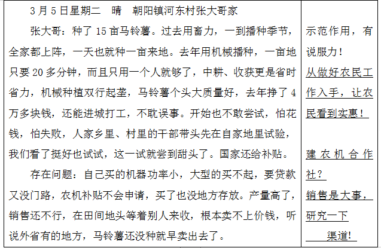
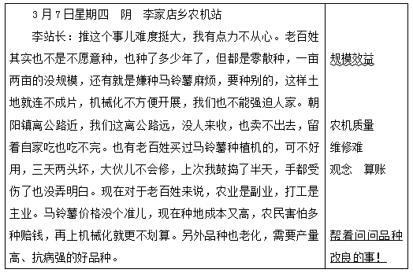
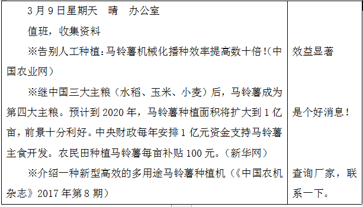
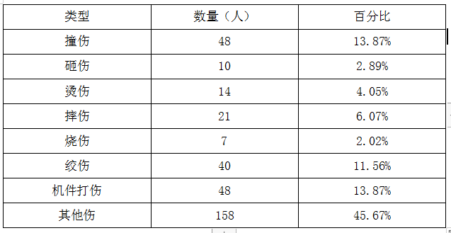
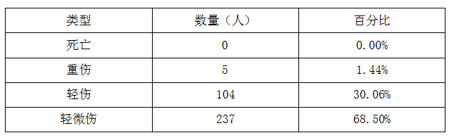

# 2019年下半年全国事业单位联考A类《综合应用能力》题

> 分类：事业单位-综合应用/联考 · 来源：fenbi（gwy.gkzhenti.cn）
> 考次：2019-H2 · 类别：A 类 · 卷面ID：1646192713778
> 原文：https://gwy.gkzhenti.cn/paper/1646192713778

---

## 一、给定材料
**材料1**
L县位于A省西北部平原地区，全县总面积2268平方公里，人口62万，下辖朝阳、明水等8个镇和李家店、东风等11个乡，总耕地面积150万亩，是传统农业大县。L县所在区域的土壤和气候条件非常适合马铃薯的生长，是远近闻名的“马铃薯之乡”。在《L县农业发展“十三五”规划》中，L县专门制定了马铃薯产业的发展战略，提出到2020年，要把L县建成马铃薯良种繁育、种植、加工示范区。
近年来，为落实中央关于加快农业机械化发展的要求，L县大力发展农业机械，目前全县有拖拉机1800余台，低速四轮农用车3500余辆，马铃薯播种机100余台，挖坑机、种耕机、薯类收获机等其他农业机械160台。尽管农业机械的数量有了一定的增长，但农机归属分散，大中型农机数量较少，简易、老旧农机比例大，推广农机新技术新产品的工作还比较薄弱，马铃薯专用机具相对不足，与农业大县的地位不相称，也与建设“马铃薯示范区”的任务不相适应。
L县农机管理中心是隶属于县农业农村局的直属事业单位，是在合并原县农机推广站和县农机监理所的基础上于2012年成立的。中心下设办公室、计财股、监理所、推广站、农机校等部门，编制17人。
农机管理中心的主要工作职责是：
1.负责宣传、贯彻执行国家有关农业机械化的法律法规。
2.负责全县新型农业机械的选型、引进、试验、示范、推广和农业机械项目的组织实施。
3.负责全县农业机械的检验、入户、挂牌，农机手培训、考核、发证和年度审验等。
4.负责全县农业机械安全操作的监督检查，纠正农机手的违章作业，确保农机生产安全。
5.负责全县乡、村道路农业机械事故的现场勘查、责任划分与认定，妥善处理事故。
6.负责全县农机配件产品经营的质量监督、申办执照。
7.负责全县农业机械作业任务的分配，对完成任务情况进行收集、分析、上报。
8.负责全县农机购置补贴的申报。
9.负责指导全县各乡镇农机站的业务工作。
**材料2**
小王是L县农机管理中心的一名工作人员，从农业大学农业机械化专业毕业后考入中心工作，由于专业对口、工作努力，很快就成为业务骨干，近期被聘任为中心主任助理。
2019年2月，中心接到了市农业农村局《关于做好2019年推广马铃薯机械化种植技术的通知》(以下简称《通知》)。《通知》指出，马铃薯作为主要粮食，产业前景广阔。推广马铃薯机械化种植，实现马铃薯从耕播、施肥、铺膜、中耕、病虫防治、收获的全程机械化，省工省力、节种节水节肥，效率高、投入低。同样条件下，机械化种植比使用畜力木犁播种，每亩增产300～500公斤，节省人工投入60%，减少经济投入50元，亩纯增效益200元以上，而且机械化种植的马铃薯质量好、破损率低，综合效益更为显著。《通知》要求，今年全市的马铃薯机械化种植面积要达到60%以上，并对各县区下达了具体指标任务，要求推广机械化种植马铃薯作为带动农民增收、推动农业进步的有效途径来抓，同时将选择部分乡镇作为马铃薯机械化种植示范区，享受财政专项经济补贴、专用农机补贴、全程技术指导和其他农技支持等一系列优惠政策，对推进不力的县区将给予通报批评，取消评优资格，酌减农机工作经费。
接到《通知》后，小王有些着急，因为在前一段的摸底中，他发现对于推广机械化种植马铃薯这项工作，只有朝阳镇等少数几个乡镇积极性较高，而李家店乡等其他乡镇没有行动，要完成市里的要求难度不小。为进一步摸清情况，小王决定展开调研，并到一些乡镇去走访，以下是他在调研和走访过程中的部分工作笔记摘录：

>

>

>
**材料3**
2018年，L县农机主管部门掌握的各类农机安全事故共65起，死亡0人，受伤346人，造成直接经济损失53.95万元，从农机事故类型看，大中型拖拉机3起，马铃薯收获机14起，马铃薯播种机2起，联合收割机1起，其他农业机械45起。
以下是根据2018年L县各医疗机构涉农机接诊记录整理的数据：
表一：2018年L县各医疗机构涉农机接诊基本情况汇总表

>
表二：2018年L县各医疗机构涉农机伤情汇总表

>
据朝阳镇马站长介绍，农机安全事故的发生多为自伤。发生地点遍布广大农村区域，事故统报渠道不畅，发生事故后常常隐而不报。在抢收抢种期，农机安全事故发生概率较高。每年“三夏三秋”农忙期间，特别是晚上抢时作业，高强度工作容易使农机手注意力不集中，精力容易分散，另外在这个阶段，农机手们普遍图快、怕麻烦，极易出现违规违章操作。监理人员要阻止其作业，纠正违规违章行为也十分困难，只能进行安全教育，提醒他们安全作业。大部分农机作业环境十分恶劣，地头不是沟就是坎，或者是水渠，对驾驶员操作技术要求较高，但大部分农户把农业机械当作一般生产工具，认为会用就好了，不注册登记、不年检、不考证、不挂牌，不重视农机使用安全方面的学习。由于没有经过正规培训、考证、安全教育，不太懂农业机械常识，加上由于国家没有出台农业机械强制报废的具体规定，部分农业机械已经达到或超过报废水平仍在继续带病使用，存在极大安全隐患。
某基层农机安全监督人员认为，目前农机安全方面纳入检验并办理牌证的只有上道路运输的拖拉机、联合收割机，其他机械没有强制检验规定。另外现有农机安全技术检验装备落后，参检农机的某些隐患未必能检测出来。
某法律界人士认为，法律没有授予农机监理机构乡村及乡村道路上的田检路查权、违章处罚权等，对拖拉机、联合收割机以外的农机具安全管理也没有具体规定，大量分散在农户家中的农机具无监管措施，更是处于失控状态。
**材料4**
L县在各乡镇设有农机管理服务站，近年来，服务站人才断档，队伍老化现象严重。鉴于此，一些乡镇农机站陆续招募了一批年轻大学生做农机管理员，对稳定和发展农村农机管理与服务起到了重要作用。但是，乡镇农机管理员是最基层的农机工作者，工作环境差，工资待遇低。乡镇农机管理与服务还涉及应急、公安等多个部门，对工作协调能力的要求较高，新来的大学生农机管理员面对工作和生活中的困难时有畏难情绪。
为进一步了解乡镇大学生农机管理员的工作现状，小王请来几个乡镇的农机管理员进行了一次座谈。
小李：我在东风乡工作快两年了，一直努力钻研农机业务，发挥自身专业优势，示范引导、提供服务，逐步在全乡推广了机械化点播、机械深耕、秸秆粉碎还田和保护性耕作等农机化新技术。站里领导对我挺重视的，我干活也挺有劲头，可有件事儿我一直有意见。我未婚妻在另一个乡，业务水平也不错，我俩离得比较远，这平常工作满负荷、连轴转，十天半月也见不了一面。我们乡农机站正缺人，早想把她调过来，可是乡里一直说没有编制，要我先克服一下。我都克服两年了，还要再克服多久啊?
小陆：我们都是大学刚毕业，对农村情况不是太了解，就连我讲话，农民都常说听不懂，可农机工作就是会有很多专业术语嘛！我也挺苦恼的。这两年农机数量增加，维修能力不足，很多农机出了毛病没地方修，农民经常“带病操作”，可我怎么说他们就是不听。我们站里有些老同志就特别会和农民打成一片，要是有人带带我们就好了。
小陈：我在大学是学农业机械的，要说也是专业对口，可学校里教的毕竟偏重理论知识，到了工作中，感到还是缺少实践的东西。特别是现在，农业机械新技术、新设备更新得快，好多机具我们也是头一次接触，使用性能啥的也不太清楚，有时碰到农民咨询技术问题，我们都怵得慌，听说有的地方专门给农机站拨付2万元专项经费，用于农机管理员技能培训，我们乡就没听说有这笔预算。
小丁：我们乡一共就四个农机管理员，一个长期休病假呆在省城，一个整天忙于复习考研，另一个人又借调在乡政府办公室，日常工作只有我一个人，既要处理站里工作事务，又要忙于农机推广与应用，有时还要被乡里抽去完成临时工作，就是有三头六臂我也忙不过来啊！
小田：农机站的工作经常要往村里跑，联系协调的任务很多，可是这些工作很难量化，效果也不是立竿见影，一年到头也看不见什么具体成果。唉，当初真的不知道农机站这个岗位这么辛苦，早知道就不受这份罪了。
小张：农机站的工作可真累啊，每天起早贪黑，跑前跑后，工资待遇还这么低，付出与所得不成比例，现在也就靠为农民服务这点情怀撑着了。
小刘：说老实话我也有点想打退堂鼓了，待遇低是一方面，整天和文化程度不高的人打交道，不仅能力提高不了，层次都要被拉低了，还怎么谈进步与发展？上次一个农民问我怎么领取农机补贴的事，我不了解，就上网查，解答得慢了点，他张嘴就骂人。亲戚要给我介绍个女朋友，人家一听说我在乡镇农机站工作，连面都不见！
**材料5**
**关于开展****2018年度农机购置补贴专项监督检查工作的通知**
各县（区）农机主管部门：
为进一步加强农机购置补贴监督管理，促进补贴政策规范实施，根据省财政厅、农业农村厅《关于印发的通知》的文件精神，经研究，决定于2019年4月中下旬在全市开展2018年度农机购置补贴专项监督检查工作，有关事项通知如下：
**一、重点检查内容**
（一）2018年度农机购置补贴工作开展情况包括：组织机构和制度建设情况，补贴对象审核情况，补贴资金发放情况，档案管理情况等。
（二）监督管理工作情况包括：补贴机具核实和补贴产品经营行为监管情况，重点机具和补贴对象审核抽查情况，监理和补贴信息相互校核情况，大中型农机具牌证管理情况以及农机合作社农机安全生产监管等情况。
（三）信息公开、投诉处理等情况。
**二、检查方式**
采取自查与抽查相结合的方式。各县（区）在自查基础上，由市农业农村局抽调人员成立检查组，抽查2个乡（镇）和1个补贴机具经销商。
**三、工作要求**
（一）各县（区）对照省市有关要求和本次检查内容，深入开展自查自纠工作，并提交书面自查报告。如有需要上级部门解决涉及农机补贴政策方面的问题，可提出建议一并上报。
（二）市级检查具体时间另行通知。请各县（区）提前备好购机清册、补贴申请与检查台账、补贴资金发放凭证等相关材料，为检查提供便利条件。
联系人：xx，电话：xx，Email：xx。
市农业农村局
2019年1月30日
接到通知后，县农机管理中心抽调了包括小王在内的四名骨干，由小王牵头，到各乡镇检查。他们首先到了明水镇农机站了解情况。
侯站长正给围着他的村民做解释：“老四啊，不是到我这领补贴，你得拿着买机器的发票复印件，到县农机中心去，人家看合格了，才能给你办。”“赵大叔，你得买马铃薯机具才能拿叠加补贴，叠加补贴不是国家给的，是县里给的。”“王婶儿，你家机器买的早，叠加补贴是我们县建设马铃薯示范区之后才出来的政策，再说也不是像你说的2000啊，就500和1000元两个档，还得看你买的机型在不在补贴目录里。”
大伙儿散去之后，侯站长看着小王苦笑道：“好多村民连叠加补贴和购置补贴都没搞清楚，更不知道收获作业补贴是怎么回事，这不今年宋来福家买了农机，但作业面积没达到要求，就没拿到作业补贴。为了这事，他找了我好几次，可我也没办法啊。我把各项农机政策都下发给各村了，也不知道村里是怎么跟老百姓传达的。站里人手少，一个人干好几样活儿，忙不过来还得抽调乡里年轻人临时帮忙，有的根本不熟悉业务，走马灯一样，台账、凭证啥的也都没整理好，办公室都快堆满了。前阵子还把村民交来的材料弄丢了，耽误了领补贴，大家意见挺大。”
在机械化推广工作比较扎实的朝阳镇，马站长反映了一些情况，引起了小王的重视。据马站长反映，这两年农机补贴政策调整了，补贴手续特别麻烦，农民感觉不方便。要拿到补贴，大伙儿还要排队，而且一排就是一两年，有的甚至还要摇号才能领到补贴。马站长说，“农民文化水平不高，手续能简单还是尽量简单点。还有就是，农机维修难啊！镇里的农机越来越多，坏了没人会修。你们县里的技术人员也不常下来，我们站里也没这能力，经销商卖完就不管了，出了问题都不知道找谁。”
小王觉得有必要就农机补贴问题向马站长做些解释：“以前农民是差价购机，补贴是补给经销商的，农民看不到实惠。现在呢，直补到农民个人，也就是农民先付全款购买农机，经审核后，政府再将补贴资金直接打到农民的银行卡上，农民享受到的实惠也看得见、摸得着了。不过流程确实比以前复杂了，除了之前的程序外，还需要农民提供相应的材料给我们核实，再由我们把这些材料汇总给财政部门，最后财政部门把钱打给农民，因为涉及的审批项目多，审核时间比较长，农民要拿到补贴款就很慢，但政策就是这么规定的，我们必须执行，不过国家也在考虑采取一些新举措，相信农民申请补贴会越来越方便的。”
在检查东风乡的一家农机经销商时，小王一行人碰到了农民李冬喜。李冬喜反映，他去年8月份在这购买了一台马铃薯收获机，使用过程中先后出现车架、割台断裂的故障，在“三包”期内找他们几次维修，也没修好，一直无法正常使用。李冬喜说自己去过乡农机站多次投诉，要求经销商退机，农机站总说自己没办法，退机还得找经销商，再不行就到法院起诉去。今天他又跑来找经销商，对方还是不给退。小王当即向李冬喜表示会协调处理，一定给他满意的答复。随即检查组对该经销商是否具有工商营业执照，是否在醒目位置张贴农机购置补贴经销商标识，有无公开补贴产品的配置参数、补贴金额等信息，质量保证书、销售合同是否健全等情况进行了检查。特别检查了其是否存在减少配置，变相涨价，以小充大骗补，以没有补贴的产品冒充有补贴的产品销售等违法违规行为。检查组当场发现了一些问题，要求经销商立即整改。
在李家店乡，小王等人正好遇上村民赵大姐又跑来找李站长。赵大姐一听小王是县里派来了解农机补贴实施情况的，立即拉住了小王：“你给评评理，是你们说买农机有补贴，我才买的，结果好几年不给我钱，哪有你们这么骗人的！”
小王知道这位赵大姐的事情，她2017年购买了一台农机，而当年县里的补贴指标用完了，让她第二年再领。可等第二年去办理补贴时，她当初购买的农机型号已经不在新的补贴目录中了，也就领不到补贴了。这两年她不断找乡里和县里，但是由于补贴标准和补贴范围都是国家规定的，政策调整导致她拿不到补贴，乡里和县里也没有办法，这事已经向上级部门反映了，还没得到答复。
小王耐心地向赵大姐解释：“每年的资金指标是市里根据各个县的综合情况下达的，预测的时候不一定特别准确，有的地方买农机的人多，资金就不够用；有的地方少，资金还用不完。你买机器时正赶上当年咱们县资金不够用，可第二年农机补贴目录调整了，没人骗你，这个事我们也一直在向上反映。”
对照上级通知要求的重点检查内容，全县19个乡镇的农机购置补贴工作整体上还是不错的，但通过自查自纠，也发现了两起村民勾结经销商虚开发票，钻政策空子，骗取国家农机补贴的案件，影响极为恶劣，已报送有关部门依法处理。
## 二、回答问题
**【试题一】**
**假设你是县农机管理中心主任助理小王，请根据背景材料完成下列任务。**
**如果领导派你去李家店乡做推广机械化种植马铃薯的工作，你准备与该乡农机站李站长进行一次深入沟通，请结合材料**1**、**2**，列出谈话要点。（35分）**
要求：目的明确，思路清晰、考虑周到，有针对性和说服力。字数在350字以内。
**【试题二】**
**根据材料**3**，概括L县农机安全事故的特点，并分析造成事故的原因。（35分）**
要求：概括简练准确，分析全面。字数在300字以内。
**【试题三】**
**根据材料**4**，你认为中心可以采取哪些措施，以进一步提升大学生农机管理员的素质。（30分）**
要求：措施具体可行，针对性强。字数在250字以内。
**【试题四】**
**根据材料**5**中市农业农村局通知的要求，中心拟提交自查报告。该报告由“一、自查的基本情况”“二、执行政策过程中存在的主要问题”“三、整改措施”“四、进一步完善农机购置补贴政策的建议”四部分组成。请你拟写其中二、四两部分内容。（50分）**
要求：问题概括全面准确，建议针对性强；切合主题，论述充分；字数在700字以内。
