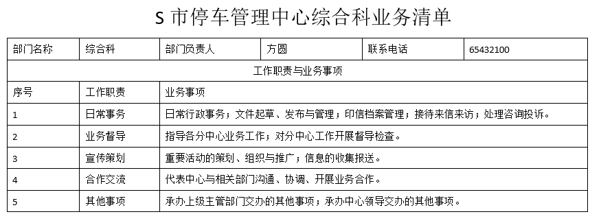

# 2022年5月全国事业单位联考A类《综合应用能力》

> 分类：事业单位-综合应用/联考 · 来源：fenbi（gwy.gkzhenti.cn）
> 考次：2022-05-21 · 类别：A 类 · 卷面ID：1671013811756
> 原文：https://gwy.gkzhenti.cn/paper/1671013811756

---

## 一、给定材料
**材料1**
(334279)
S市停车管理中心（以下简称“中心”）是S市城管局直属事业单位，主要承担全市停车资源的统计调查与规划，智慧停车管理平台的建设运行维护，停车设施建设和使用的指导协调、考核监督等工作。中心在市内各城区设立了分中心。
中心实行主任负责制，根据工作职责下设综合科、计财科、规划科、运营科等。按照市委、市政府推进“放管服”改革的要求，该中心向社会公布了各科室工作职责的业务清单，其中综合科的业务清单如下：

>
小赵是综合科副科长，协助方科长开展工作。
**材料2**
(334280)
拟统计，目前S市全市机动车保有量达268万辆，主城区机动车保有量达14.7万辆。全市停车泊位总量约152.5万个，主城区停车泊位总量约103.2万个，主城区停车泊位缺口约41.5万个，且泊位缺口还在不断扩大。
S市高度重视停车问题，早在2008年就印发了《关于破解机动车“停车难”问题的实施意见》（以下简称《意见》），提出了“城市停车是一种公共服务”的理念，并成立了停车办公室。作为管理机动车停车问题的专门机构。针对停车设施规划建设，《意见》提出了“配建停车为主、公共停车为辅、路内停车为补充”的工作思路。2016年，为适应机构改革的要求，市里成立了S市停车管理中心，并针对新情况陆续出台了《S市停车场建设管理办法（试行）》《S市机动车停放服务收费管理办法》等一系列文件。
作为市停车管理中心的工作人员，小赵养成了随时关注停车问题的习惯。他每天上下班都要驾车经过学苑路，这是老城区的一条主干道，周边有幼儿园、小学等多家单位，每到早晚高峰期都被接送孩子的车堵得水泄不通，但附近的停车场使用率却不高。原来，S市各停车场普遍实行15分钟内免费政策，超出15分钟，则按6至8元每小时的标准收费。一些学生家长认为，在学苑路这样的地方，15分钟接送孩子是远远不够的，如果每天都要花钱停车，负担实在太重。了解到这一情况，中心会同学苑路街道办事处、交管局等单位召开了现场办公会，研究解决该路段的停车问题。大家一致认为，停车管理必须强调公共服务属性，收费只是利用价格杠杆调节停车资源的手段之一，应该根据实际情况确定标准。中心经过充分论证，经有关部门批准，决定对全市学校周边的收费停车场实行特殊时段1小时内免费政策，引导大家把车停入停车场内，有效缓解了学校周边道路的拥堵情况。中心还定期开展路内泊位“回头看”整改工作，及时评估路内泊位施划合理性，对影响非机动车、行人、公交等车辆通行的泊位进行动态调整
前几天，小赵对近期市长热线转来的涉及停车问题的投诉进行了整理，发现其中超过60%的内容都是对路内泊位收费问题的投诉。有的反映停车收费标价牌不明显，收费优惠免费政策执行不到位；有的反映不清楚服务监督、价格举报电话；还有的反映收费员工作态度差。此外，群众对老旧小区停车难问题意见也较大。小赵第一时间把情况汇报给领导，领导要求由小赵牵头，尽快调查摸排情况，提出方案，妥善处理。
一周后，全市主要路内停车泊位的显著位置陆续出现了规范的停车服务收费标价牌，上面清晰地公示了泊位名称地点、泊位总数、收费（免费）时段收费标准、优惠政策、监督举报电话等内容，同时，在收费员制服的背部统一印上了咨询投诉电话，若市民有停车咨询投诉类需求，可以直接拨打电话，中心将在第一时间给予解决。
针对东风社区居民反映老旧小区停车位少、满足不了停车需求的情况，中心第一时间联合相关部门实地勘察、梳理摸排，在不影响道路安全及车辆通行的情况下，在社区周边施划了路边停车泊位200余个。中心还在全市选取了14个小区作为“融合管理示范小区”。在小区内部，联合街道、社区、物业，清除杂物、地锁，移除“僵尸车”，施划停车泊位线及停车标识。在小区外部，整合周边道路停车泊位资源，协调周边单位停车场提供给小区居民使用。“以前，小区内车停得乱七八糟，回来晚了，车都进不来。现在好了，有了固定停车位，而且价格不高，完全能接受。”居民李女士拍手叫好。
**材料3**
(334281)
智慧停车是将智慧化手段综合应用于城市停车位的数据采集、管理、查询、预定等服务，实现停车位资源的利用率最大化。近期，S市召开了“智慧停车建设工作推进会”。会议指出，智慧停车项目是一项惠民工程，对于缓解城市停车难、促进城市高质量发展有重要意义。会议要求，要定期研判工作推进过程中遇到的困难和问题，确保把这项惠民工作办实办好。根据会议部署，S市停车管理中心负责对全市范围内智慧停车建设工作开展调研、并形成关于S市智慧停车建设情况的调研报告。
会后，中心立即成立专项调研组开展工作，以下是部分调研记录。
第一部分：相关部门反映情况
市城建集团：由我们集团承建的S市智慧停车管理平台于2020年11月28日在主城五区全面上线，接入道路临时泊位和部分停车场的实时数据，通过停车出行热力图大数据分析、停车场备案等功能模块，掌握停车数据的实时动态，全市停车管理“路内路外一张网”总体格局初步现，与此同时，基于智慧停车平台数据打造的“S停车”手机APP和公众号，可实现预约车位、搜索共享停车、反向寻车、停车诱导、充电共享、停车缴费及查账等服务功能。
“S停车”用户已突破73万，真正跑出了“加速度”。
某智慧停车有限责任公司：我们是市域建集团下属子公司，承担智慧停车管理台投资、建设和运营。S市智慧停车建设工作取得了很大的成绩，但问题和困难也很突出。智慧停车管理平台运行中的监测功能需要设备支持，现在有超声波、红外线、摄像头等，但精准度不高，容易出现识别错误，影响数据准确性。还有就是我们智慧平台的“共享停车”服务功能可以激活城市的闲置停车位，提升车位的周转率，现在大部分机关事业单位数据已经归入这个平台，但绝大多数小区停车数据纳入不进来，封闭管理的小区一旦允许社会车辆进入，可能会增加安全风险，很多业主参与共享的热情都不高。
某国企停车管理公司：我们以旗下44个停车场资源为载体，依托“S停车”APP，对外发布共享车位信息，推广“错时共享”停车，其同打造共享停车场，但还存在很多困难。比如，共享停车的费用收取、资金监管、车辆剐蹭等方面的责任划分，停车场配合义务等问题都没有明确的政策理定，配套的标准并不完善，这也是我们的顾虑所在。
某停车场运营企业：市里要求现有经营性停车场都要逐步接入智慧停车平台，接入这个平台对我们企业有什么好处我还不太明白，是不是技术门槛挺高，还需要改造现有车道吗？谁能来给我们讲讲？
第二部分：网民意见
网友@我爱提意见：我手机上已经安装了8款停车APP啦，但还是涵盖不了全市的停车场，据说咱们市停车场有超过30款停车APP在同时使用，这些APP里，有的能快捷支付，有的不能；有的天天推送无聊广告，还关闭不了，我和身边很多朋友都更愿意使用扫码支付。再说，APP里有的功能也实现不了，比如实时监测车位数，不同APP上显示的都不一样，还有那个预约车位服务，简直就是个摆设。
网友@陈先生：我一直在“S停车”上缴费，可前几天在人民路停车时，我都开车走了，系统仍在计时，客服说是由于停车位采用高位视频监测泊车信息，如果前后两辆车停车过近，会有可能产生离场时信息采集不上，导致出现客户端持续计费的情况。智慧系统这么“高大上”，不能把硬件设备搞搞好吗！
网友@哆啦A：我曾经让朋友在“S停车”上试着绑定我的车牌号，结果我们都能查到车辆行踪，细想起来有点后怕，这不等于随时都在跟踪我吗！我问APP客服，答复是车牌号在公众场所本来就是人人都能看到的，系统这样设定也是为了方便操作，如果有需要，可以申请单一绑定。我认为这不是方不方便的问题，这是在泄露隐私。
网友@社会对我很友好：我是一名残疾人，按照咱们市的规定，在路内停车位和公共停车场能享受2小时的免费停车。有些地方做得很好，但有些却不行。比如说有的停车APP上能够进行残疾车认证，将身份证、行驶证、残疾证和车牌号上传后，就能够直接绑定，享受优惠政策。有些停车场的APP却没有这项认证服务，有人工值守的还行，检查完我的证件就给我免了，要是找不到人，只能缴费。
第三部分：专家观点
交通大学范教授：现在各平台之间的竞争关系使数据共享遭遇瓶颈。不同的停车场使用不同的APP和公众号，功能都相差无几，但需要多次重新输入车牌号，非常麻烦。解决停车难问题不仅是政府的责任，也是企业的社会责任。邻省A市的智慧车联盟，打通了4个平台上的泊位数据资源，让市民只需要下载一个APP，就可以获得4个平台上的泊位信息。这样的做法值得学习和借鉴。
**材料4**
(334282)
针对市长热线反映的关于停车收费问题的市民投诉，2021年12月24日，S市停车管理中心专门邀请了各区分中心工作人员、收费员代表、停车管理公司代表等20余人，召开了关于收费员队伍建设的座谈会，会议由综合科组织。
方科长首先对与会代表表示欢迎和感谢，接着介绍了本市一年来停车管理工作的基本情况和明年的工作打算，肯定了各区在收费员管理工作中取得的成绩和收费员的工作贡献，希望大家就加强收费员队伍建设提出意见建议。之后代表们发表了各自的看法。
收费员张师傅：我今年快60岁了，干收费员5年多了。现在收费员的工作越来越难干，工资低，还受气。这两年开始用智慧停车管理系统，我这年纪，学点新东西太难了，一遇到车主缴费上的技术问题，我也是不懂啊。
收费员张师傅：要我说现在这个停车收费系统挺好的，以前收费都是人工的，而且离开时才交费，车主的随意性大，还有人恶意逃费，我们经常为了追要停车费拦车，甚至横穿马路到对面收费，特别危险。现在这种情况少多了，车主只要停车不付费，都有记录。但也有一些人不讲理，上次有个车主非说他只停了28分钟，应该享受半小时以内免费停车政策，可系统显示31分钟，要交8块钱，这都是自动的，也不是我给计的时，他非得跟我吵，甚至还要动手打人，感觉我们的人身安全和尊严都得不到保障。
城北区分中心廖主任：收费员流动性大，管理一直很有难度。你要是真的严格起来，他说不来就不来，反而让你很被动，上次有市民投诉某收费员态度恶劣，我们对他进行了处罚，结果第二天人家就“撂挑子”了，我们还临时找不到人代替。所以我觉得收费力队伍建设问题需要上级部门拿出办法来，
城中区分中心杜科长：我们中心每年有业务培训计划，可深入开展的几次。大家都觉得收费员工作简单，没啥可培训的，可你看现在智能设备这么多，还有消防、抗灾的要求，不培训哪行！我听说市里有许多社会组织可以提供公益性急救知识培训和一些专业基本技能培训，我还看到过别的城市组织消防员给路面收费员演示如何正确使用灭火毯等消防工具。
收费员马师傅：我当收费员半年了，待遇虽说不高吧，也总能补贴点家用。要说有啥不满意的地方，就是有时心情不太好。车主不讲理咱没办法，可为啥公司也不进情面呢？今年夏天，有次中午气温将近40度，我有点难受，刚把工作服脱了想凉快一下，就碰上查岗，批评我不按要求着装，我也挺委屈。公司管理规定里全是对我们的要求，为什么就不说保障和奖励呢？上次有个车主忘关车窗，皮包还在车里放着，我打电话联系不上人，就一直在旁边看了两个小时，人家为了感谢我，硬要给我钱，车主的钱我肯定不能要，可公司连个表扬都没有。
甲公司钱经理：我们对收费员是依法依规进行管理的。公司根据区里规定，制定了《停车场收费员管理制度》刚才大家反映的问题，咱们管理制度当中都有明确规定。比如说，停车收费人员在岗时，应统一穿工装，佩带上岗证、工号牌、臂章，并在规定时间内穿戴反光背心。还有，员工如果擅自离岗，一经发现将予以罚款或开除处理。这也是落实区里关于规范收费员管理工作的要求。
城东区分中心严科长：依法依规管理是个大前提，但是管理上还是可以人性化一点嘛。我一直在想，为什么收费员对自己工作认同度这么低？我觉得一个重要问题是我们忽视了对他们职业道德的培养和职业荣誉感的提升。
城西区分中心刘科长：前儿天新闻提到B市举办了一个“道路停车收费管理行业技能比武”活动。比赛内容不仅有对行业规范的掌握，还考验收费员的车牌录人速度，通过现场模拟方式考察对无理车主的应对能力等，我觉得这样的活动能激发收费员的工作热情和职业认同感。
城北区分中心廖主任：对于一些恶意逃费的车主，我觉得也不能一味要求收费员“受受委屈”，该曝光曝光，该处理处理。收费员每天面对着来来往往形形色色的车主，确实承受了很大的心理压力，现在有很多关于沟通和心理疏导的培训课程，咱们是不是也引进一些，办一些活动，做一些小游戏什么的，引导他们做好自我解压和情绪管理。
……
大家你一言我一语，讨论非常热烈。方科长表示，会将大家的意见建议及时向中心领导汇报。
**材料5**
(334283)
2021年5月，国务院办公厅转发了国家发改委等部门《关于推动城市停车设施发展的意见》。意见强调要坚持“谁投资，谁受益”原则，激发各类市场主体投资运营城市停车设施的动力。鼓励社会资本以市场化投资为主开发运营，或者通过合理确定收费标准、政府适当让渡项目收益权等方式，吸引社会资本参与。极拓展配套服务功能，在不减少车位的前提下，可允许停车设施配建一定比例的洗车点、便利店等便民设施，提升项目综合收益能力。此外，还提出创新金融支持方式、加大金融支持力度、完善停车设施用地政策，加强用地保障等意见。
省里转发了《关于推动城市停车设施发展的意见》后，s市召开专题讨论会。会上，有专家指出，我市新能源汽车数量不断增长，但充电设施建设远远落后于需求，特别是公共停车场充电设施的建设尤为薄弱。建议相关部门充分用好用活国家政策，加大招商引资工作力度，积极引入一批“理念先进、资金雄厚、技术可靠”的市场主体参与公共停车场充电基础设施建设运营，点面结合推进全市公共停车场充电设施建设，在这个具有广阔投资创业前景的“蓝海”上，创造“合作多赢”的局面。这一建议得到众多与会人员的支持。
会后，S市研究出台了《加快推动公共停车场新能源汽车充电基础设施建设三年行动计划》，明确未来新建公共停车场按不低于停车位总数30%的比例建设快速充电桩；现有公共停车场按照不低于停车位总数10%的比例建设以快充为主，慢充为辅的公用充电设施。要求国土规划、发展改革、市场监督等部门落实“放管服”改革要求，实行“一站式”“保姆式”服务，开通“绿色通道”，简化审批流程，在融资担保，财税优惠、特许经营、定价机制等方面给与支持。在现有每年投入300万元的基础上，未来5年继续安排5000万元专项基金，用于新建公共停车场充电设施的补助，引导高校、科研院所、企业开展产学研用的紧密合作，加强新能源汽车和充电设备专门人才培养，支持新型移动充电设施建设和技术开发。
为吸引更多的社会资本投资公共停车场充电设施建设，S市成立了由发改委、城管局等部门组成的招商工作组，对部分重点企业进行了走访。小赵作为其中一个工作组的负责人，带领工作组来到了K公司。K公司是S市的一家龙头企业，近年来也投资了S市一些其他的智能化新项目。K公司负责人高总对工作组的到来表示欢迎，直言有进入这一领域的意愿，但也提出了几点顾虑：一是如果自建停车场，获取土地难、审批程序繁杂、投资大、建设周期长；要是与其他停车场合作，盈利模式就比较单一，主要收取的就是充电电费和服务费，利润率较低，回报周期长。二是存在市场、政策等不确定因素，有些政策明确标明了有效期，不知道到期之后会在什么变化。三是从总体上看，商业模式和充电技术需要持续创新，公司在这方面的技术和人才储备不足，对于高总的疑虑，工作组将进行回应和解释。
## 二、回答问题
**【试题一】**
**假如你是S市停车管理中心综合科副科长小赵，请完成下列任务：**
**根据材料**2**，归纳S市停车管理工作的成功经验，供中心领导参阅。（30分）**
要求：归纳恰当，概括全面、准确，语言简洁。不超过250字
**【试题二】**
**根据材料**3**，列出调研报告中“进一步推进我市智慧停车建设工作的意见建议”这一部分的内容要点。（35分）**
要求：内容具体，针对性和操作性强。不超过300字。
**【试题三】**
**座谈会结束后，综合科要向中心领导汇报会议召开的基本情况及与会代表的发言内容。根据材料**4**，撰写一份会议简报。（45分）**
要求：内容全面，结构完整，语言流畅。不超过600字。
**【试题四】**
**假如你是S市停车管理中心综合科副科长小赵，请完成下列任务：你代表工作组与K公司高总进行沟通，以打消他的疑虑、增强企业投资公共停车场充电设施建设的信心。根据材料**5**，列出沟通的具体内容。（40分）**
要求：角色定位准确，沟通内容完整，有说服力。不超过450字。
