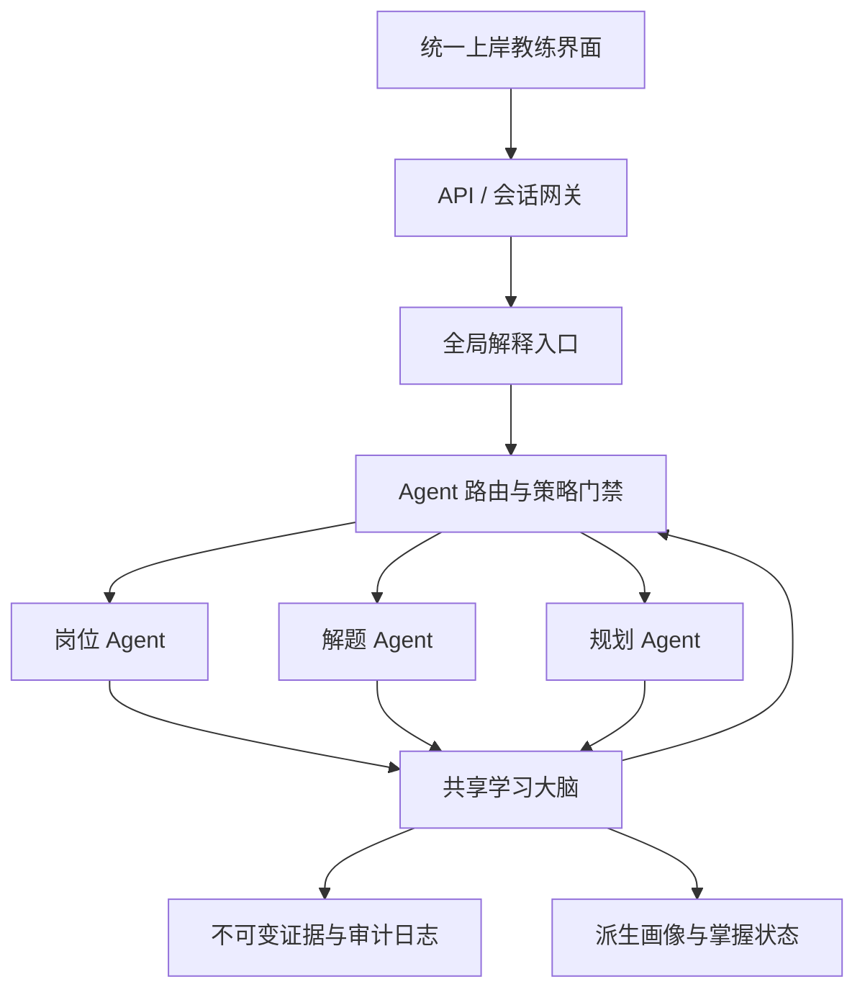

# 多 Agent 与共享学习大脑架构

> 历史目标架构：当前产品已确认用户只感知一位“岸岸”，后台能力不再作为多个用户人格。
> 当前边界见 [正式产品与系统说明](../product/anan-product-system-spec.md)。
>
> 状态：目标架构  
> 日期：2026-07-12  
> 适用端：微信小程序、未来 iOS/Android/Web  
> 核心约束：无人工主链依赖，所有高影响结论可追溯、可重算、可审计

历史关联：[原产品需求文档](../product/_archive/2026-07-12-ai-guokao-coach-prd.md) · [微信小程序实施与商业交付方案](../engineering/2026-07-12-wechat-mini-program-implementation.md) · [行测—申论双轨规划 Agent 契约](2026-07-13-dual-track-planning-agent.md)

## 1. 架构决策

产品内部由三个专业 Agent 构成，但三者不直接各自维护用户真相。统一的学习大脑是证据、结论和决策的唯一权威边界。



### 1.1 核心不变式

1. Agent 不能直接更改长期画像，只能提交带证据的候选结论。
2. 学习大脑使用类型化命令应用结论，并保存决策版本和前后状态。
3. 规划 Agent 是每日时间的最终裁决者；岗位 Agent 和解题 Agent 只提交目标、风险和候选行动。
4. 用户原始证据不被 AI 摘要覆盖；摘要是可重建的派生数据。
5. 模型输出不是数据库事实，必须通过 schema 校验、证据检查和领域规则才能入库。
6. 影响岗位可报性、总分、战略放弃和商业权益的结论不允许仅靠自由文本生成。
7. 全局提问只是交互入口，不是第四个事实 owner；路由后仍由岗位、解题或规划 Agent 在各自边界内回答。
8. 检索到的资料和用户上传内容都是不可信输入，不能通过文本指令改变权限、领域规则或系统提示。

### 1.2 行测—申论双轨不可降级原则

共享学习大脑是一个权威边界，但不把行测和申论压成同一种证据或一条学习链。两条轨道始终是同等的一等公民：

- 行测保留“作答→复盘归因→变式验证→间隔复测→掌握”的独立证据图。
- 申论保留“完整材料→找点/提纲→原稿→证据化评阅→结构化复盘→重写→新材料迁移”的独立证据图。
- 解题 Agent 分别在两条轨道内产生候选结论；规划 Agent 将两轨的收益、紧迫度、时间成本与证据完整性放入同一选择器，不把申论当成行测之后的剩余时间。
- 岗位 Agent 只消费同一国考年度、两科完整、经能力估计领域发布的正式区间；单题 AI 申论训练估分永远不直接改写岗位分差。
- 每类完成状态只能由所属领域在 canonical 证据同一事务中结算；通用规划接口不接受客户端自报完成。

当前申论已发布到成稿、结构化复盘、grounded review 和评阅确认；行测结构化复盘/掌握/验证 writer 尚未发布时，学习大脑必须返回显式 capability gap 和未知数量，不产生伪完成证据、不借用申论 reflection、不用 `0` 代替“不可用”。

### 1.3 全局解释入口

普通页面始终提供统一提问入口。客户端不指定 Agent，只提交用户问题和类型化上下文：

```ts
type GlobalAskContext = {
  routeId: string;
  workspace: "today" | "training" | "position" | "profile";
  objectRefs: Array<{
    type: "position" | "question" | "material" | "attempt" | "plan" | "report";
    id: string;
    version: string;
  }>;
  taskMode?: "practice" | "retest" | "mock" | "essay";
  taskStage?: "reading" | "answering" | "submitted" | "reviewing";
  learnerStateVersion: string;
};
```

服务端按“会话身份 → 页面权限 → 领域路由 → 证据检索 → 模型生成 → 结构校验”处理。客户端不上传 learner ID、题目正文或预期答案；服务端使用授权对象引用组装上下文。

统一回答契约包含：

- `answerId`, `respondingAgent`, `answerType` 和结构化正文。
- `sourceRefs`：资料类型、对象 ID、版本、引用锚点和可见标题。
- `confidence`, `limitations` 和 `knowledgeFreshness`。
- `allowedActions`：可执行的查看证据、加入复盘、调整计划或补充信息；高影响写操作仍需独立确认。
- `policyDecision`：正常回答、仅操作帮助、提交后可问、证据不足或领域禁止。

自有资料库的搜索范围包括已授权题库与解析、版本化正式方法卡、已达到效果门槛的社区方法卡、岗位原文与规则、国考官方材料，以及当前用户有权访问的作答和复盘。社区来源必须显示卡片版本、适用范围和验证样本，不与正式方法混合标记。默认不使用无来源公网内容；没有可支持证据时必须回答“资料库暂无可靠依据”，不由模型补齐事实。

## 2. Agent 边界

### 2.1 岗位 Agent

**负责**

- 国考报考资格完整性、条件匹配和待确认条件。
- 冲、稳、保岗位组合及主目标版本。
- 目标分区间、样本来源、类似岗位范围和置信度。
- 岗位条件或成绩变更时发布 `GoalGapChanged` 事件。

**不负责**

- 不自己生成每日训练计划。
- 不解释单题错因。
- 不在缺失硬条件时给出“确认可报”。
- 不使用无样本解释的单一上岸概率。

### 2.2 解题 Agent

**负责**

- 行测作答轨迹、原始思路、错因候选和用户确认。
- 申论找点、结构、表达、重写和迁移验证。
- 变式题选择、即时验证和间隔复测候选。
- 对题目争议和解析冲突生成质量事件。

**不负责**

- 不因一次自评或一道变式题直接宣告长期掌握。
- 不决定今天所有时间的分配。
- 不在题目质量或用户表达不足时编造错因。

### 2.3 规划 Agent

**负责**

- 将岗位分差、考期、能力收益、复测到期、时间预算、情绪和执行历史合并成每日 1–3 个任务。
- 在外部模考、自有标准卷、恢复日和针对练习之间排定周节奏。
- 产生考场跳题、阶段降权和战略放弃候选，执行受控规则。
- 任务未完成后重算新计划，不堆叠任务债务。

**不负责**

- 不修改岗位硬条件。
- 不以情绪文本替代标准测量结果。
- 不在没有收益、时限和重评日期时发布战略放弃。

## 3. 学习大脑数据模型

### 3.1 不可变证据层

| 证据类型 | 关键字段 | 用途 |
|---|---|---|
| `qualification_fact` | 字段、值、来源、确认时间 | 岗位匹配 |
| `assessment_attempt` | 考试类型、环境、试卷版本、开始/结束 | 能力校准 |
| `question_attempt` | 答案、用时、信心、修改、跳题轨迹 | 对错与速度证据 |
| `external_answer_ingestion` | 原资料、匹配版本、原答案、用时类型、用户确认 | 纸笔/外部作答证据 |
| `reflection_artifact` | 原始文字/语音、结构化标签、用户确认 | 错因与认知证据 |
| `essay_artifact` | 材料版本、OCR、原稿、重写稿 | 申论能力证据 |
| `external_exam_report` | 平台、场次、截图、用户确认值 | 外部校准 |
| `daily_checkin` | 可用时间、精力、压力、信心 | 当日负荷 |
| `task_execution` | 计划版本、实际用时、完成状态 | 执行校准 |

证据记录使用 append-only 语义。用户修正产生新版本和废弃关系，不直接改写原记录。

### 3.2 候选结论层

统一 `inference_candidate` 包含：

- `candidate_id`, `learner_id`, `inference_type`
- `value` 结构化 JSON
- `evidence_refs` 原始证据 ID 列表
- `producer` 规则或 Agent 标识
- `model_id`, `prompt_version`, `policy_version`
- `confidence`, `valid_from`, `expires_at`
- `requires_user_confirmation`, `user_confirmation_status`
- `validation_status`, `rejection_reason`

错因、申论思路和外部 OCR 结果必须经用户确认。系统计算的正确率、用时和到期日不需要用户确认。

### 3.3 派生状态层

- `learner_goal_state`：主目标、候选岗位、目标分情景和有效期。
- `ability_estimate`：行测/申论区间、模块子能力、置信度和校准版本。
- `error_pattern_state`：错因、频率、观测窗口和反证。
- `mastery_state`：`unseen -> exposed -> reflected -> provisionally_mastered -> stable_mastered -> decayed`。
- `study_budget_state`：周模板、当日预算、常规休息日和实际完成率。
- `affect_state`：用户自报和行为证据分开保存，仅影响规划负荷。
- `strategy_state`：跳题、降权、放弃的范围、证据、开始/失效时间和重评日期。

### 3.4 决策层

`daily_plan` 是版本化决策，不是每次打开页面都重新生成的文本。每个任务包含：

- 任务类型、题目/材料版本、时长和顺序。
- 任务目标、成功标准和终止条件。
- 优先级分解：岗位收益、能力收益、遗忘紧迫度、时间适配度和负荷惩罚。
- 所依赖的画像、结论和证据版本。
- 算法版本、生成时间、失效条件和重排原因。

## 4. 证据等级与冲突处理

### 4.1 能力证据默认顺序

1. 可验证的真实考试成绩。
2. 自有受控标准卷。
3. 经用户确认且信息完整的外部模考。
4. 限时专项训练与延时复测。
5. 普通练习。
6. 经用户确认的纸笔/外部单题作答。
7. 用户自报成绩。

证据权重还受时间新鲜度、样本量、作答完整度、是否限时和题目质量影响。打印、导出、拍题和查看解析是行为事件，不是能力证据；纸上作答无法验证的逐题用时和改答轨迹不得补齐或伪造。

### 4.2 冲突策略

- 新高级证据与旧低级结论冲突：重算并降低旧结论权重。
- 同级证据冲突：扩大估计区间，调度新验证任务，不强行选一。
- 用户自述与作答证据冲突：保留自述，长期能力以受控作答为主。
- Agent 之间冲突：学习大脑先校验证据，规划 Agent 只在合法候选中做时间取舍。

## 5. 关键事件

| 事件 | 生产者 | 主要消费者 |
|---|---|---|
| `QualificationChanged` | 账户/岗位域 | 岗位 Agent、规划 Agent |
| `PrimaryGoalChanged` | 岗位 Agent | 学习大脑、规划 Agent |
| `GoalGapChanged` | 岗位 Agent | 规划 Agent |
| `AttemptRecorded` | 作答域 | 解题 Agent、能力校准 |
| `ReflectionConfirmed` | 解题 Agent | 错误模式、复测调度 |
| `VerificationDue` | 掌握域 | 规划 Agent |
| `AbilityEstimateChanged` | 能力域 | 岗位 Agent、规划 Agent |
| `ExternalReportConfirmed` | 模考域 | 能力校准 |
| `ExternalContentMatched` | 学习摄入域 | 解题 Agent、内容质量域 |
| `ExternalAnswerConfirmed` | 学习摄入域 | 解题 Agent、能力校准 |
| `OfflinePacketIssued` | 学习输出域 | 任务运行时 |
| `DailyCapacityChanged` | 时间/情绪域 | 规划 Agent |
| `PlanRecalculationRequested` | 任意受控域 | 规划 Agent |
| `ContentDisputed` | 解题 Agent | 内容质量域 |

商业发布使用数据库 outbox 保证业务写入和事件发布的一致性。消费者必须幂等，所有重算任务保存输入版本。

## 6. AI 调用分层与成本约束

### 6.1 不调用大模型的任务

- 资格硬条件过滤、正确率和用时计算。
- 遗忘曲线、复测到期日、任务预算和商业额度。
- 低风险计划排序与已有计划读取。
- 作答事件入库、掌握状态机转移和证据等级计算。

### 6.2 小模型任务

- 复盘文本初步结构化、错因候选和简单追问。
- 外部模考报告 OCR 后字段归一。
- 当日计划解释和阶段摘要更新。

### 6.3 高能力模型任务

- 复杂错因对话和多次作答模式分析。
- 申论材料、原稿、思路和重写的联合分析。
- 周诊断与高影响战略解释。

每次调用必须记录 `learner_id` pseudonym、场景、输入/输出 token、延迟、模型、提示版本、估算成本、质量结果和对应权益预留。

## 7. 与现有后端的映射

| 目标能力 | 现有域 | 改造结论 |
|---|---|---|
| 岗位 Agent | `positions`, `position_decision` | 保留 owner；将单点分扩展为区间和证据等级 |
| 解题 Agent | `practice`, `review_session`, `companion`, `essay` | 统一作答、原始思路、候选归因和验证契约 |
| 规划 Agent | `taskstream`, `study_budget` | 从固定任务流升级为版本化决策引擎 |
| 共享学习大脑 | `memory`, `calibration` | 从快照读模型升级为证据、候选结论和派生状态三层 |
| 模考 | `mock_exam` | 增加试卷版本、等值组卷、曝光控制、轨迹与外部报告 |
| AI 治理 | `ai` | 增加结构化输出验证、调用分层、评测和成本归因 |
| 商业权益 | `commerce` | 保留服务端 owner，增加小程序交易渠道和 Agent 场景额度 |

现有 `calibration` 使用最新模考分或简单正确率折算，不能直接作为目标能力模型。现有 `mock_exam` 的 135 题模块数量蓝图可保留为试卷结构输入，但选题和 100 分正确率折算需替换为经校准的试卷与评分版本。

## 8. 可观测性与审计

- 全链路 request ID，用户操作、决策、AI 调用和数据库事件可关联。
- 指标覆盖 Agent 成功率、schema 失败率、用户确认/驳回率、计划重排原因、单闭环成本和能力重算延迟。
- 任何用户看到的高影响结论可从 `decision_id` 回放到原始证据。
- 模型、提示、规则、试卷和评分算法的发布均有独立版本及影响评估。

## 9. 验收门禁

- 三个 Agent 均无越权写入长期画像的代码路径。
- 岗位、能力、错因、掌握、放弃和每日计划结论均有证据引用。
- 外部模考和 AI 归因在需要用户确认时不能提前进入派生画像。
- 日计划在相同输入版本下可重放，重排必须有明确事件原因。
- 用户删除流程覆盖原始证据、派生画像、AI 摘要、向量数据和审计中的个人映射。
