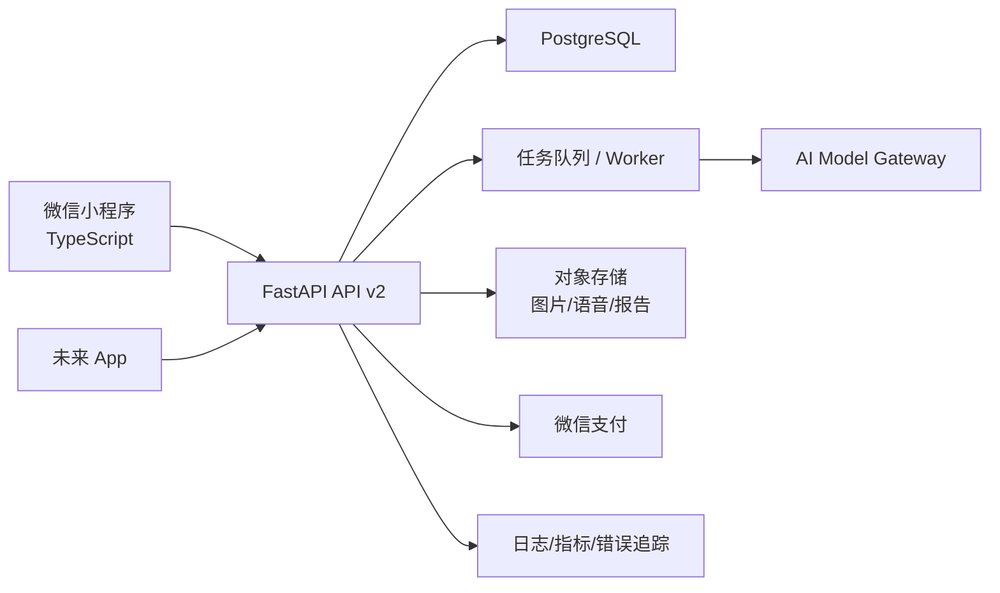

# 微信小程序实施与商业交付方案

> 状态：可执行工程基线  
> 日期：2026-07-12  
> 目标：以小程序打通完整商业闭环，后续 App 作为同一平台的新客户端

关联文档：[产品需求文档](../product/2026-07-12-ai-guokao-coach-prd.md) · [多 Agent 与共享学习大脑架构](../architecture/2026-07-12-agent-learning-brain-architecture.md)

## 1. 实施原则

1. 小程序是正式产品端，不是 iOS 页面的 Web 翻刻或一次性验证项目。
2. 现有 FastAPI、PostgreSQL、题库、岗位库和部分领域服务继续作为服务端基础。
3. 小程序使用独立、版本化 API 契约，不把 Swift 模型或现有页面状态当作后端边界。
4. 确定性计算与 AI 理解分离；所有 AI 调用可计量、可评估、可审计。
5. 上线依赖正式迁移、CI/CD、监控、回滚和数据备份，不继续以手工 `rsync + restart` 作为商业发布流程。

## 2. 目标技术架构



### 2.1 小程序端

推荐使用微信原生小程序 + TypeScript。产品当前首要需求是微信登录、订阅通知、拍照/语音、支付和长列表性能，原生能力可减少跨端抽象带来的运行差异。后续 App 复用的是 API、设计 token 和领域契约，不是小程序视图代码。

建议目录：

```text
apps/wechat/
  miniprogram/
    api/             # 由 OpenAPI 生成的类型化客户端
    components/      # 设计系统与领域组件
    pages/           # 路由级页面
    domains/         # goal, learning, reflection, plan, commerce
    state/           # 账户与服务端状态快照
    telemetry/       # 埋点、request ID、性能
  tests/
    unit/
    contract/
    e2e/
```

### 2.2 后端

- 保留领域单体，按 owner 扩展，不在当前规模提前拆微服务。
- 新增后台 worker 处理 OCR、语音转写、复杂复盘、申论、周诊断和画像重算。
- 使用数据库 outbox 与幂等 job key，避免作答成功但画像不更新。
- 同步 API 只完成身份、校验、核心业务写入和可立即计算结果；长 AI 任务返回 job ID，客户端订阅或查询正式状态。

## 3. 身份、会话与隐私

### 3.1 微信登录

1. 小程序获取一次性 login code。
2. 服务端与微信服务端交换平台身份，映射为内部 learner ID。
3. 服务端签发可撤销会话，小程序不接受任何客户端传入 learner ID。
4. 用户后续绑定 App 时，通过经身份验证的 account-link 流程合并，不以手机号或昵称自动合并。

### 3.2 个人信息分类

- 报考资格、学习行为、原始语音/图片、AI 派生画像分表分权。
- 端上只保存会话和最小必要快照，不存储完整长期画像。
- 原始图片和语音使用带过期时间的受控 URL，存储时限与用户可见设置明确。
- 删除流程使用可追踪删除任务，完成后向用户出具删除结果。

## 4. API v2 边界

以下是业务边界，具体 schema 必须在实现时以 OpenAPI 固化并生成 TypeScript 客户端。

| 域 | 核心接口 |
|---|---|
| 账户 | `POST /api/v2/auth/wechat`, `GET /api/v2/me`, `DELETE /api/v2/me` |
| 资格 | `GET/PUT /api/v2/qualification-profile`, `POST /validate` |
| 岗位 | `GET /api/v2/positions`, `POST /api/v2/goals`, `GET /api/v2/goals/current/gap` |
| 诊断 | `POST /api/v2/assessments/quick`, `POST /attempts`, `GET /ability` |
| 时间/情绪 | `PUT /api/v2/study-budget`, `POST /api/v2/daily-checkins` |
| 计划 | `GET /api/v2/plans/today`, `POST /tasks/{id}/start|complete|abandon` |
| 行测 | `POST /api/v2/question-attempts`, `POST /api/v2/reflections`, `POST /confirm` |
| 申论 | `POST /api/v2/essay-attempts`, `POST /review-jobs`, `POST /rewrites` |
| 验证 | `GET /api/v2/verifications/due`, `POST /attempts` |
| 模考 | `POST /api/v2/mock-exams`, `POST /submit`, `POST /external-reports`, `POST /confirm` |
| 档案 | `GET /api/v2/learning-profile`, `GET /api/v2/decisions/{id}/evidence` |
| 商业 | `GET /api/v2/commerce/catalog|entitlement`, `POST /wechat-orders`, `POST /notifications` |
| 异步任务 | `GET /api/v2/jobs/{id}` |

所有写接口支持 idempotency key。所有变更画像或计划的响应返回决策/事件 ID，不只返回展示文本。

## 5. 数据库与迁移

### 5.1 新增核心表组

- `identity.wechat_accounts`, `identity.account_links`
- `learner.qualification_facts`, `learner.goal_versions`
- `learning.assessment_attempts`, `learning.question_attempt_events`
- `learning.reflection_artifacts`, `learning.inference_candidates`
- `learning.mastery_states`, `learning.verification_schedules`
- `learning.essay_artifacts`, `learning.external_exam_reports`
- `learning.daily_checkins`, `learning.daily_plan_versions`, `learning.task_executions`
- `learning.ability_estimate_versions`, `learning.strategy_versions`
- `platform.outbox_events`, `platform.background_jobs`
- `commerce.wechat_orders`, `commerce.wechat_payment_notifications`

### 5.2 迁移规则

- 引入 Alembic 作为唯一 schema 版本机制，为现有生产 schema 建立经审核的 baseline revision。
- 每个迁移包含向前操作、数据回填计划、大表锁影响和发布顺序。
- 迁移在临时生产拓扑与经脱敏数据规模的环境验证，不仅跑空库测试。
- 应用发布使用 expand/migrate/contract 顺序，不将破坏性 schema 变更与客户端发布绑成一步。

## 6. 自有模考与外部报告

### 6.1 自有标准卷

- 试卷是可发布的版本对象，固定题目、顺序、模块、难度、知识覆盖和评分版本。
- 组卷引擎控制题目曝光、近期已做题、难度分布、模块配比和跨卷等值性。
- 保存单题用时、修改、跳题、回看、离开页面和交卷轨迹。
- 评分不继续使用简单正确率折算 100 分；评分版本必须有题目参数、校准样本和误差说明。

### 6.2 外部模考

- 不设粉笔专用业务入口，使用平台中立的“导入外部模考”。
- OCR/AI 识别结果在用户确认前不进入能力计算。
- 存储平台、场次、日期、是否限时、总分、模块、截图哈希和用户确认版本。
- 信息不完整的报告只用于总趋势；异常高分、非限时或重复报告按受控规则处理。

## 7. AI 工程与单位经济模型

### 7.1 调用政策

- 用户没有新证据时不重复生成计划。
- 一组高价值错题批量初分析，只对模糊或高影响项追问。
- 长期记忆使用近期原始证据、阶段模式和长期画像三层摘要，不在每次调用中传入全部历史。
- 每个 AI 场景有固定输入/输出 schema、提示版本、评测集、可接受阈值和成本上限。
- 权益预留、AI 调用和权益确认是同一可审计交易；失败调用按契约退回额度。

### 7.2 成本看板

每日计算：

- 每活跃、每付费、每续费用户 AI 成本。
- 每场景、每模型、每有效复盘和每申论闭环成本。
- 缓存命中、批处理节省、schema 失败、重试和无效输出成本。
- AI 成本/实收、毛利、额度使用分布和高成本异常用户。

## 8. 商业与支付

- `commerce` 继续作为产品目录、订单事实、用户权益、场景额度和审计的 owner。
- 微信支付订单与 App Store 交易存入各自渠道事实表，最终折算为同一 `user_entitlement` 视图。
- 支付通知验签、幂等入库、金额/商品/账户校验后才发放权益。
- 退款、关单、重复通知、跨渠道重复购买和账户合并均需要明确状态机与审计。
- 发布前根据当时最新微信小程序类目、虚拟服务、支付和用户隐私规则完成合规复核，复核结果纳入发布门禁。

## 9. 测试与质量体系

### 9.1 自动化测试

- 领域单元测试：资格、证据、掌握状态机、计划排序、额度和支付。
- PostgreSQL 集成测试：事务、outbox、幂等、并发和用户隔离。
- OpenAPI 契约测试：后端 schema 与生成的 TypeScript 客户端一致。
- 小程序组件、状态机、无障碍与关键页面视觉测试。
- 端到端链路：登录、建档、定岗、短测、日计划、作答、复盘、验证、模考、申论、支付和删除。

### 9.2 AI 评测

- 建立版本化金标数据集，覆盖错因、追问、申论、情绪语气、战略放弃和 OCR。
- 产品评估不只看文本好坏，还看证据引用完整性、错误自信率、用户驳回率和后续变式验证结果。
- 任何模型或提示更换在离线评测、回放评测和成本门禁通过后发布。

## 10. CI/CD、环境与运维

### 10.1 环境

- `development`：本地与个人测试数据。
- `staging`：与生产拓扑一致，使用独立微信配置、数据库、对象存储和支付沙箱/验收流程。
- `production`：受控发布、审计、备份和最小权限。

### 10.2 流水线

1. 格式、静态检查、单元/集成/契约测试。
2. 数据库迁移升降级、大表锁和数据回填验证。
3. 小程序构建、包体积、端到端与视觉验证。
4. AI 离线评测和预算门禁。
5. 构建不可变后端制品，部署 staging，执行数据与业务验收。
6. 经批准后使用同一制品发布 production，保留上一制品和应用回滚能力。

### 10.3 可观测性

- 结构化日志、request ID、错误追踪、API/worker 延迟和队列积压。
- 登录、计划生成、作答写入、AI 任务、支付和删除主链 SLO。
- 数据库慢查询、连接池、outbox 延迟、备份完整性和恢复演练。
- 业务告警覆盖岗位匹配异常、能力大幅跳变、计划空集、AI 成本异常和权益不一致。

## 11. 交付工作流与门禁

以垂直商业闭环递进，每个工作流均达到安全、测试、观测和文档门禁后才进入下一个。

### WS0：工程与发布基座

- 整理当前未提交工作区，建立可追溯基线。
- Alembic、CI/CD、staging、密钥管理、日志/监控和备份恢复。
- 小程序工程、设计 token、OpenAPI 生成和基础测试。

**门禁**：任意发布可定位到 commit、迁移和制品；staging 可完成账户数据全量删除演练。

### WS1：建档、岗位与目标分差

- 微信身份、资格画像、可报/待确认岗位、冲稳保和主目标。
- 目标分从单点改为情景区间，展示样本和证据等级。

**门禁**：任一岗位可报结论能回放全部资格条件；缺失硬条件时无“已确认”路径。

### WS2：快速诊断与共享学习大脑

- 证据层、候选结论、派生画像、版本化能力区间和快速短测。
- 时间预算、每日状态确认和规划 Agent 第一条每日决策。

**门禁**：所有能力结论有区间、置信度和证据引用；同输入版本可重放日计划。

### WS3：行测复盘与自动验证

- 完整作答轨迹、高价值题判定、用户原始思路、AI 候选归因和用户确认。
- 变式题、1–3 天与 7–14 天验证及掌握状态机。

**门禁**：无确认归因不进入长期错误模式；无延时证据不标记稳定掌握。

### WS4：申论闭环

- 拍照/OCR、材料与答案版本、思路表达、区间评分、重写和迁移验证。
- 高能力模型评测集和单次成本门禁。

**门禁**：评分指向材料与评分依据；单篇不大幅改写长期估分。

### WS5：模考、周节奏与情绪决策

- 自有标准卷、外部模考导入、5+1+1 周节奏、恢复日、动态复测配比。
- 考场跳题、阶段降权和战略放弃的证据化决策。

**门禁**：外部数据经用户确认后才校准；任何放弃结论有范围、收益证据、有效期和重评日期。

### WS6：商业发布

- 微信支付、统一权益、场景额度、订单/退款审计和单位经济看板。
- 隐私、内容、支付、数据安全、容灾和微信平台合规验收。

**门禁**：支付到权益全状态可审计；高影响结论可回放；备份恢复、故障演练和客服数据查询权限验收通过。

## 12. 开工前必须确定的外部输入

- 微信小程序 AppID、主体、类目、隐私配置和域名归属。
- 微信支付商户主体、结算和商品形态。
- AI 模型供应商合同、数据使用边界、限流、成本和保留政策。
- 国考题库、岗位、历史分数和方法卡的授权范围与版权可追溯记录。
- 生产域名、对象存储、邮件/告警、错误追踪和备份基础设施账户。
