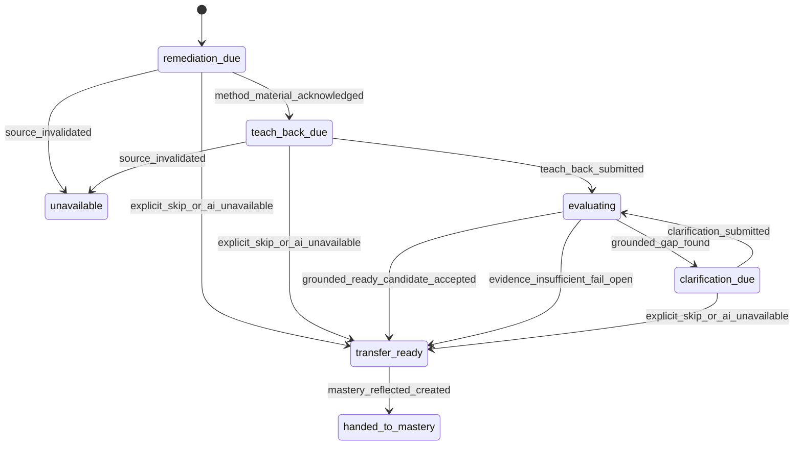

# 岸岸「补弱学习 → 教教岸岸 → 迁移验证」实施小本本

> 历史归档：本文件不再作为当前产品、实现或上线状态权威。核心闭环已合并进
> `docs/product/anan-product-system-spec.md`。

> 文档状态：`draft / proposal / 未冻结 / 未授权实施`
>
> 创建时间：2026-08-12（Asia/Shanghai）
>
> 当前 Git 基线：`main@d42761ce4485e5efcb9069744a3c0cea1156c509`
>
> 当前工作区：脏工作区，创建本文档时共有 74 个未提交变更条目；现有改动均视为用户资产，不得覆盖、回滚或顺手整理。
>
> 建议后续发布单元：`RU-ANAN-TEACH-BACK-CYCLE-001`（名称仅为提案，必须先进入 `.product-governance` 并通过冻结）。

## 0. 以后从哪里恢复

任何新任务、上下文压缩或换工作区后，先完整阅读本文档，再按以下顺序恢复：

1. 执行 `git status --short`、`git rev-parse HEAD`，确认基线和未提交改动是否已变化。
2. 读取 `.product-governance/manifest.json`，再核对本文引用的决策、需求、契约和发布单元。
3. 核对“第 13 节：尚未冻结的产品决定”是否已有用户新决定；新决定优先，但必须记录来源并回写治理包。
4. 核对“第 14 节：实施波次”的前置条件，只执行当前已解锁的一个波次。
5. 每完成一个波次，在本文末尾“执行日志”追加日期、Git SHA、改动摘要、验证证据和未解决项。

本文是防止上下文污染的工程小本本，不替代 `.product-governance` 的正式权威。真正改代码前，必须把已确认内容转成新的需求、决策、契约、状态机、数据生命周期、AI 场景和发布单元；不能拿本文的 `proposal` 当作已冻结事实。

## 1. 证据标签

本文每项结论使用以下标签：

- `用户已确认`：来自本轮及此前明确产品决定。
- `代码已验证`：创建本文档时在仓库中直接观察到的事实。
- `治理已接受`：已存在于 `.product-governance` 的正式决策或需求。
- `方案提议`：推荐设计，尚未获得新的治理冻结。
- `未知/阻塞`：实现前必须补齐，不能由开发者或 AI 擅自猜测。
- `冲突`：当前权威、代码或最新产品方向不一致，必须先裁决。

## 2. 一句话目标

`用户已确认`：把费曼式讲授嵌进岸岸现有闭环，让用户补完弱项后“教教岸岸”；但它不能成为新的孤立功能、第五个 Agent 或新的首页入口。

`方案提议`：把当前半成品“错题即时救场”升级为一个有唯一 `learningCycleId` 的补弱学习回合：

> 真实证据 → 错因/弱项假设 → 补一个方法或知识点 → 教给岸岸 → 岸岸追问 → 新题迁移验证 → 间隔复测 → 岸岸修正判断和明日任务

这里的“教会岸岸”是用户体验隐喻，不表示用户内容被用于训练底层模型，也不表示一次口头复述就已掌握。

## 3. 已确认的产品边界

### 3.1 用户已确认

- 用户唯一感知到的“大脑和教练”叫“岸岸”。后台可以有多个技术模块，但不能向用户暴露多个 Agent 人格。
- 首页不新增平行卡片类型，继续升级现有“岸岸建议”和今日当前任务。
- 岸岸建议必须表达：观察到了什么、暂时判断什么、今天怎么练、用什么验证、判断错了怎么改。
- 新用户冷启动是“第一次教练会谈”，不是一次填完大量档案；证据等级从“刚认识你”逐步上升。
- 产品近期优先服务事业编考试；首要内容方向为事业编 A 类的职测，广西或新疆属于考试范围差异，不应拆成两套产品；公务员方向暂缓。
- 保留现有视觉语言，不重做整套前端；紫色渐变图标、极光背景可以保留，主操作按钮倾向现有黑色视觉。
- 费曼讲授必须串进闭环，不能做成独立工具页、知识广场或聊天入口。

### 3.2 治理已接受

现有治理包已经接受以下约束，后续新发布单元必须继承：

- `DEC-ANAN-GOLDEN-LOOP-002`：新用户四种认识路径、分级证据、可验证的岸岸建议、用户可见确认与纠错。
- `DEC-FREEZE-RU-ANAN-GOLDEN-LOOP-003`：沿用现有页面和视觉资产，不恢复旧建档入口，不修改 Figma 源文件，不发布。
- `REQ-ANAN-SINGLE-COACH-VOICE-001`：唯一教练声音。
- `REQ-ANAN-COACH-ENTRY-002`：新用户由“岸岸如何认识我”进入。
- `REQ-ANAN-EVIDENCE-LEVEL-002`：不得伪装高精度认识。
- `REQ-ANAN-VERIFIABLE-COACH-LOOP-002`：判断必须有任务、验证和纠错。
- `REQ-ANAN-DAILY-BRAIN-SUGGESTION-002`：每日中控候选不能绕过用户确认直接成为用户事实。
- `anan-coach-golden-loop-projection@v2`：当前用户可见闭环是只读投影；新增规范事实需要新版本契约。
- `RU-ANAN-GOLDEN-LOOP-003` 已冻结并覆盖 Today、onboarding、learning brain 等路径；本功能与其路径及语义重叠，不能直接修改这个冻结发布单元。

### 3.3 明确不做

- 不新增“费曼学习”底部 Tab、首页宫格入口或常驻功能卡。
- 不新增一个对用户说话的“费曼 Agent”“复盘 Agent”或“评测 Agent”。
- 不把“讲得流利”“讲满时长”当成掌握。
- 不因为 AI 说“听懂了”就更新能力或掌握状态。
- 不在迁移题作答前展示正确答案、解析或标准步骤。
- 不把用户语音、转写或讲授内容默认用于模型训练。
- 不趁本次改动重画整套界面、重做导航或清理无关脏文件。
- 不在事业编知识发布缺失时静默回退到国考内容。

## 4. 现在代码实际是什么样

### 4.1 已存在的有效链路

`代码已验证`：当前职测/行测技术域已经有以下能力：

- 真实作答会话、用时、答案和复盘状态。
- 错因候选、追问、用户确认和错因证据。
- 掌握状态及即时、首次、延迟复测调度。
- 计划候选生成、每日任务物化、Today 当前任务投影。
- 反思语音上传、私有媒体、转写及绑定基础设施。
- AI 场景部署、模型调用台账、成本/权益归因和评测发布基础设施。

### 4.2 已存在但半死不活的“即时救场”

`代码已验证`：`backend/app/domains/xingce_learning/rescue/service.py` 已经实现：

> 已确认错因（仅 `method_selection` / `knowledge_gap`）→ 知识节点 → 已发布方法卡 → 一道同类题

但它目前只是只读查询：

- 返回 `reviewId`、`sessionId`、方法卡和同类题，没有自己的资源版本、回合状态或完成证据。
- `apps/wechat/miniprogram/pages/reflection/index.ts` 中的 `startRescuePractice()` 只切换内嵌预览；注释明确说明正式交互式单题会话尚未实现。
- `apps/wechat/miniprogram/pages/reflection/index.wxml` 会在预览中直接显示正确答案和解析，因此这个预览不能作为迁移验证证据。
- 救援卡下方仍然存在独立的“马上用一道新题试试”，方法学习并没有控制验证何时开始。

`方案提议`：不再新造一个功能，而是让这个 rescue 逻辑退居为“学习回合内容解析器”；旧只读接口保留兼容期，新客户端不再把带答案的同类题预览当训练。

### 4.3 当前链路的结构缺口

`代码已验证`：当前用户确认错因后，`real_attempt/service.py` 会立即调用 mastery 服务；`mastery/service.py` 直接创建：

- `state = reflected`
- `verification_stage = immediate`
- `due_at = 当前时间`

随后计划系统生成 `objective_verification`。也就是说，当前是：

目标链路需要在“确认错因”和“立即复测”之间增加一个有证据、有状态、有失败降级的补弱回合：

## 5. 产品体验合同

### 5.1 触发条件

`方案提议`：第一版只对以下全部满足的回合开放：

- 来源是用户已确认的真实错因，不是 AI 未确认候选。
- 错因为 `method_selection` 或 `knowledge_gap`。
- 能解析到与当前考试范围匹配、处于有效发布状态的知识节点和方法卡。
- 方法卡和验证题来源均未撤回、未失效，且能冻结版本或内容指纹。
- 功能开关、客户端兼容、AI 场景、成本权益和隐私策略均已就绪。

第一版每次复盘只挑一个当前最值得补的弱点进入回合，避免一口气生成三套讲授任务。其余错因保留为证据，交给后续计划调度；不丢失，也不同时轰炸用户。

不符合条件时沿用当前直接迁移验证链路，并明确记录 `learning_cycle_unavailable_reason`，不能伪装成已经学习过。

### 5.2 用户看到的步骤

1. 错因确认完成后，岸岸说清“为什么先补这个”。
2. 展示一张精简的方法卡：怎么识别、怎么做、易错边界；不展示迁移题答案。
3. 主按钮使用现有黑色风格，文案为“教教岸岸”。
4. 用户可语音或文字讲给岸岸；文字是完整替代路径，不能把语音设为唯一入口。
5. 岸岸切换为“学生模式”，一次只追问一个有证据的缺口。
6. 当解释达到“可以去验证”或用户选择跳过、AI 暂不可用时，进入真实新题。
7. 新题和后续间隔复测才更新掌握状态。
8. Today 的“岸岸建议”展示因果变化，例如：“你刚才讲清了方法，但新题在条件切换处仍不稳定，因此明天先复测这个边界。”

### 5.3 岸岸文案边界

推荐语气：

> 我先当学生。别背答案，讲给我听：遇到这类题，你先看什么？为什么？

> 识别条件你讲清楚了，我还有一点没听懂：条件变成……时，这个方法还适用吗？

> 我大概听懂了，但讲清楚不等于做得出来。现在用一道新题验证。

禁止语气：

> 你已经完全掌握了。

> 你的理解力是 92 分。

> 岸岸已经被你训练得更聪明了。

## 6. 领域所有权：谁拥有哪一个事实

| 事实                          | 唯一权威所有者                                               | 其他模块权限                           |
| ----------------------------- | ------------------------------------------------------------ | -------------------------------------- |
| 原始作答、答案、用时          | `xingce_learning.real_attempt`                               | 只读引用                               |
| 已确认错因                    | `xingce_learning.real_attempt`                               | 只读引用                               |
| 补弱学习回合及当前阶段        | 新增 `xingce_learning.learning_cycle`                        | planning/Today/learning brain 只读投影 |
| 用户讲授内容与讲授回合        | 新增 `xingce_learning.teach_back`                            | AI 审计和数据权利按契约引用            |
| AI 对讲授的判断               | AI 审计中的候选 + learning cycle 的已验证路由结果            | 不直接写掌握状态                       |
| 今天排什么、任务是否开始/完成 | `planning`                                                   | Today 只读投影                         |
| 迁移验证及间隔复测掌握状态    | `xingce_learning.mastery`                                    | learning brain 只读消费                |
| “岸岸观察/判断/下一步”        | `learning_brain` 生成候选，用户可见投影遵守 golden-loop 契约 | 不复制业务事实                         |
| 用户语音文件                  | `learning_media`                                             | teach-back 通过版本绑定引用            |

关键规则：`learningCycleId` 是跨模块关联键，但不是让各模块重复保存一份状态。计划任务必须绑定具体 `learningCycleVersionId`；掌握版本必须能反向追到来源 learning cycle；学习大脑只能通过资源版本引用解释“为什么任务变了”。

## 7. 建议的规范状态机

### 7.1 新增学习回合，而不是污染 mastery

`方案提议`：新增一个独立、版本化、仅追加的 `xingce_learning_cycle`。它只拥有“确认错因后、迁移验证前”的补弱状态；一旦把回合交给 mastery，迁移和间隔复测继续由现有 mastery 状态机拥有。

建议状态：

- `remediation_due`：学习材料已冻结，等待用户补弱。
- `teach_back_due`：用户已确认看完材料，等待讲给岸岸。
- `evaluating`：讲授已提交，AI 正在形成有依据的候选。
- `clarification_due`：仅有一个待回答的澄清问题。
- `transfer_ready`：可以创建现有 mastery 的即时验证。
- `handed_to_mastery`：已原子创建 mastery 版本，回合不再拥有后续验证状态。
- `unavailable`：必要内容撤回、范围不匹配或确定无法继续；必须记录原因。
- `superseded`：被更新的规范回合替代，不作为普通用户终态。

合法转移：

规则：

- `handed_to_mastery` 不是“掌握”，只是把迁移验证交给 mastery。
- AI 超时、失败或证据不足必须允许用户进入迁移题，不能永久阻塞学习。
- 跳过必须写为事实和原因，但不能降低用户能力分，也不能伪造讲授完成。
- 同一个来源错因与知识节点不能并发打开重复回合。
- 同一状态版本只能有一个合法后继；命令必须携带 `commandId`、`expectedRevision` 和请求指纹。

### 7.2 复盘状态的最小兼容改动

`冲突/方案提议`：当前复盘在错因确认后只有“立即验证到期”等语义。新流量需要增加一个终端交接里程碑，例如 `learning_cycle_opened`，表示复盘已经把后续责任交给 learning cycle；不要让复盘继续复制 learning cycle 的每一个内部阶段。

旧数据和旧流量保持当前状态不变，不回填、不重写历史复盘。

## 8. 数据模型草案

以下字段是契约草案，必须在治理冻结和迁移设计复核后才能落库。

### 8.1 `learning.xingce_learning_cycle_versions`

最少包含：

- `learning_cycle_version_id`、`learning_cycle_id`、`version_no`
- `user_id`、`state`、`revision`
- `exam_scope`、`exam_category`、`track`
- `source_review_id`、`source_review_version_id`、`source_session_id`
- `source_cause_decision_version_id`、`cause_code`
- `source_question_id`
- `knowledge_release_id`、`knowledge_node_id`
- `method_card_id`、`method_card_snapshot`、`method_card_sha256`
- `source_evidence_refs`
- `handoff_mastery_version_id`（仅在 `handed_to_mastery` 有值）
- `unavailable_reason_code`（仅在 `unavailable` 有值）
- `supersedes_learning_cycle_version_id`
- `created_at`

约束：

- 用户、来源复盘、知识节点、方法卡和考试范围必须一致。
- 方法卡必须冻结快照或可验证内容版本；不能只存会变化的裸 `cardId`。
- 同一逻辑回合只有一个当前后继。
- 表为 append-only；有数据后禁止破坏性 downgrade。
- 对用户所有读写都必须按 `user_id` 过滤，不能依赖客户端传入的用户标识。

### 8.2 `learning.xingce_teach_back_turns`

每一轮用户解释或岸岸追问均追加一行：

- `turn_id`、`learning_cycle_id`、`learning_cycle_version_id`
- `user_id`、`sequence_no`
- `actor = learner | anan`
- `input_mode = text | voice_transcript | system_fallback`
- `text_content`
- `media_artifact_version_id`（可空）
- `agent_run_version_id`（岸岸轮次或 AI 处理时可空/必填由契约决定）
- `created_at`

讲授正文不能混进 planning task payload 或 learning brain 建议文本。

### 8.3 `learning.xingce_teach_back_evaluation_candidates`

AI 结果先作为候选保存，不直接推进掌握：

- `candidate_id`、`learning_cycle_id`、`source_turn_id`
- `definition_release_id`、`scenario_deployment_id`、`agent_run_version_id`
- `outcome = clarification_required | ready_for_transfer | evidence_insufficient`
- `dimension_findings`
- `grounding_refs`
- `next_question`（只有 `clarification_required` 可有）
- `schema_valid`、`grounding_valid`
- `created_at`

只有结构、来源和权限验证通过的候选，才能由确定性服务写出 learning cycle 的下一版本。模型自身不能直接更新 cycle 行。

### 8.4 mastery 和 learning media 的兼容扩展

- mastery 新版本建议增加可空 `source_learning_cycle_version_id`；旧版本保持空值合法。
- mastery 的 `evidence_refs` 必须包含 cycle、teach-back 路由结果和来源复盘版本。
- `learning_media` 需要前向迁移，增加 `teach_back_voice` purpose 与 `xingce_teach_back` 绑定类型。
- 语音保留期限、删除传播和转写保留策略目前未知，未确认前可先实现完整文字路径，但不能偷偷复用 `reflection_voice` 语义。

## 9. 命令、查询、事件和接口草案

### 9.1 写命令

所有命令至少携带 `commandId`、`expectedRevision`，并返回最新资源版本：

- `openLearningCycleFromConfirmedCause`：内部命令，与错因确认同一事务触发。
- `acknowledgeRemediationMaterial`：确认已完成这次补弱材料，不代表掌握。
- `submitTeachBack`：提交文字或已绑定语音转写。
- `submitTeachBackClarification`：回答当前唯一追问。
- `skipTeachBackToTransfer`：显式跳过并记录原因。
- `acceptTeachBackEvaluationCandidate`：服务端确定性内部命令。
- `handoffLearningCycleToMastery`：原子创建 `reflected/immediate` mastery 并绑定 cycle。
- `markLearningCycleUnavailable`：内容失效或一致性检查失败时使用。

### 9.2 只读查询

- `getLearningCycle(cycleId)`：返回当前版本、用户可见材料、当前下一步和安全的历史轮次。
- `getPendingLearningCycles()`：供 planning 候选输入仓读取，不能直接作为 Today DTO。
- `getTeachBackMediaBinding()`：只返回当前用户可访问的媒体状态。

### 9.3 对外接口建议

路径名称在 OpenAPI 冻结时确认，建议语义为：

- `GET /api/v1/xingce/learning-cycles/{cycleId}`
- `POST /api/v1/xingce/learning-cycles/{cycleId}/material-acknowledgements`
- `POST /api/v1/xingce/learning-cycles/{cycleId}/teach-back-turns`
- `POST /api/v1/xingce/learning-cycles/{cycleId}/skip`
- `POST /api/v1/xingce/learning-cycles/{cycleId}/mastery-handoff`（优先内部化，不一定暴露给客户端）

不能手改小程序 API 文件；必须从规范 OpenAPI 生成，再通过 `apps/wechat/package.json` 的 `npm run api:generate` / `npm run api:check` 校验。

### 9.4 Outbox 事件

建议版本化事件：

- `xingce-learning-cycle-opened@v1`
- `xingce-remediation-material-acknowledged@v1`
- `xingce-teach-back-submitted@v1`
- `xingce-teach-back-route-decided@v1`
- `xingce-learning-cycle-handed-to-mastery@v1`
- `xingce-learning-cycle-unavailable@v1`

事件必须包含用户、aggregate revision、command id、资源版本引用和原因码；不把完整语音或不必要的讲授正文广播到 outbox。

## 10. AI “学生模式”契约

### 10.1 AI 只做什么

AI 基于冻结的以下证据判断用户讲授中还有什么需要澄清：

- 已确认错因及其证据。
- 冻结的方法卡和知识节点。
- 原题的规范内容与标准解法/解析。
- 用户当前轮和必要的同回合历史轮次。

AI 输出不是“教学质量分数”，而是结构化候选：

| 维度                               | 可选状态                                              |
| ---------------------------------- | ----------------------------------------------------- |
| 识别条件 `problem_recognition`     | `supported / missing / contradicted / not_applicable` |
| 方法步骤 `procedure`               | 同上                                                  |
| 原因解释 `rationale`               | 同上                                                  |
| 边界或易错点 `boundary_or_pitfall` | 同上                                                  |

每个 `supported` 或 `contradicted` 都必须有用户原话片段和规范来源引用。无法建立引用时必须 `evidence_insufficient`，不能凭语气或流畅度猜。

### 10.2 必须防止的错误

- 用户流畅复述了错误方法，模型因为迎合而判定通过。
- 用户照抄方法卡，模型误判为已经能迁移。
- 用户口音、停顿或转写错误被当成知识缺口。
- 用户提示注入要求模型忽略方法卡或泄露答案。
- 模型在第一轮讲授前泄露迁移题正确答案。
- 模型把考试范围不匹配的国考材料当成事业编 A 类依据。
- AI 故障扣除权益但没有可核对的调用台账或补偿路径。

### 10.3 降级原则

- AI 不可用、超时、成本预留失败或证据不足时，岸岸明确说明“这次先用新题验证”，允许 fail-open 到迁移题。
- 降级不等于讲授成功；写 `teach_back_unavailable` 或 `evidence_insufficient` 事实。
- 用户可以对岸岸的判断选择“我不同意”，记录争议后进入迁移题；迁移结果拥有更高证据权重。
- 具体追问轮数、权益扣减和成本上限是未冻结项，不能写死在代码里。

## 11. planning、Today 和 learning brain 如何串起来

### 11.1 planning

`代码已验证`：当前规划只认识：

- 阶段：`objective_baseline / objective_practice / objective_reflection / objective_verification`
- 类型：`practice / reflection / verification / mock_exam / essay`

`方案提议`：增加一个内部阶段和任务类型：

- stage：`objective_remediation`
- kind：`learning`
- completion evidence：`learning_cycle_handoff` 或明确的 skip/unavailable 终态证据
- start URL：绑定具体 `learningCycleId` 和 `learningCycleVersionId`

该任务在用户口中仍是岸岸今天安排的“补一下这个弱点”，不是一个新产品模块。

排序规则：

- 已 `in_progress` 的同一任务永远优先恢复。
- 一个 learning cycle 内部的材料、讲授、追问和 handoff 不能被 planning 拆散或改绑。
- 打开的补弱回合必须优先于新的泛化针对训练；与其他已到期间隔复测的跨回合竞争仍由计划引擎按冻结优先规则决定，不能在页面硬编码。
- planning 只存任务引用和完成证据，不复制讲授状态或 AI 评价。

### 11.2 Today

Today 仍只显示一个“当前下一步”。表现层增加 `teach` phase 或等价内部映射：

- `remediation_due`：岸岸先带你补一个点。
- `teach_back_due / clarification_due`：教教岸岸。
- `transfer_ready`：用一道新题验证。
- `handed_to_mastery`：由现有 verification phase 接管。

Today 反馈必须能说明因果：

> 因为你刚才把识别条件讲清楚了，但还没说明边界，所以岸岸先追问一个问题；回答后再用新题验证。

禁止只显示“任务已更新”或另起一个无来源的推荐卡。

### 11.3 learning brain

- 只消费 cycle/mastery/outbox 的版本化事实。
- 可以形成“岸岸的暂时判断”和次日任务候选。
- 不直接写 cycle、planning 或 mastery。
- 用户反对 AI 判断、跳过、迁移失败等都要成为后续建议的可解释证据。
- `anan-coach-golden-loop-projection@v2` 需要新版本契约，才能展示 `teach` 阶段和 `learningCycleId`；不能悄悄扩字段。

## 12. 小程序改动原则

### 12.1 技术路由不是新功能入口

`方案提议`：可以新增一个执行路由，例如 `/xingce/teach-back/index`，但它不出现在 Tab、首页功能列表或我的页面。用户只能从错因完成态、Today 当前任务或恢复会话进入。

页面复用现有：

- `pages/reflection` 的工作台导航、字体、间距和黑色主按钮风格。
- 现有 learning-media 上传控制器、草稿恢复和文字输入兜底。
- 现有 Today 岸岸建议卡和当前任务容器。

不直接把整个状态机继续塞进 `pages/reflection/index.ts`；复用视觉和小组件，但将 teach-back 的状态、API 和恢复逻辑放在自己的 feature/runtime 中，避免现有巨型页面继续膨胀。

### 12.2 旧 rescue 的处理

- 老客户端继续读旧 rescue 查询，直到兼容窗口结束。
- 新流量不再展示包含 `correctOptionIds` 和 `explanation` 的同类题预览。
- rescue 的“错因 → 知识节点 → 方法卡”解析逻辑抽成 learning cycle 的生产者依赖。
- 同类题由现有 verification 会话安全发放，客户端只收到可作答 bundle；判定后才可看答案解析。

### 12.3 必测恢复场景

- 材料看到一半杀掉小程序，再进来恢复同一 cycle。
- 语音上传成功但提交响应丢失，重放 command 不生成重复轮次。
- AI 正在处理时退出，Today 显示可理解的处理中/降级状态。
- 文字与语音路径得到相同业务结果。
- 老客户端遇到新后端时不会收到无法打开的新任务；功能开关必须等兼容客户端部署后再开。

## 13. 尚未冻结的产品决定

以下不是让实现者临场发挥的问题。进入治理冻结前必须由产品确认或接受推荐默认值。

| 编号                 | 当前状态                   | 推荐默认                                                                                           | 阻塞内容             |
| -------------------- | -------------------------- | -------------------------------------------------------------------------------------------------- | -------------------- |
| D1 首发范围          | 用户已确认方向，契约未冻结 | 仅事业编 A 类职测；广西/新疆通过 `examScope/examCategory` 绑定内容发布；公务员不开                 | 全部实施             |
| D2 内部命名          | 代码仍叫 `xingce`          | 本单元不做大规模域重命名；把 `xingce` 视作客观题技术兼容名，但所有新契约必须显式携带事业编考试范围 | 契约、知识检索、数据 |
| D3 跳过策略          | 未确认                     | 允许跳过，不惩罚，记录原因，直接去迁移验证                                                         | 状态机、文案         |
| D4 AI 追问上限       | 未确认                     | 先由评测和成本预算决定；配置化，不在业务代码写死                                                   | AI 场景、权益        |
| D5 权益与付费        | 未确认                     | 未有正式权益前不扣用户付费额度；仍完整记成本台账                                                   | AI 运行、商业        |
| D6 语音保留与删除    | 未确认                     | 文字路径可先交付；语音必须等 data lifecycle 和删除传播冻结                                         | 语音功能             |
| D7 用户反对 AI       | 未确认                     | 记录争议并允许进入迁移题，迁移证据优先                                                             | 命令、UI             |
| D8 rescue 历史兼容期 | 未确认                     | 新流量不开历史回填；旧接口只保兼容，不继续扩展                                                     | 发布/清理            |

### 13.1 现有权威冲突

`冲突`：现有 `DEC-ANAN-GOLDEN-LOOP-002` 强调不新增平行计划/能力/错因/任务状态；本方案推荐新增一个补弱 learning cycle 和一个 planning stage/kind。

推荐裁决：新 cycle 不是另一份计划、能力、错因或 mastery，它填补的是此前无人拥有的“补弱材料到迁移验证之间”的规范事实；planning 新 stage 只投影该资源。新的 successor 决策应明确允许这一个资源和一个投影，同时禁止任何重复状态。如果不做 successor 决策，就不能把状态偷塞进 reflection 或 learning brain。

### 13.2 考试范围冲突

`冲突/代码已验证`：当前 rescue repository 多处硬编码 `exam_scope = 'guokao'`，而现有产品文档仍以“国考 AI 教练”为标题；最新产品方向已变为事业编 A 类职测。

推荐裁决：本发布单元不允许沿用国考知识发布假装事业编可用。必须先存在可验证的事业编 A 类知识 release、方法卡绑定和题目覆盖；缺失时返回 `unavailable`，不静默回退。

## 14. 实施波次

一次只解锁一个依赖闭合波次。每个波次结束必须有代码、测试和可重放证据，不能用“页面看起来能点”代替系统闭环。

### Wave 0：治理与范围冻结（先做，不能跳）

目标：把本文从 proposal 转成正式权威。

工作：

- 先处理/确认当前 74 个脏工作区变更，至少明确 golden-loop 当前基线；不得覆盖用户改动。
- 新增 successor 决策，解释为什么允许 learning cycle，而不形成平行大脑。
- 新增需求：单一 learning cycle、讲授不等于掌握、AI 失效降级、事业编范围、用户争议、可访问性。
- 更新 glossary、domain ownership、interaction state machine、page matrix、contract、data lifecycle、AI scenario、entitlement、NFR 和追踪矩阵。
- 创建 `RU-ANAN-TEACH-BACK-CYCLE-001`：`dependsOn` 且 `supersedes` `RU-ANAN-GOLDEN-LOOP-003`，因为会重叠其 Today/learning brain/小程序路径。
- 运行产品治理验证并冻结发布单元。

停止条件：任一 D1–D8 中影响当前波次的决定仍未知；治理验证不通过；需要直接编辑冻结 RU。

### Wave 1：规范资源、迁移与纯领域服务

目标：建立可审计、可恢复、暂不对用户开放的 learning cycle。

建议路径：

- 新增 `backend/app/domains/xingce_learning/learning_cycle/`
- 新增 `backend/app/domains/xingce_learning/teach_back/`
- 修改 `real_attempt` 的新流量 handoff、`mastery` 的 cycle 来源绑定。
- 新增当前 Alembic head 之后的前向迁移；不要提前硬编码 revision 编号。
- 扩展 learning media purpose/binding，但只有 data lifecycle 已冻结时才启用语音。
- 新增 domain tests、migration replay、幂等/并发/权限测试。

完成定义：API 尚可关闭，但能用服务/契约测试完整重放 `confirmed cause → cycle → transfer_ready → mastery handoff`，且旧数据无变化。

### Wave 2：AI 学生模式

目标：让岸岸只基于冻结证据追问，不迎合、不泄题。

工作：

- 发布独立 AI scenario definition、prompt/schema、检索来源和部署记录。
- 复用现有 `ai_audit` 的 scenario deployment、agent run、model call ledger、attribution、成本和权益机制；不要另造无审计的模型调用。
- 建立评测集：流畅但错误、照抄方法卡、部分正确、边界缺失、方言/转写误差、提示注入、内容撤回、范围不匹配。
- AI 候选经 schema + grounding 验证后才推进 cycle。

完成定义：错误但流畅的解释不会被路由为 `ready_for_transfer`；AI 故障能无重复扣费地降级。

### Wave 3：planning 与 Today 消费者

目标：Today 真的因为 learning cycle 改变下一步。

工作：

- planning 增加 `objective_remediation` / `learning`，补全 completion contract 和候选输入仓。
- plan task 绑定精确 cycle version，完成只接受规范 handoff/skip/unavailable 证据。
- Today presentation 增加 `teach` 映射，岸岸建议展示本回合的观察、判断、动作、验证和纠错。
- learning brain 只读消费新事件和资源引用，发布 projection 契约新版本。

完成定义：打开的 cycle 会改变当日计划；完成/跳过/失败会再次改变计划；不出现两个互相冲突的“当前下一步”。

### Wave 4：小程序执行体验

目标：在不重画整套 UI 的前提下交付完整回合。

工作：

- 新增内部 teach-back 路由及 feature/runtime；不新增导航入口。
- 复用反思工作台、黑色主按钮、文字/语音草稿和恢复能力。
- 修改 eligible 新流量的反思完成 CTA 为“先补一下，再教教岸岸”。
- 移除新流量的带答案 rescue 预览；迁移题进入真实 verification 会话。
- 从 OpenAPI 重新生成小程序 API，更新交互覆盖、导航、结构和视觉守卫。

完成定义：用户可从错因完成态连续走到迁移题；退出重进从精确步骤恢复；Today 也能继续同一回合。

### Wave 5：整链验收与渐进放量

推荐发布顺序：

1. 部署 dormant schema，功能开关关闭。
2. 部署后端读写能力和监控，仍不创建用户可见 cycle。
3. 部署兼容客户端。
4. 仅对“新产生、符合条件”的事业编 A 类职测错因开启；不回填历史。
5. 观察漏斗、AI 降级、迁移验证、投诉和成本。
6. 数据证明可靠后再讨论扩大错因类型、历史回填或综应适配。

回滚原则：关闭新 cycle 创建；已打开 cycle 保持可恢复或通过显式降级交给 mastery，不能留下永远无法完成的计划任务。

## 15. 验收场景

### 15.1 必须通过的主链

1. 用户完成真实职测题并确认 `knowledge_gap`。
2. 系统原子冻结事业编 A 类方法卡、来源证据和知识发布，打开 cycle。
3. 用户看完材料，使用文字或语音讲给岸岸。
4. 岸岸发现一个有来源的边界缺口，只问一个问题。
5. 用户补充后，系统路由到迁移验证；不能显示“已经掌握”。
6. 系统创建带 cycle 来源的 `reflected/immediate` mastery。
7. 用户做一题全新的安全 verification bundle。
8. mastery 根据真实结果进入后续调度。
9. Today 和岸岸建议明确展示判断如何因讲授与验证改变。

### 15.2 异常与边界

- AI 直接认为可以验证：不追问，仍必须做新题。
- AI 证据不足/超时/不可用：记录降级，允许去新题，不伪造讲授成功。
- 用户跳过：记录 skip，去新题，不扣能力、不加掌握。
- 用户不同意 AI：记录 dispute，迁移题证据优先。
- 用户讲得很流畅但内容错误：不能进入“已理解”；最多追问或降级到验证。
- 用户复制方法卡：不能据此确认掌握。
- 用户讲完退出：重进恢复同一 cycle/turn，不重复调用或扣费。
- 同一 command 重放：返回同一资源版本，不新建重复 turn/mastery/task。
- 两个并发回答：只有一个合法后继，其余得到可恢复冲突。
- stale `expectedRevision`：返回 409，客户端刷新，不覆盖新事实。
- 跨用户 cycle id：不泄露存在性或内容。
- 方法卡/题目/知识发布撤回：fail closed 为 unavailable，不能继续用旧内容验证。
- 旧客户端：功能未开前不收到新任务；旧历史继续走原链路。
- 迁移题作答前：任何接口和 UI 都不返回正确答案或解析。
- 用户发起数据删除：语音、转写、turn、AI 引用和下游建议按冻结 data lifecycle 传播。

## 16. 验证门禁

### 16.1 后端

至少运行并保留证据：

- 新增 learning-cycle/teach-back 契约和服务测试。
- `backend/tests/test_xingce_rescue.py`
- `backend/tests/test_xingce_reflection_contract.py`
- `backend/tests/test_xingce_async_cause_planning.py`
- `backend/tests/test_xingce_planning_closure.py`
- `backend/tests/test_xingce_mastery_scheduler.py`
- `backend/tests/test_planning_contracts.py`
- `backend/tests/test_planning_routes.py`
- `backend/tests/test_feed_today.py`
- `backend/tests/test_learning_brain_daily_suggestion.py`
- `backend/tests/test_learning_media.py`
- `backend/tests/test_xfyun_learning_media.py`
- `backend/tests/test_migrations.py`
- `backend/tests/test_openapi_auth_contract.py`

还必须包含：迁移从当前 head 全量 replay、append-only 触发器、唯一后继、幂等、并发、跨用户权限、内容撤回、AI 超时与成本补偿测试。

### 16.2 小程序

在 `apps/wechat` 运行：

- `npm run api:check`
- `npm run typecheck`
- `npm run lint`
- `npm run test`
- 与页面改动相关的 interactions/navigation/structure/visual/package 校验
- 最终 `npm run check`

必须增加真机或自动化交互证据：微信后台切换、杀进程恢复、弱网重放、语音授权拒绝、纯文字路径、AI 处理中恢复、旧客户端兼容、平板/横竖屏不遮挡主操作。

### 16.3 产品治理

- 全量治理验证通过。
- successor 决策和发布单元冻结。
- requirement → contract/state/data/AI scenario → test → evidence 可追溯。
- 任何未知项都不能伪装成“后续优化”。影响安全、付费、隐私、考试范围和 canonical ownership 的未知项必须阻止放量。

## 17. 可观测性与是否真的“串起来”

不先拍脑袋定提升百分比；先记录完整漏斗并建立基线：

- eligible confirmed cause 数量。
- cycle 打开、材料完成、讲授提交、追问、跳过、AI 降级、mastery handoff。
- 从错因确认到迁移题开始的耗时和中断恢复率。
- 讲授后迁移题结果、后续间隔复测结果。
- AI 候选被 schema/grounding 拒绝的比例。
- 用户争议率、错误泄题事件、考试范围不匹配事件。
- 每完成一个 cycle 的模型调用、转写和存储成本。
- Today 因本回合发生重排的证据，以及用户是否看到了“因为…所以…”反馈。

功能是否存活只用这四个问题验收：

1. 它获得了什么新证据？
2. 它改变了岸岸的哪个暂时判断？
3. 这个判断在 24 小时内改变了什么任务？
4. 用户在哪里看见“因为刚才发生了什么，所以现在变成了什么”？

任一项答不出来，停止扩功能，先修链路。

## 18. 研究依据与表述边界

本方案借鉴的是“自我解释、为教而学、实际讲授、检索练习和迁移验证”的机制组合，不把商业化的“费曼学习法”名称包装成已被完整验证的单一标准协议。

- Chi 等人的自我解释研究：[Self-explanations: How students study and use examples in learning to solve problems](https://doi.org/10.1207/s15516709cog1302_1)
- Fiorella 与 Mayer 的实际讲授研究：[The relative benefits of learning by teaching and teaching expectancy](https://doi.org/10.1016/j.cedpsych.2013.06.001)
- Nestojko 等人的“准备去教”研究：[Expecting to teach enhances learning and organization of knowledge in free recall of text passages](https://doi.org/10.3758/s13421-014-0416-z)
- Karpicke 与 Blunt 的检索练习研究：[Retrieval practice produces more learning than elaborative studying with concept mapping](https://pubmed.ncbi.nlm.nih.gov/21252317/)

产品结论：讲授是暴露理解缺口和进行主动提取的手段；真正的能力确认仍依赖不同表述或不同题目的迁移，以及之后的间隔复测。

## 19. 一旦恢复，第一批具体动作

只有 Wave 0 获得授权后，下一任务按此顺序开始：

1. 再次核对工作区和 `RU-ANAN-GOLDEN-LOOP-003` 当前 diff，确认其是否已收尾。
2. 将 D1–D8 的用户决定固化为 successor decision。
3. 在治理包中新增 learning cycle 的 glossary、domain owner、requirements、contract v1、状态机、数据生命周期和 AI scenario。
4. 创建并验证 `RU-ANAN-TEACH-BACK-CYCLE-001`，其 allowed paths 只覆盖第一个依赖闭合实施单元。
5. 冻结通过后，先做 Wave 1 的 schema + domain service + migration tests；不先画页面。
6. 只有 `confirmed cause → learning cycle → mastery handoff` 服务级证据通过后，才解锁 AI 和前端。

## 20. 执行日志

### 2026-08-12｜计划建立

- 只新增本文档，没有修改现有 `.product-governance`、业务代码、Figma、部署或发布状态。
- 验证了当前直接错因→mastery 链路、planning 阶段、rescue 半成品、带答案预览、learning media 约束和事业编/国考范围冲突。
- 当前状态：`Wave 0 未授权，所有实现波次锁定`。
- 下一恢复入口：第 19 节。
