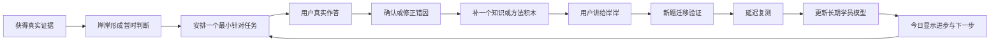

# 岸岸开发路线图（唯一执行小本本）

> 版本：2026-08-14 v4  
> 状态：当前唯一开发顺序与进度入口  
> 产品目标权威：[岸岸 AI 备考教练｜正式产品与系统说明](anan-product-system-spec.md)  
> 机器实施权威：`.product-governance/` 中已冻结且验收通过的具体发布单元  
> 基线：`main@d42761ce4485`；工作区存在大量未提交改动，不能据此宣称已部署或可公测

## 1. 我们到底要做什么

**岸岸是一位用真实学习证据持续形成、验证并修正判断的千人千面 AI 备考教练。**

用户最终只感知一位“岸岸”，不感知学习大脑、错因 Agent、计划 Agent 等后台模块。产品不是题库、
报告、聊天、识图和计划的集合，而是让用户每做一件事，岸岸的下一步真的发生变化。

这条主链是所有开发的北极星：

成绩单、错题、快速诊断、岗位目标、名师题本、图片结构化、方法卡、能力报告和岸岸问答，
都只是向这条主链交付证据或行动的“积木”。任何积木不能独立制造第二套计划、错因、掌握或记忆事实。

## 2. 用户必须感受到的产品承诺

1. **少操作**：安全身份恢复后直接进入今日；资料未填完也能开始真实任务。
2. **强反馈**：做完马上知道岸岸观察到了什么、判断怎样变化、下一步为什么变。
3. **不装懂**：证据不足时说“刚认识你”或“正在验证”，不输出伪精准能力分。
4. **真个性化**：不同证据产生不同任务；新证据会改变判断和计划，不只是生成不同文案。
5. **能证明进步**：看解析、听讲或讲给岸岸只代表学习过程；迁移题和延迟复测才推进掌握。
6. **功能真的能用**：按钮后必须有真实接口、规范写入、下一消费者和失败恢复，不能用兜底文案遮住内部不兼容。
7. **跨考试复用**：教练引擎和通用方法服务国考、省考、事业单位；只把真实存在差异的内容做成范围版本。

## 3. 当前公测前的完成画面

一名新用户和一名老用户都应能完成下面的真实旅程：

“主动导入证据”包括成绩单、错题、岗位目标和名师题本。用户不必先完成这些资料才能学习；
它们是在今日里帮助岸岸更快认识用户的可选入口。

公测不是“所有历史页面都重新设计完”，而是至少一条完整学习主链没有死按钮、契约错位、假成功、
跨用户串数据或无法恢复的失败，并且用户能清楚看见刚才的学习如何改变下一步。

## 4. 已验证到哪里

下面的“已验证”只表示对应冻结发布单元及其受控测试通过，不等于当前代码已部署，也不等于全产品
端到端已经完成。

| 能力                                                       | 当前状态               | 可证明的范围                                                                                    | 仍不能声称                                       |
| ---------------------------------------------------------- | ---------------------- | ----------------------------------------------------------------------------------------------- | ------------------------------------------------ |
| 四种认识路径与跨端契约                                     | 已验证局部闭合         | `RU-FUNCTIONAL-CLOSURE-004` 验收通过                                                            | 四条真实账号旅程全部公测可用                     |
| 快速诊断到初步判断                                         | 已验证数据库与前端投影 | `RU-QUICK-DIAGNOSTIC-CLOSURE-005` 验收通过                                                      | 完整冷启动全部路径已验收                         |
| 错因—反证—今日反馈                                         | 已验证                 | `RU-CAUSE-VERIFICATION-FEEDBACK-006B` 验收通过                                                  | 所有题型、所有页面均完成接线                     |
| 岸岸统一学员上下文                                         | 已验证                 | `RU-LEARNER-COACH-CONTEXT-014A` 验收通过                                                        | 已部署到当前用户环境                             |
| 长期记忆、跨天复测、grounded 讲回                          | 已验证受控实现         | `RU-LEARNER-COACH-COMPLETION-015A` 只读复验通过                                                 | 真实 provider、真机和生产迁移已完成              |
| 低阻塞今日主链                                             | 已验证                 | `RU-CORE-FLOW-DEBURDENING-016` 验收通过                                                         | 合规同意、真机身份和全链弱网已验收               |
| 教练积木统一装配                                           | 已验证                 | `RU-COACH-BRICK-ASSEMBLY-017A` 验收通过                                                         | 每个历史功能都已经接入装配器                     |
| 资料分析及非图推图片证据                                   | 已验证发布与消费契约   | 010～013 系列发布单元及生产证据报告                                                             | 所有图片都已语义结构化；图推已完成               |
| 名师题本安全识别、私有持久化、题级图像匹配、恢复与真实作答 | 已验证到 022           | 018～022 冻结单元；022 的入口、低操作歧义处理、幂等保存、今日任务复用、恢复/删除及 6 类场景通过 | 真实账号教练整链、图推语义结构化和生产部署已验收 |
| 真实默认诊断—错因—资料分析 5 题复测—今日反馈               | 已验证到 023           | 真实测试账号完成 9/10 诊断与 5/5 复测；本地 023 修复和 37 项机器验收通过                        | 当前生产 104 已包含 105～113 的新路由与结算行为  |
| 104→113 迁移与知识图谱发布清单恢复                         | 已验证到 024           | 真实 104 dump 修复后重新导出，并以首错即停模式零错误恢复到第二空库；34 项迁移回归通过           | 生产已经迁移、服务已重启或发布已切换             |
| 全产品公测状态                                             | **未验证**             | 全局治理仍为 `draft`                                                                            | 可公测、生产就绪或已经上线                       |

稳定状态标记：全产品公测状态 | **未验证**。该结论不依赖 Markdown 表格的自动对齐空格。

关键证据位于 `.product-governance/execution/reports/`。最近三个主线通过报告是：

- `4c59b65d1e21ad96.d374549e452cc1bf7b0f.json`：低阻塞主链；
- `1464cf31003191b4.b4ccfbc9299ef62b7c5c.json`：教练积木装配；
- `7584d128ed4b4563.850f14c2153167bf46da.json`：名师题本安全匹配基础。
- `8c0ab677a74d63aa.49537be715a962956720.json`：名师题本小程序产品闭环 022。

021 的冻结快照为 `sha256:85378227e6b8ac5db659a21636dc07ae0d9ddbce86f254ac503e213a72048324`。
它只证明本地可信渲染页能按封存分题坐标产生 questionUnitId 级哈希，并且现有匹配优先消费该题证据；
不代表小程序入口、真实账号整链、图推语义理解或生产部署已完成。

022 的冻结快照为 `sha256:c401517884a532ba5082433c52aa3ffb37e4abb511d33c4a7061fa517322f945`。
它证明“今日我想加练—导入与仅歧义确认—自动保存—复用当前 objective_practice—我的题本恢复/删除”
在冻结范围内完成，并保持原真实作答、错因和岸岸反馈所有权；仍不证明真实账号环境、生产迁移或公测就绪。

## 5. 当前仍缺的关键闭环

1. 默认诊断真实账号链已完成一次真实走查和本地修复验收；题本上传—作答—错因—岸岸—复测真实账号整链仍未验收。
2. 105～113 已通过真实 104 dump 的迁移和二次零错误恢复，但尚未作为同一制品部署到当前生产环境。
3. 教学包消费、长期记忆和讲回能力仍缺部署后真实 provider 与真机联合验收。
4. 省考和事业单位客观题可以复用教练引擎，但仍缺各自明确的内容发布身份和选题证据。
5. 事业编综应不能把国考申论评分结论直接换名字使用，仍需独立 rubric 与内容版本。
6. 隐私、容量、弱网、重放、恢复、真机、横竖屏和平板验收尚未形成完整公测证据。

图推结构化资产暂不作为全局阻断条件。缺少结构证据时仍可显示原题图片、进行真实作答、使用原答案解析；
系统不得伪装成“AI 已理解图形”，也不能让其他题型和整条教练链因此停摆。

## 6. 开发阶段与顺序

### 阶段 A：核心教练地基收口

**状态：已完成若干受控发布单元，等待全链集成验证。**

已覆盖低阻塞进入、真实默认诊断、错因反证、统一学员上下文、长期记忆、讲给岸岸、跨天复测和
教练积木装配。接下来不再横向增加新 Agent、新建议卡或第二套学习状态。

退出条件：这些能力能被后续真实端到端旅程共同消费，而不是只在各自测试中成立。

### 阶段 B：名师题本完整接入

**状态：022 受控实现完成；真实账号退出验收转入阶段 C。**

按以下发布单元顺序推进：

1. **019｜题本持久化与生命周期（已完成受控实现）**  
   题本作为现有私有资料的 `question_book` 类型，只保存来源身份；单题进度由当前识别修订与
   匹配头动态派生，已支持同账号列表/详情、下一道待处理、幂等去重、Markdown 导出和删除传播。
   没有新建题目单元或匹配真相表，也不把题本当成作答或掌握证据。
2. **020｜匹配题进入现有真实练习（已完成受控实现）**  
   当前已确认、内容头未变更且绑定活动知识发布的规范题，会按识别顺序进入现有 `objective_practice`。
   未匹配、歧义、过期或未发布项不阻塞其他可用题；作答、保存、提交和学习事实继续由原 runtime 拥有，并冻结题本来源。
3. **021｜区域级图片匹配（已完成受控实现）**  
   Grok/Gemma 保留已发给识别模型的可信服务端渲染页，识别服务按 prompt 到下一题的稳定纵向边界临时裁剪，
   只持久化归属到 questionUnitId 的区域、源页哈希和现有同族视觉哈希。不保存裁剪字节；重叠、跨页、页缺失或非可信处理器自动无图回退。
4. **022｜用户入口与教练反馈（已完成受控实现）**  
   今日“我想加练 → 导入一本题本”；我的“我的学习资料 → 我的题本”。导入后显示匹配进度、仅处理歧义，
   未匹配题不阻塞已匹配题，保存和开练命令支持不确定结果重放；只复用服务端当前真实行测训练任务及已注册开练路由，
   不新建练习、计划、错因或岸岸状态。组题完成后进入原真实作答链，后续错因、补弱、讲回、迁移和今日反馈仍由原闭环拥有。

退出条件：用户从今日上传一本真实题本，系统找回题库原题，完成一组真实练习，确认错因后看到岸岸下一步改变；
中断后可恢复，删除后相关私有资产按生命周期清理。

### 阶段 C：黄金主链整体验收

**状态：当前阶段。**

022A 的阶段交接语义仍保留为“阶段 C，用真实账号把题本黄金旅程跑穿”：使用真实 PDF/图片题本，
确认一次歧义后进入真实作答与错因确认，随后验证岸岸建议及后续复测，并覆盖中断恢复、跨账号隔离和删除传播。

- 新老用户静默进入今日；
- 无资料用户直接获得真实默认诊断；
- 成绩单、错题、岗位和题本作为可选加速证据；
- 岸岸建议完整表达“观察—判断—今天怎么练—如何验证—错了怎么改”；
- 一次任务完成后，错因、讲回、迁移、复测和下一日计划由同一组规范事实串联；
- 两名证据不同的用户获得不同任务或优先级，新增证据后计划可解释地改变；
- 页面、生成客户端、后端、数据库、内容发布和 AI 场景做联合兼容测试。

退出条件：至少默认诊断、错题导入和题本导入三条真实账号旅程端到端通过；四种认识方式的剩余路径不得出现
死按钮或接口不兼容。稳定复现的 `403/404/409/422/500/503` 必须修根因，不能以“暂不可用”冒充完成。

### 阶段 D：多考试内容发布

**状态：地基可复用，内容身份未闭合。**

- 教练状态机、错因、掌握、讲回和长期模型保持一套；
- 475 张行测/职测方法卡默认跨国考、省考、事业单位复用，只处理明确例外；
- 为国考、省考、事业单位建立各自可追溯的题目/试卷/地区/年度/科目发布身份；
- 先验证客观题共同链路，再为事业编综应建立独立 rubric 和内容版本；
- 不把地区差异做成用户进入前的门禁，选题时由系统内部范围契约处理。

退出条件：每个对用户宣称支持的考试轨道都有真实发布内容、合法来源、可用选题和整链证据；未发布轨道不串库、
不拿别的考试零值或假数据代替。

### 阶段 E：强反馈与交互收口

**状态：核心方向已实现一部分，待全链稳定后统一打磨。**

- 不重画全站；保留紫色渐变图标、极光背景和石墨黑主按钮；
- 今日首屏只保留一个主动作，次要入口收进“我想加练”；
- 任务完成后突出“我看见了什么、哪项判断变化、下一次何时验证”；
- 保留微信右上角工具栏安全区；支持 `<600px` 手机、`>=600px` 平板及横竖屏；
- 动效用于确认状态变化，不用持续动画制造焦虑或遮住操作。

退出条件：核心旅程在手机和平板真机上无需解释即可完成；关键按钮不被遮挡；反馈不伪造分数进步；错因和
真实作答链无回归。

### 阶段 F：公开测试准备

**状态：未开始完整验收。**

- 迁移顺序、兼容性、备份、恢复和回滚演练；
- 身份、同意留痕、跨账号隔离、导出、删除和私有题本数据清理；
- 弱网、超时、重试、幂等、并发、跨日过期和 provider 失败；
- 真实设备、包体、性能、AI 质量与单闭环成本基线；
- 请求、命令、证据、内容版本和模型调用可追踪，但敏感内容不进入日志；
- 体验版/预发布环境完成真实旅程后，才决定公开测试范围。

退出条件：有环境证据支持“可公测”，而不是只有本地测试或页面截图。

## 7. 下一步只做什么

**当前唯一开发焦点：为 023+024 建立一次独立的生产发布门禁，把后端制品与数据库从 104 一致升级到 113。**

发布门必须先生成同一制品、核对其 Alembic 单头和 `learner-coach-context@v2` 路由，创建现场可恢复备份，再按
105～113 单链迁移并验证旧发布清单、活动 v5、核心题库/学习事实计数和服务健康；失败时不得切发布指针。
该门禁通过并获得生产执行授权后，才执行迁移、部署与服务重启。部署后立即用真实账号复跑默认诊断黄金链，随后再跑题本黄金旅程；
任何真实契约断点都修权威链，不增加用户门禁、假成功或第二套兜底。

## 8. 每个功能的存活检查

任何新功能或旧功能修复都必须回答：

1. 它获得了什么新证据？
2. 哪个领域拥有这条规范事实？
3. 它改变了岸岸的哪个判断？
4. 这个判断在 24 小时内改变了什么真实任务？
5. 用户在哪里看见“因为刚才发生了什么，所以现在变成了什么”？
6. 重放、冲突、弱网、中断和失败后如何恢复？
7. 删除或撤回后，原图、转写、AI 载荷、派生判断和索引如何处理？

前五项任一答不上来，这个能力不得作为主链功能上线；它最多只能被标记为内部工具或待接积木。

## 9. 防偏移红线

- 不新增用户可见的第二个教练人格，不新增“大脑建议卡”；统一叫“岸岸建议”。
- 不新造 OCR、题目匹配、真实作答、错因、掌握、计划、长期记忆或复测引擎。
- 不以页面数、接口数、AI 文案数量或 Figma 画板数量作为产品完成度。
- 不用本地缓存替代服务端规范事实；本地只保存草稿、恢复信息和待重放命令。
- 不用灰按钮、资格表单、内容审核状态或内部发布配置阻塞本可安全开始的学习。
- 不把接口不兼容、题量不足、provider 未部署包装成“智能降级”；先修真实链路。
- 不因图推结构化未完成阻塞其他题型；也不伪造图推理解结果。
- 不在核心后端闭环稳定前重做全套 UI；只做支撑当前主链的增量界面。
- 不执行部署、生产迁移或数据写入后就宣称上线；必须另有环境级验收。

## 10. 以后怎样维护这本小本本

每完成一个发布单元，只更新四处：

1. “已验证到哪里”的状态与证据；
2. 当前阶段的退出条件；
3. “下一步只做什么”的唯一焦点；
4. 新发现的阻断、未知和明确不做项。

同一时间只允许一个“当前唯一开发焦点”。如果产品目标、教练主链、事实所有权、隐私边界或考试范围发生变化，
先更新正式产品说明和治理决策，再改本路线图；不能在实现中悄悄改变产品。
