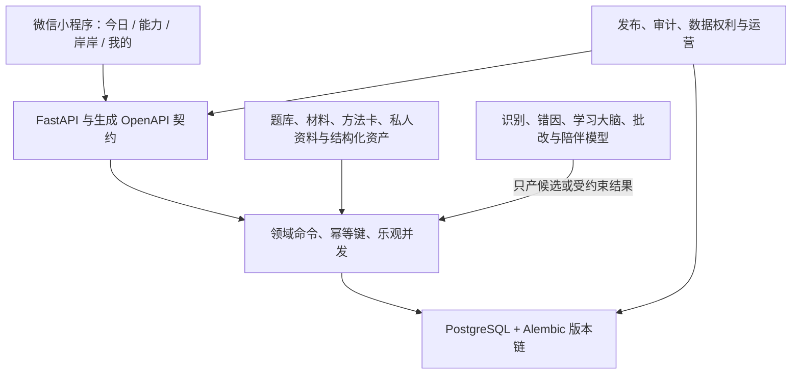

# 岸岸 AI 备考教练｜正式产品与系统说明

> 文档版本：2026-08-14 v1.1  
> 文档状态：当前产品与系统叙事权威  
> 代码审计基线：`main@d42761ce4485`；当前工作区状态以开发路线图和 Git 实际输出为准  
> 适用范围：产品定义、用户闭环、信息架构、领域职责、AI 边界、当前差距与实施顺序

当前阶段、状态和下一发布单元统一维护在
[岸岸开发路线图（唯一执行小本本）](anan-development-roadmap.md)；本文件保持产品目标与系统边界权威，
不重复维护易过期的逐日进度。

## 0. 这份文档解决什么问题

仓库曾同时存在国考、公考、事业编、iOS 古风游戏化、小程序交付版、功能边界、测试计划、
发布单元等多套文档。它们记录了不同阶段的真实思考，但已经不能共同充当当前权威。

本文件重新回答五个问题：

1. 岸岸现在要做成什么产品；
2. 用户真正应该经历怎样的学习闭环；
3. 当前代码已经具备什么、尚未接通什么；
4. 每类事实由哪个领域拥有，AI 可以做什么、不可以做什么；
5. 下一阶段按什么依赖顺序收口，怎样才算完成。

这不是上线完成报告，也不把工作区里尚未验收的代码写成已交付能力。

### 0.1 事实标签

本文使用以下标签，避免把愿景和现状混在一起：

- **已确认目标**：产品负责人在当前讨论中明确决定的产品方向。
- **治理决策**：`.product-governance/` 中已有接受或冻结记录的约束。
- **代码观察**：可以从当前代码、迁移、路由、测试或配置直接验证的事实。
- **目标设计**：为实现已确认目标形成的正式目标态；尚不代表代码已实现。
- **待确认**：缺少产品决定、外部规则或可靠证据，实施前必须补齐。
- **历史材料**：只解释来源，不再约束当前产品。

### 0.2 权威顺序

发生冲突时按以下顺序处理：

1. 用户最新明确决定；
2. 适用法律、平台政策和数据授权；
3. 已接受或冻结且未被取代的治理决策；
4. 当前代码、数据库迁移、生成契约和可重复测试；
5. 本文件中的目标设计；
6. 历史归档与推断。

`.product-governance/` 目前只覆盖前端生命周期、陪伴记忆、结构化图形等局部发布单元，
状态仍是 `draft`，不能被解释为完整产品架构已经冻结。本文件负责完整叙事入口；
机器可执行契约仍必须在相应发布单元冻结后才获得实施权威。

---

## 1. 产品定义

### 1.1 一句话定义

**岸岸是一位用真实学习证据持续形成、验证并修正判断的千人千面 AI 备考教练。**

它的价值不是把题库、报告、聊天和计划堆在一起，而是让用户每完成一次真实学习行为，
下一步训练都会发生有依据、可解释、可验证的变化。

### 1.2 当前目标用户与考试范围

**已确认目标：**

- 产品不绑定单一考试；同一教练闭环必须能承载国考、省考和事业单位考试；
- 当前已有产品语义和内容地基以国考为主，因此首个可验收内容轨道仍是国考行测；
- 省考和事业单位不复制教练代码，而是通过精确的考试项目、地区、年度、类别、科目和内容发布版本接入；
- 用户当前可以把事业编作为个人优先备考方向，但不把平台基础模型收缩成“事业编专用”；
- 地区可能为新疆，也可能变化；地区必须是可配置的证据范围，不能写死为一套永恒相同的规则；
- 用户焦虑、需要快速反馈，不应假设其天然具备长期主义。

**代码观察：**

当前代码仍以“国考、行测、申论”为主要语义，岗位、建档、周模考、救援训练、申论评分
和内容发布中存在国考硬编码。因此，国考是现有地基；其中行测/职测通用方法和同微技能题目可直接复用到
省考与事业单位，只有明确存在考试差异的内容才需要单独配置或排除。

### 1.3 产品承诺

岸岸应向用户稳定兑现四件事：

1. **看见我**：知道我刚才怎么做，而不只知道对错；
2. **判断我**：提出有证据、带置信边界的暂时判断；
3. **带我练**：把判断转成今天一个足够小、足够明确的行动；
4. **证明我进步**：用迁移题和延迟复测验证，而不是用“看过解析”假装掌握。

### 1.4 当前非目标

- 不增加新的用户可见 Agent 人格；
- 不再以“功能中心”思路继续堆独立入口；
- 不把十几道快速诊断包装成完整能力测评；
- 不以连续打卡、积分或宏大计划替代真实学习证据；
- 不在没有考试范围、内容版本和授权证据时声称覆盖某地区；
- 不为了新闭环重画全部前端，也不移除已确认保留的紫色渐变图标和极光背景。

---

## 2. 岸岸的产品原则

### 2.1 用户只感知一位教练

用户只认识“岸岸”。计划引擎、错因识别、学习大脑、能力估计、结构化识别、评分与检索
都是后台能力，不是四个平级人格，也不各自向用户争夺解释权。

岸岸负责把后台能力组织成一句用户能理解的话：

> 因为刚才发生了什么，我现在怎么判断，所以今天先做什么；做完后我会用什么验证，
> 如果判断错了又会怎么改。

### 2.2 先有证据，再有结论

没有真实作答、成绩单、错题或诊断证据时，岸岸只能明确说“刚认识你”。能力分、错因和
计划建议必须能够回指证据；证据不足时展示缺口和下一步，不制造小数点式伪精准。

### 2.3 AI 先产候选，规范事实由领域拥有

AI 可以提出错因候选、策略候选、批改建议、追问和解释；不得直接改写能力、掌握、任务
完成、资格、岗位或付费权益等规范事实。需要用户确认、确定性规则或领域命令的环节必须
显式经过对应所有者。

### 2.4 完成、理解和掌握是三件事

- **完成**：完成了一次规定动作；
- **理解**：能说清核心规则、步骤和适用边界；
- **掌握**：能在新题和延迟复测中稳定迁移。

看完解析、点击“懂了”、向 AI 复述一次，都不能直接把掌握状态写成稳定掌握。

### 2.5 用短反馈对抗焦虑

用户首先需要的是“我今天做什么、做完得到了什么、明天会怎么变”，而不是一份宏大的
长期计划。第一日应在约 15～25 分钟内形成第一次真实闭环；日常任务也要尽快反馈可见
变化，再把这些变化积累成长期能力。

### 2.6 每个功能都必须把结果交给下一环

一个功能只有同时回答以下问题才算活着：

1. 它获得了什么新证据；
2. 它改变了岸岸的哪个判断；
3. 这个判断在 24 小时内改变了什么任务；
4. 用户在哪里看见“因为刚才发生了什么，所以现在变成了什么”。

缺少任一项，功能只能算工具或展示页，不能算教练闭环的一部分。

---

## 3. 完整学习闭环

这条链是产品主链。成绩单、拍照识题、错因识别、结构化图形、题库、计划、能力报告、
岸岸问答和费曼讲解都只能作为某个环节的能力存在。

### 3.1 认识层级

岸岸对用户的认识分四级：

| 层级         | 允许使用的表述                 | 最低证据                     |
| ------------ | ------------------------------ | ---------------------------- |
| 刚认识你     | “我先从这里了解你”             | 目标、时间或自报情况         |
| 形成初步判断 | “目前更像是……”                 | 至少一次真实学习或导入证据   |
| 正在验证     | “我安排了训练来确认”           | 判断已转成针对任务，等待验证 |
| 比较了解你   | “多次练习和复测都支持这个判断” | 跨场景或跨时间的重复证据     |

任何页面都不得在“刚认识你”阶段显示看似精确的完整能力画像。

### 3.2 判断的统一表达

“岸岸建议”是唯一的教练建议容器，不新增“大脑建议卡”等平行概念。完整结构为：

1. 我观察到了什么；
2. 我暂时怎么判断；
3. 今天因此怎么练；
4. 练完用什么验证；
5. 如果判断错了怎么改。

判断必须带证据范围和不确定性。用户可以确认、否定或补充，修正应进入下一轮计划依据。

### 3.3 做错后的补弱闭环

职测题的目标流程：

1. 保存答案、用时、把握度、修改、草稿/标注等动作证据；
2. 生成错因候选，用户确认或纠正；
3. 定位知识点或方法卡；
4. 进行最小补弱学习；
5. 用户向岸岸讲清“规则—步骤—边界—易错点”；
6. 岸岸只追问缺失部分和反例，不代替用户讲完整答案；
7. 立即给一道新情境迁移题；
8. 在后续计划中安排延迟复测；
9. 依据迁移和复测结果更新掌握状态。

### 3.4 费曼讲给岸岸

“把 AI 教会”不是一个孤立的新功能，也不是新增第五个 Agent。它是补弱学习和迁移验证
之间的理解检查器。

岸岸的评估维度应至少包含：

- 核心规则是否正确；
- 解题步骤是否完整且有顺序；
- 适用条件和不适用边界是否清楚；
- 是否能指出常见误区或反例；
- 是否只是复述原解析。

结构化视觉证据必须按受众隔离：题干、材料与选项证据可进入学生岸岸；解析与解法图片只进入 verifier。2026-08-13 已发布当前 `original_analysis` 可证明身份的 31,996 份解析媒体证据和 71,331 条题目绑定，其中公式 30,572、原图来源证据 1,410、已有结构实图 14；19,248 份错版、非活动或质量不闭合候选继续隔离。这里的发布是生产证据层，不代表真实用户费曼会话或 provider 已启用。

语音可以作为输入方式，但首次实现可以先以文字为主。无论输入形式如何，讲解原文、
转写、评分、保留期限、删除与导出范围都必须进入数据生命周期设计。

---

## 4. 冷启动与首次惊艳时刻

### 4.1 身份进入

**已确认目标：**用户进入小程序后完成无感身份恢复；老用户直接进入“今日”，新用户进入
第一次教练会谈并选择岸岸获取第一份证据的方式。四种方式必须分别接到真实证据任务和后续
教练闭环，不能只是按钮、页面或旧建档流程的别名。

**实施边界：**“无感”指尽量消除重复身份操作，不等于绕过微信平台要求、隐私披露或
合法同意。当前工作区的静默登录代码仍需结合真实平台政策、服务端同意留痕和真机流程
验收，不能仅凭页面自动发起登录就宣称合规闭环完成。

### 4.2 新用户第一问

首屏询问：

> 你想让岸岸怎么认识你？

提供四条路径：

| 路径                     | 获得的最低证据             | 第一动作                             |
| ------------------------ | -------------------------- | ------------------------------------ |
| 导入最近成绩单           | 模块成绩、考试范围、时间   | 找到最需要验证的分差或弱项           |
| 导入几道错题             | 题目、当时答案和补充行为   | 生成错因候选并给同类验证题           |
| 做一次约 20 分钟快速诊断 | 少量锚点题的过程证据       | 决定先从哪里开始，不生成完整能力结论 |
| 我还没选岗               | 资格、地区、目标和可用时间 | 先形成目标区间与学习方向             |

资格、地区和学习偏好按所选路径渐进补全，不在进入时一次性索取全部档案。每条路径都必须
把获得的证据交给岸岸判断、针对任务和验证，不能在导入或填写完成后重新掉回无关的旧流程。

### 4.3 第一日黄金链路

惊艳时刻不是生成一张漂亮的长期计划，而是用户第一次练习后看到：岸岸识别了他“为什么
这样做”，紧接着给出一道能验证该判断的题，并根据结果真的改变下一步。

---

## 5. 日常产品体验

### 5.1 四个主 Tab

当前小程序注册四个主 Tab，目标职责如下：

| Tab  | 唯一职责                                   | 不应承担                     |
| ---- | ------------------------------------------ | ---------------------------- |
| 今日 | 告诉用户现在做什么，并完成当天最短闭环     | 堆满所有统计、入口和运营位   |
| 能力 | 展示被证据支持的能力、错因和掌握变化       | 只展示静态分数，不产生行动   |
| 岸岸 | 解释判断、接收补充、完成教练会谈和讲给岸岸 | 只做通用聊天，不影响后续行为 |
| 我的 | 目标、资格、学习设置、数据权利和账户       | 复制学习功能中心             |

### 5.2 今日页

今日页继续沿用现有视觉和页面结构，只升级现有“岸岸建议”与任务反馈，不重画整页。

首屏优先级：

1. 微信状态栏和右上角原生小程序工具栏安全区；
2. 当前阶段和一句可信的岸岸判断；
3. 一个明确主任务，主按钮使用已确认的石墨黑样式；
4. 完成后的即时反馈和下一步；
5. 次要任务、周节奏和查看更多。

紫色渐变图标、极光背景和 AI 身份可以保留，但不应让每张卡片都变成高饱和视觉中心。
整体节奏可借鉴扇贝的清爽留白、强主动作和少量情绪反馈，不复制其业务结构或素材。

### 5.3 焦虑反馈模型

每次任务结束至少给出三层反馈：

- **立即反馈**：这一步完成了什么、哪里变好了；
- **判断反馈**：原假设被支持、被削弱还是仍待验证；
- **未来反馈**：下一次何时复测，今天是否需要继续。

打卡和连续天数可以是轻量陪伴反馈，但不能成为学习成功的主要证据。

### 5.4 响应式与设备边界

已接受的断点：

- 紧凑布局：宽度 `< 600px`；
- 中等/平板布局：宽度 `>= 600px` 且 `< 1024px`；
- 宽屏布局：宽度 `>= 1024px`。

页面需支持横竖屏、可调整窗口和原生胶囊安全区。平板不应只是把手机卡片横向拉宽；做题、
材料阅读和批注场景应使用主内容/辅助内容的自适应布局，并在旋转后重新计算批注坐标。

### 5.5 名师题本与私人加练

用户可以上传名师题本、讲义中的练习页或连续照片。产品目标不是把每道题重新完整 OCR 成一套
私人题库，而是先分题，再使用题干文字、选项特征和逐题图片证据找回现有规范题库中的原题。

入口保持克制：今日页“我想加练 → 导入一本题本”负责开始学习；“我的 → 我的学习资料 → 我的题本”
负责继续处理、查看和删除。高置信匹配自动采用，只有歧义项批量确认；未匹配题保留原图和私人记录，
不得串到错误的规范题目。

匹配确认后的规范题目必须进入现有真实作答、错因、补弱、讲给岸岸、迁移、复测和今日反馈链，
不得新建第二套练习系统。图片题必须使用当前题的区域级视觉证据；无法确定区域时安全退回文字匹配，
不得把整页或整本题本的视觉指纹复制给每道题。

---

## 6. 当前代码地图

### 6.1 规模快照

以下是 2026-08-12 对当前工作区的机械盘点，只用于描述规模：

| 项目                                 |                             观察值 |
| ------------------------------------ | ---------------------------------: |
| 微信小程序注册页面                   |       61（主包 5，15 个分包共 56） |
| 后端 OpenAPI 路径                    |                                246 |
| 后端一级业务域目录                   |                                 49 |
| Alembic 迁移文件                     | 107，当前最新文件为 `20260810_106` |
| 后端 `test_*.py` 文件                |                                235 |
| 小程序匹配到的 TS/MJS test/spec 文件 |                                197 |

数量不代表页面可用、业务闭环完成、测试全绿或已经发布。

### 6.2 运行结构

### 6.3 当前主要能力簇

| 能力簇         | 当前代码观察                                                    | 与目标态的主要差距                                           |
| -------------- | --------------------------------------------------------------- | ------------------------------------------------------------ |
| 身份与建档     | 微信会话、v2 onboarding、资格、偏好和能力起点已存在             | 四种认识路径尚未端到端接入；同意留痕存在断点                 |
| 岗位与目标     | 岗位检索、资格和目标分差链路较完整                              | 语义和数据面以国考为主，事业编地区发布契约未建立             |
| 今日计划       | 日容量、候选、任务版本、执行事实和重排已存在                    | “岸岸建议”闭环主要是前端投影；多个入口尚未统一成一条证据链   |
| 职测地基       | 真实作答、检查点、交卷、评估、复盘、错因、掌握和复测已存在      | 仍以 `xingce`/国考口径建模；救援训练只到方法卡与相似题预览   |
| 综应地基       | 材料阅读、找点、提纲、作答、评阅、重写和迁移链路已存在          | 当前评分与发布编译器是国考申论专用，不能直接视为综应实现     |
| 证据导入       | 成绩、外部作答、拍照识题、OCR、私人资料、图题结构化已有多套能力 | 部分路径只完成识别或展示，未稳定改变岸岸判断和任务           |
| 能力与学习大脑 | 能力版本、证据引用、策略候选和用户确认存在                      | 用户可见解释与计划变化尚未形成稳定闭环；治理发布单元验证失败 |
| 岸岸与记忆     | 陪伴问答、授权内容、短期和显式长期记忆能力存在                  | 问答对教练行为的影响必须通过领域命令，不能直接写学习事实     |
| 商业与数据权利 | 商品、权益、配额、导出和删除域存在                              | 当前冷启动应保持免费；付费边界和生产恢复仍待决策             |

---

## 7. 领域所有权与不可破坏的边界

“一位岸岸”不等于“一个大模型拥有全部数据”。每类规范事实只能有一个所有者。

| 规范事实                 | 唯一所有者                     | 其他能力如何使用                           |
| ------------------------ | ------------------------------ | ------------------------------------------ |
| 身份、会话和账户状态     | Auth / Data Rights             | 页面只能读取投影；删除由数据权利流程编排   |
| 资格和地区偏好           | Qualification / Onboarding     | 岗位、计划读取版本，不复制第二份资格真相   |
| 岗位发布与目标证据       | Positions / Position Decision  | 学习计划消费目标差距，不推断录取概率       |
| 每日计划、任务和执行投影 | Planning                       | 职测、综应、模考通过所有者命令写完成证据   |
| 职测作答过程与题级评估   | Xingce Learning / Task Runtime | 错因和能力引用不可变 evidence ref          |
| 综应学习产物与评阅       | Essay Intelligence             | 计划只读取阶段和权威完成事实               |
| 用户确认的错因           | 对应学习/错因决策域            | AI 只提供候选；确认后才进入掌握和计划      |
| 掌握与复测状态           | 对应学习掌握域                 | 报告和计划读取，不以页面本地状态覆盖       |
| 能力估计版本             | Ability / Calibration          | 学习大脑聚合解释，不另造能力分             |
| 策略候选和接受决定       | Learning Brain                 | 仅接受后的决定可影响计划                   |
| 岸岸显式长期记忆         | Companion Memory               | 不自动抽取分数、错因、资格或计划为聊天记忆 |
| 内容发布和版本           | Knowledge / Content Release    | AI 和练习必须引用批准的版本与授权范围      |
| 商品、权益与配额         | Commerce                       | AI 调用和 UI 只消费结果，不自行扣减        |

跨域更新应通过版本化命令、不可变引用和 outbox/事件完成。页面本地存储可以保存草稿、
待重放命令或纯展示状态，不能成为计划、能力、错因或掌握的第二真相。

---

## 8. AI 能力边界

### 8.1 后台能力，不是用户人格

| AI 场景         | 可以产生                          | 不得直接产生                     |
| --------------- | --------------------------------- | -------------------------------- |
| 图片/题目结构化 | OCR、版面、图形元素和题目候选结构 | 未经校验的规范题目版本           |
| 错因识别        | 候选错因、证据摘要、待追问项      | 用户已确认错因、掌握状态         |
| 学习大脑        | 策略候选、优先级解释              | 未确认的永久策略或计划事实       |
| 综应/申论评阅   | 受材料和 rubric 约束的评阅候选    | 无引用依据的分数与事实断言       |
| 岸岸问答        | 解释、追问、建议、授权内容引用    | 资格、能力、计划、权益的直接写入 |
| 费曼讲解评估    | 漏项、边界、反例和迁移题建议      | “稳定掌握”的直接判定             |

### 8.2 AI 输出的最低要求

- 输出绑定用户、场景、模型/提示版本和输入证据版本；
- 结构化输出必须通过 schema 和确定性校验；
- 外部 provider 超时和不确定结果按 fail-closed 处理；
- 不足以支持结论时返回未知或需要补证，不编造；
- 用户可以查看关键依据、纠正候选并触发重新判断；
- 成本、延迟、质量、数据保留和人工处理阈值必须有内部发布检查，不得直接变成核心学习硬堵塞。

### 8.3 陪伴记忆与长期学员模型

岸岸的“长期记忆”不是一张保存所有聊天和 AI 总结的大表，而是两类权威数据在当前场景下形成的
统一只读学员模型：

| 类型 | 权威所有者 | 能否直接修改 | 如何影响岸岸 |
| --- | --- | --- | --- |
| 用户主动告诉岸岸的讲解偏好与个人备注 | Companion Memory | 用户可查看、修改、删除和停用 | 只调整表达方式与非高影响建议 |
| 目标、学习时间和岗位 | Onboarding / Position / Planning | 通过对应设置或预览确认命令修改 | 改变计划范围、容量和目标分差 |
| 真实作答、错因、掌握、能力和策略 | 各学习域 / Learning Brain | 不允许改文本；通过证据争议、错因确认、迁移题和复测修正 | 改变判断、选题、复测和岸岸建议 |
| 两小时连续对话 | Companion Short-term | 可随时清空，到期自动删除 | 只用于接住连续追问 |

因此不得再新增一套 `learner_memory_facts` 去复制成绩、错因、能力或掌握。首版新增的是
`learner-coach-context@v1` 只读编译契约，而不是新的事实所有者。它在每次今日页、岸岸问答或复盘场景中，
从当前业务版本组装：

- 当前认识层级与新鲜度；
- 用户明确偏好；
- 与当前任务相关的目标、能力假设、错误模式、掌握和复测状态；
- 每个判断的证据引用、置信等级、适用范围与待验证动作；
- 该判断已经影响的建议、计划版本或任务；
- 允许用户采取的修正动作。

这个上下文不长期保存自然语言结论，缓存失效后可以从规范事实重建。AI 输出仍是候选；Learning Brain、
掌握度、计划等领域继续决定什么能成为事实。向模型发送的每条长期上下文都必须保留 `owner + entityId +
versionId`，进入现有 retrieval bundle / model-call audit，不能像普通 prompt 文本一样无来源注入。

当前实现状态必须分开描述：

- Learning Brain 已经拥有版本化画像、能力、错误模式、相反证据、策略候选和证据引用，Companion 也已能读取
  学习画像和授权页面上下文；
- 本地工作区已经实现用户显式长期记忆、两小时短期会话、管理页和数据权利处理；
- 2026-08-13 对生产服务的只读核验显示 Learning Brain 路由已上线，但三张 Companion Memory 表和
  `/api/v2/companion/memories` 尚未上线，不能把本地页面描述成用户当前可用；
- 当前显式记忆在 retrieval bundle 形成后才附加到 provider payload，缺少逐条选择与使用审计；这个接线在
  正式部署前必须修复。

“学习约束”不能继续只是一段文本记忆。用户写“工作日只能学一小时”时，系统必须把它作为待确认命令，
跳转或生成 `weekly_study_preference` / `daily_capacity` 预览；只有用户确认后才改变计划。拒绝或未确认时可以
保留为备注，但界面必须明确“尚未改变学习安排”。相同原则适用于考试目标、地区和岗位。

现有“岸岸的记忆”页面升级为“岸岸对我的了解”，保留原视觉，不新增主导航：

1. **我告诉岸岸的**：讲解偏好和个人备注，可编辑、删除和停止用于回答；
2. **岸岸从学习中发现的**：只读展示“初步判断 / 正在验证 / 比较了解”、证据数量、新鲜度、影响了什么以及
   下一次如何验证；
3. 学习判断提供“查看依据”“这不准确”“重新验证”，但不提供直接改能力分或掌握状态的文本编辑；
4. “这不准确”必须进入对应领域的争议、补充证据或复测命令，不得删除历史证据或直接覆盖当前事实。

现有 `20` 条显式记忆硬上限不作为正式产品门禁。上线前应允许继续保存，并由场景相关性决定本次注入哪些
偏好；上下文预算是内部模型成本控制，不能变成用户第 21 次保存时的无效 `409`。用户关闭显式记忆只停止
主动偏好进入回答，不关闭完成核心教练功能所需的学习事实；如果以后提供“停止个性化教练”，必须作为独立
隐私决策和数据生命周期处理。

首个闭合发布单元按以下顺序推进：

1. 修正显式记忆契约：去掉硬数量门禁，补充稳定 `memoryId + revision` 来源引用和检索审计；
2. 建立 `learner-coach-context@v1` 只读编译器，让今日页与岸岸问答读取同一份当前认识；
3. 把学习约束接入现有周偏好/今日容量的预览确认命令，不允许“记住了但计划没变”；
4. 升级现有记忆页为双区展示，并把纠正动作路由到真实领域；
5. 在迁移和回滚演练后随正常应用版本部署 Companion Memory 表、API、生成客户端和页面；
6. 用真实错因确认、一次迁移题和一次延迟复测验收“判断形成—任务改变—用户看见—判断修正”。

首版不引入外部 Memory 框架或向量数据库。现有 PostgreSQL 版本事实、授权检索与审计链足以跑通闭环；只有
当显式偏好和历史证据规模使当前检索无法满足经过测量的质量、延迟或成本目标时，TencentDB Agent Memory
之类的组件才可作为检索索引，不能成为事实所有者。

### 8.4 “讲给岸岸”的教学包内部防线

**已确认问题：**没有可靠知识依据的 AI 不得评价用户讲解，否则会把模型自身知识和推理
能力错误地当成人类学习标准。

**目标方案，首个纯编译发布单元已进入冻结校验：**每次 teach-back 只围绕一个微技能编译版本化教学包，
至少带有当前备考目标、原题内容版本、非空答案/解析、通用方法与边界、常见误区
以及独立迁移题。模型只能依据该包输出“有依据、遗漏、冲突、无法判断”的候选，并为每条
判断提供 evidence ref。

教学包不足时必须在会话开始前无感降级：有部分依据则帮助梳理但不判掌握；只有私有材料则
整理用户表达；范围冲突或内容失效则改做已验证任务。任何等级下，讲解本身最多产生“理解
待验证”，只有迁移题和延迟复测可以推进掌握。

用户侧的岸岸应扮演“对本轮微技能没有预先解法、只认真听用户讲”的学生：先用自己的话
复现用户实际讲出的步骤，再严格按这套步骤尝试新题，缺步骤就停下并只追问一个关键问题。
为防模型偷用已有知识补全，学生复现和教学包核验必须是两个隔离上下文；答案键和标准方法
不得进入学生层。后台综合复现忠实度、教学包依据和迁移结果形成候选判断。

该能力不新建“费曼学习”专区。首发只升级职测复盘完成态中现有的错题救援卡，链路固定为
“确认错因 → 补一个微技能 → 讲给岸岸 → 岸岸盲复现并尝试题 A → 后台核验 → 用户独立做
题 B → 现有掌握/复测 → 今日岸岸建议反馈”。题 A 与题 B 必须是两道不同且未曝光的题；
岸岸做对题 A 只证明用户讲法可执行，不能提高用户掌握度。只有用户对题 B 的真实作答和后续
延迟复测能够推进现有掌握状态。

当前错题救援会把同类题答案与解析一并下发并在复盘页标出正确选项，这只能作为答后展示，
不得复用为 teach-back 验证契约。教学包已拆成服务端答案上下文与学生岸岸安全题面，并让内容、
teach-back 证据与现有掌握状态所有者保持分离。

### 8.5 题目图片结构化证据桥

2026-08-13 桥接单元已从资料分析图表扩展到图推之外的题面图片与公式图。它不改动已冻结的
`multi-exam-teaching-package@v2`，而是为它附加版本化结构证据侧挂契约。任何图片证据都只有同时
满足以下条件才能进入教学包：

- `reviewState=verified`，或公式通过确定性品质门槛并保留 `machine_verified` 身份；
- `questionRef` 精确匹配当前题；
- `contentVersionId` 精确匹配当前不可变题目版本；
- `sourceAssetSha256` 存在于该版本声明的图片哈希集合。

缺证据、候选、待复核、错版、错图或重复绑定都在调用 AI 前返回稳定失败码，不生成半个教学包。
学生岸岸只收到题干、材料和选项中的逐字结构化事实；答案、解析、方法以及解析图片只能进入物理隔离的后台
核验上下文。运行时的 `question_assets.part_kind` 是受众权威：题面资产为 `student + verifier`，解析/解法/答案资产只能
为 `verifier`。后台每条结论只能引用当前包的方法步骤、答案或媒体事实白名单，任一越界引用使整个候选不可展示。

这个单元已证明“结构化证据 → 教学包 → 学生岸岸 → 后台核验”契约可行。2026-08-13 的生产发布结果为：
资料分析 1,485 份证据 / 8,478 条绑定；图推之外普通题面图 1,352 份证据 / 1,873 条绑定；题面公式图
5,440 份证据 / 21,425 条绑定；解析侧另有 30,572 份公式证据、14 份已结构化实图证据和 1,410 份原图来源证据，
合计形成 71,331 条 verifier-only 绑定。`source_image` 只证明原解析图片身份可追溯，并不表示语义已经结构化。
生产数据已生效，但教学包、学生岸岸和 provider 消费代码尚未随应用版本部署启用；下一个单元是按正常后端发布流程部署消费代码，
再接入真实复盘、迁移题与延迟复测会话。解析图片不得伪装成题面资产，也不得在未结构化时宣称 AI 已理解。

完整研究与实施建议见
[岸岸教学包与 grounded teach-back 研究方案](../research/2026-08-12-anan-teaching-pack-grounding-study.md)。

### 8.6 全局运行状态

任何读取远端事实或执行命令的正式页面，都必须设计并验证以下适用状态，不能只实现成功态：

- 首次加载、刷新和后台恢复；
- 有内容、真实空状态和证据不足；
- 可重试网络失败、不可重试业务失败和 provider 降级；
- 身份过期、权限不足、权益不足和账户待删除；
- 幂等重放、版本冲突和命令结果不确定；
- 弱网、离线草稿、恢复中和跨日过期；
- 内容版本撤回、考试范围不匹配和视觉资产不可用。

页面不得用假数据填补空状态，也不得把本地成功动画当作服务端命令已经完成。

### 8.7 非功能要求

| 维度     | 正式要求                                                       | 尚待冻结的指标                      |
| -------- | -------------------------------------------------------------- | ----------------------------------- |
| 安全     | secret 仅在服务端；对象归属、权限、内容和 PII 出口 fail-closed | 威胁模型、渗透和密钥轮换周期        |
| 隐私     | 明确用途、最小收集、同意留痕、可导出/删除、AI 数据保留可解释   | 各类语音、转写、原图和模型日志期限  |
| 一致性   | 规范事实单所有者；写命令幂等、版本化；跨域有可恢复事件         | 各链路恢复时间与对账频率            |
| 可用性   | provider 失败不制造假结果；关键学习草稿可恢复                  | 端到端 SLO、降级层级和人工响应时间  |
| 性能     | 首屏和主任务优先；平板不重复加载大材料；AI 调用可取消/续查     | 设备分层的 P95 时延、包体和内存预算 |
| 可观察性 | 请求、命令、证据、模型和内容版本可追踪，敏感内容不进日志       | 告警阈值、看板和审计抽样周期        |
| 可访问性 | 文字层级、对比度、触控面积、动态字体与动效降级可用             | 首批真机矩阵与无障碍验收基线        |
| 可恢复性 | 迁移向前兼容；发布制品不可变；备份、回滚和演练有证据           | RPO、RTO 和演练频率                 |

具体数值不得从旧报告或行业惯例直接复制；需先采集当前基线，再在发布单元中冻结。

---

## 9. 当前最重要的断点

### 9.1 国考地基与多考试目标不一致

代码和内容发布仍以国考行测/申论为主，目标则是同一教练引擎支持国考、省考和事业单位。
其中客观题方法和微技能大量通用，应默认复用；只对报考规则、时政常识、题型时间分配、主观题 rubric 等
实际存在差异的内容建立范围版本，不为每个省份和年度重复审批通用方法。

### 9.2 黄金闭环尚未验收

当前未提交工作区中已经出现静默入口、四种认识路径、今日教练反馈和学习大脑确认等代码，
但相关黄金闭环发布单元多次验证失败。因此它们属于“代码存在、等待修复和验收”，不能写成
“问题已解决”或“已经上线”。

### 9.3 冷启动仍有本地第二状态

当前四路径意图和部分今日反馈依赖小程序本地存储；路径分发也没有全部落到各自真正的第一
证据任务。它可以作为 UI 恢复机制，但不能成为岸岸认识层级的规范事实。

### 9.4 救援训练半闭环

现有救援服务能从确认错因找到知识点、方法卡和相似题，但前端主要停留在预览，甚至可能在
真正练习前展示答案和解析。它尚未完成“学—讲—追问—迁移—延迟复测”。

### 9.5 综应尚未被建模

现有 Essay Intelligence 很强，但生产 rubric 编译器明确按国考申论任务筛选。事业编综应的
题型、评分维度、材料任务和发布流程尚未形成独立版本契约。

### 9.6 功能很多，证据交接不足

图片结构化、私人资料、能力报告、岗位、问答、社区方法卡等能力已经存在，但部分结果没有
稳定交给岸岸判断、计划和验证，因此呈现为“半死不活”。后续不以增加页面为进度，而以打通
证据交接为进度。

### 9.7 发布与运维不能从旧报告继承结论

根目录旧说明曾宣称 iOS、古风师爷、生产部署和多个功能全部完成，与当前小程序产品不一致。
本次审计未执行生产部署验证，也没有把工作区 75 项未提交变更视为发布候选。

### 9.8 可见功能没有端到端验收

当前页面、接口、内容和 AI 能力数量很多，但局部测试与页面存在不能证明功能有用。四种认识
路径、今日任务、错因、结构化图片和岸岸问答都存在跨页面、生成客户端、后端契约、权限/
release、规范写入与下一消费者不一致的风险。稳定复现的接口不兼容、路由对不上或审核配置
不匹配属于集成缺陷，必须在发布前修通原功能；不得等用户点击后用“暂不可用”或无关兜底
掩盖。完整代码事实和修复顺序见
[微信小程序功能闭环与兼容性审计](../../reports/2026-08-12-wechat-gate-audit.md)。

---

## 10. 实施顺序

本节描述宏观依赖顺序；逐日状态、当前唯一焦点和下一发布单元以
[开发路线图](anan-development-roadmap.md)为准。

### P0：建立唯一权威并稳定工作区

- 本文件成为产品与系统叙事入口；
- 旧产品文档迁入历史归档；
- 根 README、后端 README、设计规范和工程手册不再引用旧产品边界；
- 盘点并拆分当前 75 项未提交改动，逐发布单元恢复可重复验证；
- 不在脏工作区上继续叠加新产品功能。

### P1：建立多考试范围地基

- 定义 `exam_scope`、地区、年度、考试类别、科目、题型和内容发布版本；
- 直接复用现有 475 张行测方法卡，其历史 `draft/tested_count/reviewer` 字段不作为教学包阻断条件；
- 国考、省考和事业单位共用客观题方法和同微技能题目，不修改教练闭环代码；
- 只对明确的考试差异增加排除或专用内容，不设逐地区、年份的方法审批门槛；
- 题目编译只保留未曝光、去重、微技能匹配和答案解析完整性检查。

### P2：验收新用户黄金链路

- 静默身份恢复与合规同意留痕闭环；
- 四条认识路径分别接到真实证据任务，不互相冒充或掉回无关建档流程；
- 认识层级和证据引用落服务端规范事实；
- 首次判断、一个针对任务、当场验证、次日复测形成可重复端到端用例；
- 页面、生成客户端、后端、题库/图片和 AI 权限/release 在发布前完成联合兼容验证；
- 稳定复现的 403/404/409/422/500/503 一律视为集成缺陷，不以降级文案冒充交付；
- 只升级现有今日页和岸岸建议，不重画全站。

### P3：完成职测补弱与讲给岸岸

- 已完成轻量教学包编译器、学生岸岸/provider 隔离影子契约与题目媒体证据生产发布；尚未随应用版本部署消费代码，也尚未接真实 provider、会话或复盘页；
- 修正救援训练，答案和解析按阶段披露；
- 接入讲解、岸岸追问、理解评估、迁移题和延迟复测；
- 讲解评估不能越权写掌握；
- 迁移和延迟复测结果真正改变计划与能力投影。

### P4：把 Essay Intelligence 适配为综应

- 以事业编综应内容和 rubric 版本为入口，不直接复用国考申论结论；
- 验证材料阅读、找点、提纲、作答、评阅、重写和迁移在综应题型下的适用性；
- 岸岸统一解释职测与综应的资源分配，不出现两个教练。

### P5：公开测试与生产检查

- 全链自动验证、真机、横竖平板、弱网和恢复测试通过；
- 数据版本、迁移、备份、回滚、provider 和内容发布检查通过；
- 隐私同意、导出、删除和 AI 数据保留完成审计；
- 只有带环境证据的版本才能宣称“已部署”“可公测”或“已上线”。

---

## 11. 完成定义

### 11.1 一个功能完成

必须同时具备：

- 明确的用户问题和入口；
- 确定的规范事实所有者；
- 成功、空、加载、失败、权限、冲突和恢复状态；
- 幂等、并发、版本和数据生命周期约束；
- 能改变下一个学习动作的证据交接；
- 用户看得见的因果反馈；
- 自动测试和必要的真机/人工证据；
- 回滚或安全降级路径。

### 11.2 黄金链路完成

至少用四类新用户分别跑通“选择认识方式—真实证据—初步判断—针对任务—练后反馈”：
成绩单、错题、快速诊断和尚未选岗。每条路径都必须跨过真实生成客户端和后端，并验证结果
被下一环消费；不能只验证第一天能打开页面或单层 mock 返回成功。

### 11.3 千人千面完成

不能用“生成了不同文案”证明个性化。必须证明两名证据不同的用户，在相同目标下获得不同
任务或不同优先级；完成新证据后计划再发生可解释变化；重复请求在事实未变化时保持稳定。

---

## 12. 指标框架

当前不凭空设定目标数值。发布单元冻结时再基于基线确定阈值。

### 12.1 激活

- 进入后获得第一条真实证据的比例和耗时；
- 获得第一次岸岸判断的比例；
- 完成第一道验证题的比例；
- 四种冷启动路径各自的中断点和接口边界。

### 12.2 学习有效性

- 判断被迁移题支持、削弱或改判的分布；
- 即时迁移与延迟复测表现；
- 错因确认后的复发率；
- 讲给岸岸后的边界理解和新情境迁移变化。

### 12.3 教练可信度

- 建议被接受、拒绝或纠正的比例；
- 建议引用证据的完整率；
- 用户纠正后计划实际变化率；
- 伪精准、无证据结论和跨域越权写入事件数。

### 12.4 稳定性与成本

- 端到端链路成功率、P95 延迟、弱网恢复率；
- AI 结构化输出校验失败率、重试率和单闭环成本；
- 内容范围错误、数据泄露、重复扣费和不可恢复命令必须为发布阻断事件。

---

## 13. 待确认事项

以下问题不能由代码或旧文档代替产品决定：

1. 哪些少数方法或题型存在确实的国考/省考/事业单位差异，需要显式排除；
2. 省考和事业单位首批接入的地区、年度、类别和科目；
3. 各考试题库与 rubric 的合法来源、授权和更新责任人；
4. 新疆与其他地区的内容差异怎样进入版本和推荐；
5. 首发免费边界、未来付费项和权益恢复策略；
6. 讲给岸岸是否首发语音，以及音频、转写和评估的保留期限；
7. AI 质量、响应时间、成本和人工兜底的具体发布阈值；
8. 首批支持的手机、平板、基础库和最低性能基线；
9. 当前服务器和小程序版本的真实部署状态与可恢复性。

这些事项进入实施前，应分别转成可追溯决策、契约和内部验证检查，不得自动增加用户前置门槛。

---

## 14. 代码与治理证据索引

### 14.1 主要代码入口

- 小程序路由：`apps/wechat/miniprogram/app.json`
- 认证与会话：`apps/wechat/miniprogram/auth/`、`backend/app/domains/auth/`
- 冷启动：`apps/wechat/miniprogram/pages/onboarding/`、`backend/app/domains/onboarding/`
- 今日与计划：`apps/wechat/miniprogram/pages/today/`、`apps/wechat/miniprogram/features/planning/`、
  `backend/app/domains/planning/`
- 职测地基：`backend/app/domains/xingce_learning/`、`backend/app/domains/task_runtime/`
- 综应/申论地基：`backend/app/domains/essay_intelligence/`
- 学习大脑：`backend/app/domains/learning_brain/`
- 岸岸与记忆：`backend/app/domains/companion/`
- 外部学习与结构化：`backend/app/domains/external_learning/`、
  `backend/app/domains/external_ingestion/`、
  `apps/wechat/miniprogram/design-system/structured-visuals/`
- 数据迁移：`backend/migrations/versions/`
- 后端接口注册：`backend/app/api/router.py`
- 统一验证：`scripts/verify.sh`、`scripts/verify_backend.sh`、`scripts/verify_wechat.sh`

### 14.2 已接受治理决策

- `DEC-ANAN-COACH-ORCHESTRATION-001`：用户只感知岸岸；保留现有视觉身份；新旧用户分流；
  今日形成判断—行动—反馈—再判断。
- `DEC-ANAN-GOLDEN-LOOP-002`：四路径冷启动、四级认识、现有岸岸建议升级、策略候选需确认。
- `DEC-FREEZE-RU-ANAN-GOLDEN-LOOP-003`：在 002 基础上收口视觉与交互守卫，不扩大为
  全站重画。
- 前端生命周期决策：紧凑 `<600`、中等 `>=600`、宽屏 `>=1024`。
- 陪伴记忆决策：只保存用户显式要求记住的偏好、约束与备注。
- `DEC-DATA-ANALYSIS-TEACHING-BRIDGE-010`：只有已复核且与题目、内容版本和图片哈希一致的
  资料分析证据可进入教学包与学生岸岸。
- `RU-DATA-ANALYSIS-TEACHING-BRIDGE-010`：结构化证据侧挂、学生岸岸消费和 provider 影子对齐已通过
  两个受控工作包验收；真实内容导入和线上会话仍是后续单元。
- `DEC-NON-GRAPHIC-MEDIA-EVIDENCE-PUBLICATION-012`：图推之外的题面实图与公式图共用不可变证据链，
  学生与验证器受众必须由当前运行资产身份决定，机器校验不冒充人工审核。

冻结代表范围和约束曾被批准，不代表实现验证已通过。发布状态必须读取对应 run registry 和
环境证据，不从决策名称推断。

### 14.3 历史材料

旧产品文档已迁入 `docs/product/_archive/`。它们可以解释某项能力为什么存在，但不得用于
证明当前产品目标、实现状态或上线状态。若历史文档与本文件冲突，以本文件及更高优先级
证据为准。

### 14.4 当前小程序与接口分组

小程序注册页按 `app.json` 分组如下：

| 包            |  页面数 | 当前主要用途                                            |
| ------------- | ------: | ------------------------------------------------------- |
| 主包          |       5 | 登录、今日、能力、岸岸、我的                            |
| plans         |       7 | 周计划、历史、结算、调休等                              |
| account       |       6 | 会员、通知、隐私、条款等                                |
| xingce        |       5 | 任务介绍、作答、导入等                                  |
| essay         |       5 | 申论工作台和历史兼容页                                  |
| community     |       4 | 方法卡与社区结构                                        |
| reports       |       7 | 能力、外部报告和学习报告                                |
| onboarding    |       8 | 建档、资格、偏好、能力起点和结果                        |
| positions     |       6 | 岗位检索、详情、收藏和决策                              |
| 其余 6 个分包 | 1～2/包 | 拍照导入、私人资料、档案、练习、模考、复盘和 essay-task |

审计基线下 OpenAPI 路径最多的能力组包括：`external-learning` 26、
`essay-intelligence` 23、`community-method-cards` 14、`xingce` 13、`plans` 13、
`commerce` 10、`positions` 10、`ilink-channel` 9、`onboarding` 8、`reporting` 8。
这说明现有系统已经高度多域化，也进一步证明不能再用“四个 Agent”概括实际架构。

---

## 15. 变更规则

- 产品范围、教练闭环、领域所有权或数据生命周期发生变化时，先更新本文件并形成决策；
- 具体实现必须在依赖闭合的发布单元内冻结，不从叙事文档直接生成“全产品已就绪”结论；
- 新功能不得创建第二套计划、能力、错因、掌握或岸岸人格；
- 文档中的“已实现、已验证、已部署、已上线”必须附可重复证据和环境范围；
- 旧文档只归档，不恢复为并列权威；需要复用时先把仍有效内容合并到本文件或机器契约。
