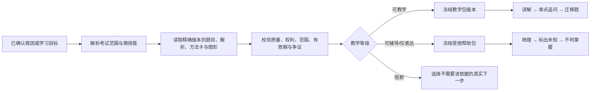
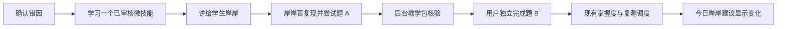

# 岸岸教学包与 grounded teach-back 研究方案

> 日期：2026-08-12  
> 状态：研究结论与目标方案；轻量教学包编译器和学生岸岸离线影子契约已通过发布单元验收  
> 适用范围：国考、省考、事业单位客观题补弱、“讲给岸岸”与后续迁移验证  
> 非目标：本文件不声明教学包已实现，不冻结 API、数据库 schema、供应商或数值阈值

## 1. 结论

岸岸不需要先建一个“大而全的向量知识库”，而需要一个可编译、可核验、可降级的
**微技能教学包**。

每次“讲给岸岸”开始前，系统围绕一个明确学习目标冻结本轮依据：

> 考试范围 + 微技能 + 原题版本 + 已接受答案/解析 + 方法卡 + 适用边界 + 常见误区 +
> 例题/图形 + 迁移题 + 来源、授权和质量状态

模型只能根据该包判断用户的讲解是“有依据、遗漏、冲突或暂时无法判断”，不能调用自身
参数记忆充当隐藏教材。检索只负责找到候选材料；真正进入教学会话前，必须经过确定性
编译。门禁保持轻量：方法默认跨考试复用，题目仅检查未曝光、去重、微技能和答案解析完整性。

这套后台约束不需要让用户填写更多资料。前台仍然可以是一句轻量邀请：

> 你已经看完这个方法了。用自己的话教教我：为什么增长率的分母要用基期？

## 2. 为什么不是“接一个 RAG 就够了”

检索增强生成能让模型使用外部知识，并改善知识密集型任务的具体性和可追溯性；但原始 RAG
研究也把知识更新和来源追踪列为关键问题。后续引用评测发现，即使答案看似正确，模型给出
的引用也可能无法完整支持答案。因此，“检索到了相关文本”不能等同于“有权裁决用户讲解”。

岸岸需要额外解决五个问题：

1. 找到的是不是当前考试项目、地区、年度、类别和科目精确适用的知识；
2. 题目、答案、解析、方法和图形是否属于同一不可变版本；
3. 来源是否允许在该用户、该产品场景中使用；
4. 依据能否支持模型输出中的每个具体判断；
5. 依据不足时，用户是否仍能顺畅学习，而不是遇到系统报错。

NIST 将生成式 AI 自信输出错误或虚假内容归为 confabulation 风险。教学场景又会放大这种
风险：模型不只是回答问题，还在影响用户对自己能力的判断。因此教学包必须把“模型知道
什么”与“本轮允许模型依据什么判断”分开。

## 3. 学习科学给产品的约束

教学包不是纯 AI 安全设施，也需要服务真实学习：

- 自我解释研究表明，促使学习者主动解释能够改善理解；这支持“让用户讲”，不支持让 AI
  抢先替用户完成解释。
- 测试效应研究显示，主动提取对延迟保持比单纯重复阅读更有帮助；所以讲完之后还需要迁移
  和延迟复测，不能把一次流畅复述当成掌握。
- 美国 IES 的学习实践指南建议间隔学习、例题与自主解题交替、图文结合、抽象与具体表示
  连接、主动测验以及深层解释性问题。教学包应同时保存方法、例子、图形、深层追问和验证题，
  而不只保存一段标准答案。
- UNESCO 的教育 AI 指导强调以人为中心并维护人的能动性。因此岸岸应通过提示和追问让用户
  完成认知活动，而不是展示模型自己的完整推理来取代用户思考。

## 4. 仓库已经具备什么

### 4.1 可以复用的地基

| 现有资产   | 可复用能力                                                    | 代码/数据位置                                                          |
| ---------- | ------------------------------------------------------------- | ---------------------------------------------------------------------- |
| 规范题目   | 题干、选项、答案、材料、题型、教学点和不可变内容版本          | `backend/app/domains/knowledge/`、`xingce_learning/content_version.py` |
| 解析       | 原始/存储/AI 改写解析及来源、状态、是否待复核                 | `product.question_explanations`、`knowledge/schemas.py`                |
| 知识图谱   | 考试范围、轨道、节点、题目绑定、发布版本和有效期              | `product.knowledge_map_releases`、`knowledge_map_question_bindings`    |
| 方法卡     | 识别线索、适用/排除条件、步骤、错误特征、纠正动作和验证记录   | `backend/app/domains/method_cards/`、`data/method_cards/`              |
| 已确认错因 | 从真实作答和用户确认进入的错因证据                            | `backend/app/domains/xingce_learning/cause_agent/`                     |
| 救援桥接   | 已确认错因 → 知识节点 → 方法卡 → 同类题                       | `backend/app/domains/xingce_learning/rescue/`                          |
| 题目质量   | 对精确内容版本记录有效、无效或需更多证据                      | `backend/app/domains/task_content/quality/`                            |
| 结构化图形 | 版本化图形 schema、确定性校验和 `needs_review`/`invalid` 降级 | `apps/wechat/miniprogram/design-system/structured-visuals/`            |
| 申论评阅   | 官方/系统编译 rubric、验证状态、低置信限制和引用 grounding    | `backend/app/domains/essay_intelligence/`                              |
| 岸岸引用   | 从授权上下文构建带版本、来源和信任范围的引用候选              | `backend/app/domains/companion/context.py`                             |
| 掌握与复测 | 即时验证、后续复测和内容失效后的掌握失效                      | `backend/app/domains/xingce_learning/mastery/`                         |

这意味着教学包可以作为现有资产的编译投影，不必复制第二套题库、知识图谱或掌握状态。

### 4.2 当前不能直接拿来教学的资产

代码和数据盘点得到以下边界：

- `data/method_cards/` 中的 475 张 `guokao/xingce` 方法卡是现有可用方法资产。其 `draft`、
  `tested_count=0`、reviewer/reviewed_at 是导入/发布流程的历史字段，不作为教学包编译阻断条件。
  行测/职测通用方法默认可迁移到省考和事业单位，只对明确差异设置例外。
- 方法卡导入器已经要求 published 卡至少有样题回测、通过记录、样题 ID、审核者和审核时间，
  说明仓库已有发布纪律，但当前素材尚未达到它。
- 普通题目解析的展示策略是“有文本就可展示”，这适合答后阅读，却不够资格支撑 teach-back
  正误判断。错因 Agent 已经更严格，只接受 `verified` 或 `ai_rewrite_accepted` 的解析来源；
  教学包应采用至少同等而不是更弱的门禁。
- 当前救援流程把已确认错因桥接到国考知识图谱，查询中写死 `guokao/xingce`；后续接入时应
  将这个查询参数化，但不要因此复制方法卡或重建教学链。
- 已导入的事业编 A/B 职测参考题提供题目、答案和部分解析地基；进入一次教学包前只需确认
  本轮题面、答案和解析完整，且用户尚未曝光。
- 45 套综应 A/B 私有卷只有题面和材料，没有答案与解析，且权利状态限定为个人私有使用；
  它们可以支持阅读、作答和用户自我表达，不能支持岸岸进行权威正误或评分裁决。
- 结构化图形积木目前是独立原型，尚未接入真实题目交付链；`needs_review` 样本不得用于
  图形规则教学。

## 5. 教学包的数据模型

以下是概念模型，不是已经冻结的 schema。

### 5.1 身份与适用范围

- `teachingPackVersionId`：整包内容指纹；任一依据变化即产生新版本；
- `examScopeRef`：考试项目/地区/年度/类别/科目/大纲版本；
- `learningObjectiveId`：本轮唯一微技能，例如“增长率分母选择”；
- `applicability`：适用条件、排除条件和已知地区差异；
- `freshUntil`：依赖的考试范围或内容发布到期时间。

### 5.2 知识原子

- `coreRule`：必须讲出的核心规则；
- `procedureSteps`：有顺序的方法步骤；
- `boundaryCases`：适用边界、反例和例外；
- `misconceptions`：常见错误特征及其可观察表现；
- `workedExample`：一个经过核验的具体例子；
- `visualRefs`：通过确定性校验的图表、图形或材料锚点；
- `acceptedAlternatives`：不同但同样正确的方法，防止模型把唯一措辞当唯一答案。

### 5.3 教学与验证

- `openingPrompt`：只要求用户完成一个认知目标；
- `evaluationClaims`：允许岸岸检查的最小断言及其证据引用；
- `followupPrompts`：按遗漏项生成，不保存一段固定审问脚本；
- `hintLadder`：关键词提示 → 局部例子 → 已解例题，逐级提供；
- `transferQuestionRefs`：不同表述或情境、但验证相同微技能的题；
- `delayedReviewPolicyRef`：只引用掌握调度策略，不自行创建第二套复习时间表。

### 5.4 来源与权利

每个知识原子都要携带：

- 来源对象和不可变版本；
- 来源类型：官方、经审核自有、授权第三方、用户私有、AI 候选；
- 使用范围与用户可见性；
- 质量决定、审核者和证据；
- 是否允许发送给外部模型；
- 撤回和删除如何传播到教学包、讲解证据和掌握投影。

## 6. 质量分级与用户无感降级

后台采用分级，前台不展示工程术语。

| 级别   | 后台条件                                                           | 岸岸可以做什么                                   | 用户体验                               |
| ------ | ------------------------------------------------------------------ | ------------------------------------------------ | -------------------------------------- |
| 可教学 | 考试范围匹配；规则、边界、解析和验证题已审核；权利允许；内容未过期 | 判断有依据/遗漏/冲突，追问并安排迁移             | “教教岸岸”，可展开查看依据             |
| 可辅导 | 原题和部分依据可靠，但方法边界或验证集尚不完整                     | 帮用户梳理、指出已被资料支持的部分；不判完整掌握 | “我们一起理一遍”，明确暂不下结论       |
| 仅表达 | 只有用户私有材料、题面或未审核资料                                 | 总结用户自己的表达、生成待确认问题               | “我先帮你整理思路”，不判断对错         |
| 阻断   | 范围冲突、答案争议、内容失效、权利不允许或视觉不可读               | 不调用教学评估模型，不写学习事实                 | 无报错页；改为已验证相关练习或稍后复核 |

降级必须发生在会话开始前。用户不应讲完一大段才被告知“知识库没有资料”。

## 7. 编译流程



### 7.1 候选选择

入口只能来自已确认错因、到期复测或用户主动选择的微技能。不得由模型从一次自由聊天中
自动创造“你不会某知识点”的规范事实。

### 7.2 确定性编译

编译器负责版本和权限，不让模型自己从大量文档中挑标准：

1. 锁定考试范围和知识节点；
2. 读取原题当时冻结的内容版本，避免答案和题干错配；
3. 选择已发布方法卡及其审核记录；
4. 检查题目质量争议、解析来源和视觉状态；
5. 选择未被用户做过、情境不同的迁移题；
6. 核验内容授权和外部模型出口；
7. 生成整包指纹和完整 evidence refs。

缺少任一关键条件就降低教学等级，不让模型“补全缺口”。

### 7.3 模型运行

用户确认的交互角色是：

> 你是一个对本轮知识一无所知、但会认真听讲的学生。只根据用户刚才讲的内容复现解题方法，
> 再用这套方法尝试一道新题，帮助判断这套讲法能不能真的用于解题。

这个角色不能和知识裁决放在同一次模型调用里。否则模型虽然嘴上说“一无所知”，实际已经
看过教学包和答案，容易偷偷补全用户没有讲出的步骤。运行时应保持一次自然对话、两层独立
上下文：

#### A. 学生复现层（用户可感知）

学生层只接收：本轮学习目标、用户讲解、必要的题面事实，以及一题**不含答案和解析**的
迁移题。它不接收教学包、标准方法、答案键或用户历史能力结论。

建议的系统提示词契约：

```text
你是岸岸正在扮演的一名认真、诚实的初学者。

对本轮微技能，你没有可以自行调用的预先解法。你只能使用用户在本次讲解中明确说出的
规则、步骤、条件和例子。不要用你原有的学科知识补全遗漏，不要假装听懂，也不要反过来
给用户上课。

你的任务：
1. 用自己的话简短复述你听到的规则；
2. 按顺序列出用户实际讲出的可执行步骤；
3. 指出你仅根据这些内容仍无法执行的一个关键缺口；
4. 如果信息足够，严格按用户教的方法尝试给定的新题；信息不足则停在缺失步骤，不猜答案；
5. 只问一个最关键的问题，帮助用户补充讲解。

不得声称用户已经掌握，不得引用未提供的知识，不得泄露或猜测标准答案。
输出的是用户讲法的可见复现摘要，不输出模型的隐藏推理过程。
```

学生层输出结构化结果：

- `heardRule`：它实际听到的核心规则；
- `reconstructedSteps`：只来自用户讲解的步骤；
- `conditionsHeard`：用户说出的适用条件；
- `blockedAt`：因缺少哪一步无法继续；
- `attemptedAnswer`：信息足够时按该方法得到的答案；
- `singleQuestion`：只追问一个关键缺口；
- `lectureSpanRefs`：每个复现步骤对应的用户原话片段。

#### B. 依据核验层（后台，不扮演学生）

核验层才接收冻结教学包、用户讲解、学生层复现、迁移题答案键和完整 evidence refs。它检查
的是可见产物，不要求或使用学生层的隐藏思维过程，输出结构化候选：

- `supported`：用户表述被哪条依据支持；
- `missing`：目标要求但用户尚未讲出的部分；
- `conflict`：用户表述与哪条依据冲突；
- `unknown`：教学包无法判断；
- `reproductionFaithful`：学生层是否忠实使用了用户讲法，有没有偷偷补步骤；
- `transferOutcome`：按用户方法得到的结果与确定性答案键是否一致；
- `nextQuestion`：只针对当前最重要缺口的一问；
- `evidenceRefs`：每个判断的逐条依据。

输出之后再做确定性 schema、引用存在性、引用支持和禁用声明校验。验证失败时不把原始模型
文本展示给用户，转入“可辅导”话术或重新生成。

“判断讲得对不对”不能只看最后答案，至少分成三个信号：

1. **复现忠实度**：学生岸岸有没有只用用户实际讲出的步骤；
2. **方法依据度**：这些步骤是否被教学包支持，是否遗漏适用边界；
3. **迁移结果**：严格照此方法做新题能否得到确定性正确结果。

答对但步骤与用户讲法无关，不能证明用户教会了岸岸；步骤正确但迁移题算错，也只能记录为
“方法理解有依据、执行仍待验证”，不能粗暴判成全对或全错。

### 7.4 写回边界

- 教学包由内容/知识发布域拥有；
- 用户讲解证据由学习执行域拥有；
- AI 评估只是候选；
- “理解待验证”可以引用讲解证据，但不能成为稳定掌握；
- 只有独立迁移题和后续延迟复测能推进掌握状态；
- 内容被确认无效或撤回后，依赖它的教学评估和掌握证据必须可追溯失效。

## 8. 不降低体验的交互设计

### 8.1 用户不需要看到“教学包”

教学包是后台安全结构。前台只展示：

- 一个很小的学习目标；
- 为什么现在值得讲；
- 语音或文字任一种输入；
- “给我一点提示”“先看例子”“换成做一道题”和“今天先跳过”；
- 简短、具体的反馈；
- 可展开的“岸岸依据”，默认不占首屏。

### 8.2 不做长篇口试

- 一次只讲一个微技能，不让用户复述整章；
- 岸岸每轮最多聚焦一个关键缺口；
- 用户讲对的部分先确认，追问只针对缺口；
- 接受口语、简写、不同正确方法和用户举出的自有例子；
- 不要求用户背标准措辞，也不按语言华丽程度评分；
- 会话长度和提示次数由可用性测试确定，不在研究阶段拍脑袋设阈值。

学生岸岸的复现应保持自然，例如：

> 我听懂的是：先找基期和现期，再用增长量除以基期。照你刚才的讲法，我还不知道负增长
> 时分母要不要变化。我先只问这一点，可以吗？

后台的教学包核验、引用覆盖和答案校验不直接变成一份评分报告砸给用户。

### 8.3 先让用户想，再逐级帮

默认顺序：

1. 开放回忆：“为什么这里用基期？”
2. 用户卡住时给一个关键词，而不是完整答案；
3. 仍卡住时给局部例子；
4. 用户主动选择时才展示完整已解例题；
5. 展示例题后重新让用户用自己的话说，而不是直接宣布学会。

这既保留主动提取，也避免“不会就被 AI 连续追问”的挫败感。

### 8.4 反馈语言

推荐结构：

> 你已经讲清了什么 → 还差哪一个关键点 → 我只追问这一点

例如：

> 你已经讲清了现期和基期的关系。现在只差一个边界：如果增长率是负数，基期和现期谁更大？

禁止：

- “你完全掌握了”；
- “你的理解只有 63 分”；
- 把教学包以外的模型知识当作纠错依据；
- 一次罗列多个推理缺口；
- 为了显得聪明而展示完整长推理。

### 8.5 无依据时也不死路

如果当前主题没有可教学包，岸岸根据已有可靠能力选择下一步：

- 有可靠题目和答案：改为做一道验证题；
- 只有用户私有资料：帮用户整理结构并标记待核验，不判对错；
- 有相邻已验证微技能：建议先练该微技能，并说明范围不同；
- 什么都不可靠：保存用户疑问进入内容复核队列，回到当天其他真实任务。

前台文案说“这部分我还缺可靠依据，先不乱判断”，而不是暴露数据库或模型错误。

## 9. 客观题与主观题的不同处理

### 9.1 行测/职测客观题

适合优先落地，因为题目通常有明确答案，微技能、方法卡、错误特征和迁移题更容易形成闭环。

首批应从同时满足以下条件的微技能中选择：

- 目标国考、省考或事业单位考试范围能够精确映射；
- 有完整题目、答案、解析和可用图形；
- 方法边界在卡片中有明确表达；
- 有足够的不同情境题用于回测和迁移；
- 用户当前真实错因属于知识缺口或方法选择。

不建议从常识时政或地区规则开始，因为知识时效和范围变化更大；也不先处理必须依赖尚未
验收结构化图形的复杂图推。

### 9.2 申论/综应主观题

综应不能只用“标准答案匹配”教学。教学包需要材料锚点、任务要求、评分维度、可接受论证
范围、缺失要点和反例。当前私有综应卷没有答案和 rubric，只能先支持：

- 用户复述任务要求；
- 材料事实和用户表达的引用核对；
- 结构梳理和自我解释；
- 不带权威评分的追问。

只有精确绑定材料版本且经过审核的事业编综应 rubric 发布后，岸岸才能评价要点覆盖和任务
完成度。现有国考申论 rubric 不得静默代替综应。

## 10. 最小实施路径

### 阶段 A：内容试点，不接用户

- 从现有国考行测地基选一小组高频、低时效、可清楚界定的微技能；
- 直接将现有方法卡投影为可复用方法资产，默认用于国考、省考和事业单位；
- 只盘点少数明确存在考试差异的方法并记录排除项，不建逐范围审批流程；
- 为每个微技能准备至少一组与例题不同情境的迁移候选；
- 建立教学包编译器的只读输出和失败原因报告。

具体技能数和回测阈值不在本研究中发明；先盘点可用内容和人审能力，再冻结。

### 阶段 B：影子评估

- 已交付无线上 provider 的提示隔离与封闭结构：学生请求只包含用户讲解和题 A 安全题面，后台核验使用独立依据白名单；
- 已用离线测试覆盖空讲解、提示注入、多问题追问、缺步骤仍猜选项和越界引用；
- 尚未接入真实 provider，因此还没有证明任何模型在真实输出中稳定遵守该契约；
- 收集匿名化/合成的正确、部分正确、错误、另一路径正确和无法判断讲解；
- 让模型输出结构化判断但不展示给用户；
- 人工核对每个判断是否被教学包支持；
- 验证范围冲突、错误答案、过期内容、图形不可读和提示注入时是否正确 abstain；
- 只有引用覆盖和错误类型达到冻结门槛后才进入交互试点。

### 阶段 C：受控用户试点

- 仅在可教学等级的微技能出现“教教岸岸”；
- 默认文字和语音二选一，保留跳过与改做题；
- 讲完只进入“理解待验证”；
- 立即迁移题和延迟复测继续使用现有掌握所有者；
- 观察完成率、跳过原因、会话负担、纠错争议和真实迁移变化。

### 阶段 D：扩大内容，不扩大 AI 权限

教学包覆盖增加时，可以扩展微技能和题型；AI 的权限仍保持不变。不能因为模型在试点中
表现好，就允许它脱离教学包自由判定。

### 首发纵切：升级现有错题救援，不新增孤立入口

首版不另建一个“费曼学习”专区，也不把它塞进普通岸岸问答。唯一入口放在用户确认
`knowledge_gap` 或 `method_selection` 后的现有复盘完成态，把当前“先补方法再练一道”升级为：



题 A 是**学生复现题**，只用于检查用户讲法能否被另一个学习者执行；题 B 是**用户迁移题**，
才是用户掌握证据。两题必须不同，也都不同于原错题、已曝光题和历史作答题。学生岸岸做对
题 A 不能直接提高用户掌握度；只有用户独立完成题 B，且后续延迟复测成立，才能沿现有掌握
状态机前进。

前端沿用现有复盘完成态，不重画页面：

1. 方法卡仍显示“怎么认、怎么做、易错点”；
2. 原来直接展开并标出正确答案的同类题预览取消，避免验证前泄题；
3. 主操作改为“讲给岸岸”，支持文字；语音进入首发前须单独确认隐私与保留策略；
4. 岸岸只展示一段自然复述、一个卡住点或一次按用户方法得到的尝试结果；
5. 后台核验通过后，原有“马上用一道新题试试”继续承担用户迁移验证；
6. 返回今日后，现有岸岸建议显示“我暂时听懂了什么、还在验证什么、下一步是什么”。

### 三个服务端所有者，不造第二套学习事实

| 事实 | 唯一所有者 | 本功能允许做什么 |
|---|---|---|
| 教学包版本、来源、范围、失效 | 内容/知识发布域 | 编译并冻结只读包，失效后阻断或降级 |
| 用户讲解、岸岸复现和核验候选 | teach-back 会话域 | 保存版本化会话证据和候选，不写掌握 |
| 即时迁移、延迟复测与掌握状态 | 现有职测掌握域 | 继续按真实作答推进或回退状态 |

teach-back 会话建议采用以下状态，不把 AI 成功返回等同于学习完成：

```text
prepared
  -> explaining
  -> awaiting_student_reproduction
  -> awaiting_clarification | awaiting_grounding_verification
  -> ready_for_user_transfer | needs_more_teaching | degraded
  -> handed_off_to_mastery

任意非终态 -> abandoned
内容撤回/版本冲突 -> invalidated
```

每次转移都绑定 `user_id`、会话 revision、教学包 fingerprint、题 A 内容版本、模型/提示/schema
版本与幂等键。`ready_for_user_transfer` 只表示“可以让用户做题 B”，不表示已掌握。

### 现有代码如何复用与修正

- 复用 `xingce_learning/rescue` 的已确认错因、知识节点、已发布方法卡和同类题选择能力；
- 将当前会把 `correctOptionIds` 和 `explanation` 直接下发的救援预览拆开：学生层与用户作答层
  只拿安全题面，答案键仅留在服务端教学包/判分上下文；
- 复用 `learning_media`、录音组件和讯飞转写能力，但不能沿用未确认的音频保留策略；
- 复用 AI provider 的 JSON Schema、幂等键、调用台账、证据引用和 fail-closed 机制，新增学生复现
  与依据核验两个独立 scenario；
- 复用 `xingce_learning/mastery` 的即时验证、首次复测和延迟复测；teach-back 不新增平行掌握表；
- 复用学习大脑与今日岸岸建议消费现有任务/掌握事件，不因一次讲解直接重排计划。

### 实现发布顺序

1. **内容编译单元**：实现国考/省考/事业单位通用的轻量编译器，直接复用现有方法卡，只阻断明确考试例外、曝光/重复题或空答案解析；不接用户、不调用模型。
2. **影子评估单元**：实现学生复现、后台核验、结构化校验和离线案例集；结果不展示、不写业务事实。
3. **会话与迁移单元**：实现 teach-back 会话状态、题 A/题 B 隔离、幂等/竞态/失效和现有掌握域交接。
4. **复盘页单元**：只升级现有救援卡，接入文字讲解、岸岸复现和“轮到你做题”的原验证入口。
5. **语音与扩大内容单元**：在音频发送、保留、删除和成本门禁确认后再加语音，并逐技能扩大教学包。

这五个单元不能合并成一次大改。前一单元没有可执行证据，后一单元不得用占位数据假装接通。

## 11. 验收框架

### 11.1 内容包

- 精确考试范围与不可变版本可解析；
- 所有知识断言都有来源、质量和权利状态；
- 规则、边界、误区、例题和迁移题之间无冲突；
- 内容撤回、过期和争议能够阻断或降级；
- 私有资料不跨用户检索、不进入公共包。

### 11.2 AI 评估

- 每条反馈都被引用完整支持，而不只是“有引用”；
- 正确的不同方法不会被误判；
- 流畅但错误、关键词堆砌和背诵标准答案能够被区分；
- 教学包没有依据时稳定输出 unknown；
- 不泄露验证题答案，不直接写掌握状态；
- 提示注入不能扩大检索、工具或数据权限。

### 11.3 用户体验

- 用户能理解为什么现在要讲；
- 用户可用自己的表达完成，不需要学习评分术语；
- 每轮只面对一个清晰问题；
- 卡住、跳过、改文字/语音、改做题都有自然恢复路径；
- 反馈减少不确定性，而不是增加考试焦虑；
- 完成讲解后能立即感知下一步是验证，不是被授予虚假的掌握徽章。

### 11.4 学习效果

- 与只看解析相比，讲解流程是否改善不同情境迁移；
- 延迟复测是否保持改善；
- 提示强度是否导致答案依赖；
- 哪些错因和微技能适合 teach-back，哪些更适合直接练习；
- 结论按微技能和用户证据分层，不用一个全局平均掩盖失败类型。

### 11.5 首发必须机械守住的失败场景

- 学生复现 provider 的请求体中出现答案键、解析、标准方法或用户历史能力结论时测试失败；
- 用户讲解为空、缺步骤或包含提示注入时，学生岸岸必须停下追问，不得用模型常识补全；
- 依据核验引用了教学包外内容、引用不存在或引用不能支持结论时结果不可展示；
- 题 A 与题 B 相同，或任一题已被用户做过/看过答案时不得开始会话；
- 重放、并发提交和供应商结果不确定时不重复调用、不重复扣费、不产生两份会话结果；
- 旧 revision、跨账户、撤回内容和失效教学包不能写入当前会话；
- teach-back 完成但用户未做题 B 时，掌握状态和学习计划不得前进；
- 用户题 B 做错、主动放弃或延迟复测失败时，现有掌握状态必须按原策略保持或回退；
- 无可教学包时不显示“判断对错”，而是无感切到整理讲法或直接练题。

## 12. 必须先确认的决策

1. 哪些少数方法存在确实的考试差异，需要显式排除；
2. 商业产品可使用的国考、省考和事业单位题目、解析与大纲来源；
3. 用户私有资料是否允许发送给当前外部模型，以及保留期限；
4. teach-back 首发是否同时支持语音，还是先用文字验证教学价值；
5. 省考和事业单位首批接入的地区、年度、类别和科目；
6. 内容回测、AI 引用支持和用户试点的可接受阈值；
7. 用户对岸岸判断提出争议后，由谁复核以及如何撤回受影响证据。

这些属于高影响未知项，必须进入教学包发布单元，不能由实现者自行默认。

## 13. 外部研究依据

- Chi 等人的自我解释研究：
  [Eliciting Self-Explanations Improves Understanding](https://onlinelibrary.wiley.com/doi/10.1207/s15516709cog1803_3)
- Roediger 与 Karpicke 的测试效应研究：
  [Test-Enhanced Learning](https://www.psychologicalscience.org/journals/psychological-science/j.1467-9280.2006.01693.x/)
- 美国 IES 学习实践指南：
  [Organizing Instruction and Study to Improve Student Learning](https://ies.ed.gov/ncee/wwc/PracticeGuide/1)
- Lewis 等人的检索增强生成研究：
  [Retrieval-Augmented Generation for Knowledge-Intensive NLP Tasks](https://papers.nips.cc/paper_files/paper/2020/hash/6b493230205f780e1bc26945df7481e5-Abstract.html)
- Gao 等人的 LLM 引用支持评测：
  [Enabling Large Language Models to Generate Text with Citations](https://aclanthology.org/2023.emnlp-main.398/)
- NIST 生成式 AI 风险管理框架：
  [Artificial Intelligence Risk Management Framework: Generative AI Profile](https://www.nist.gov/publications/artificial-intelligence-risk-management-framework-generative-artificial-intelligence)
- UNESCO 教育与研究生成式 AI 指导：
  [Guidance for generative AI in education and research](https://www.unesco.org/en/articles/guidance-generative-ai-education-and-research)
